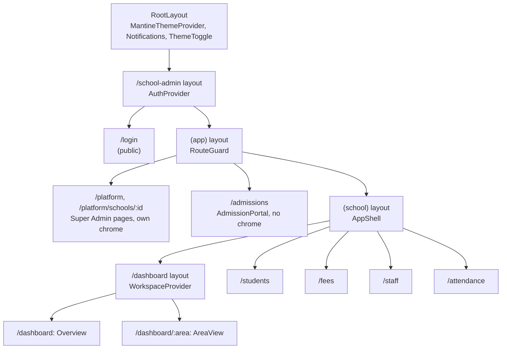
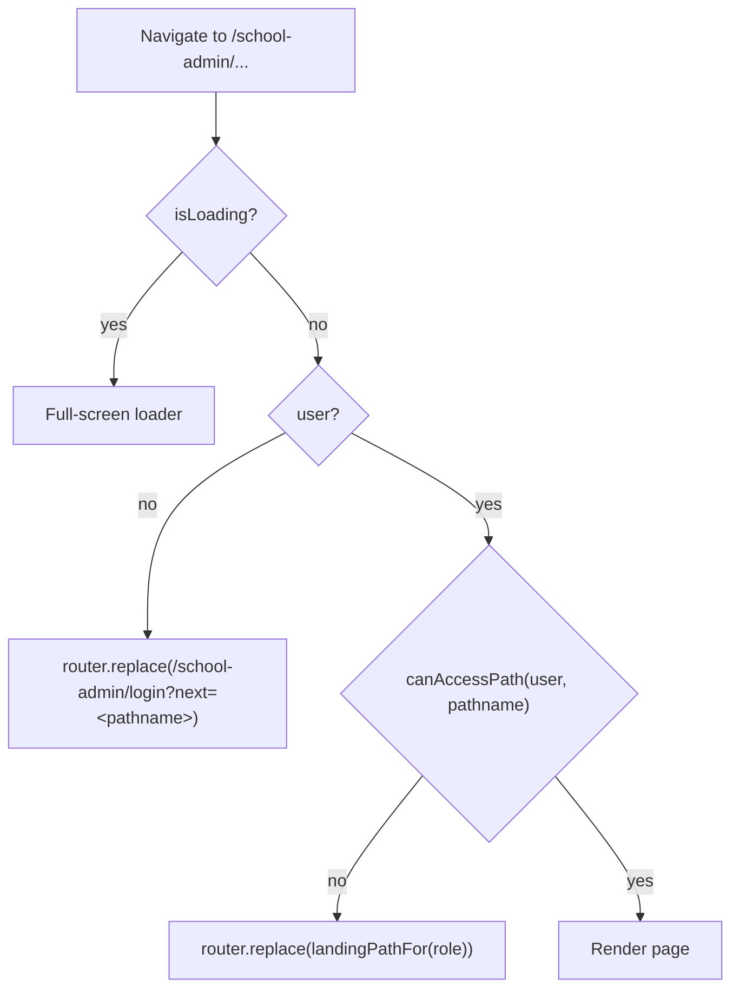
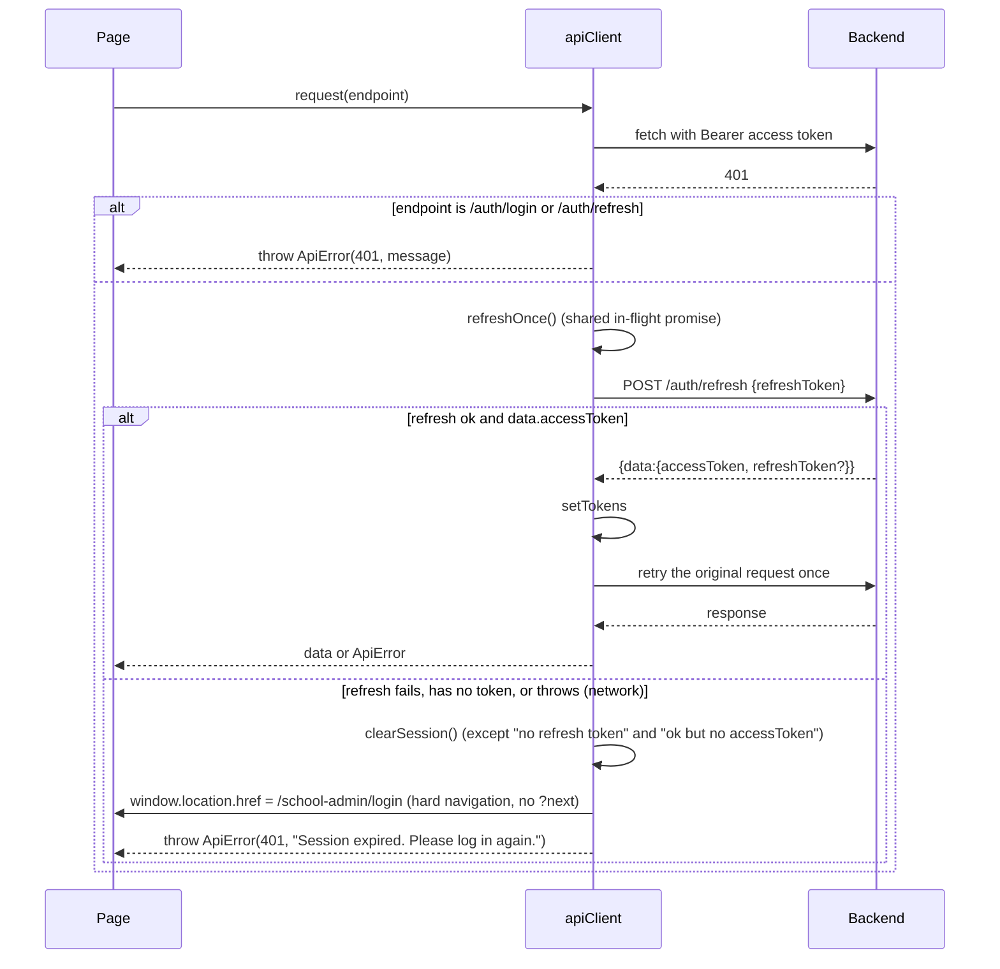

# Frontend architecture

Fastrack EduSuite's frontend is a single Next.js 15 app (App Router, React 19, Mantine 7). It serves two things:

- the public marketing site and waitlist (`/`, `/coming-soon`);
- the authenticated school workspace and the Super Admin console, both under `/school-admin`.

Every authenticated page is a client component. The server renders only shells. Data, auth and access decisions all run in the browser, and the NestJS backend repeats every access check.

## Route map

```
src/app
├── layout.tsx                      Root: fonts, ColorSchemeScript, MantineThemeProvider (+ Notifications, ThemeToggle)
├── page.tsx                        Marketing landing page
├── coming-soon/page.tsx            Waitlist page (ComingSoonTemplate + WaitlistForm)
├── not-found.tsx                   404
└── school-admin
    ├── layout.tsx                  AuthProvider (session for everything below)
    ├── page.tsx                    Server redirect -> /school-admin/login
    ├── login/page.tsx              Sign-in (public)
    └── (app)
        ├── layout.tsx              RouteGuard (session + APP_ROUTES rule required)
        ├── admissions/page.tsx     AdmissionPortal preview (no AppShell)
        ├── platform/page.tsx       Super Admin console (own top bar, no AppShell)
        ├── platform/schools/[schoolId]/page.tsx   Super Admin school detail
        └── (school)
            ├── layout.tsx          AppShell (sidebar, header, drawer, workspace guide)
            ├── dashboard/layout.tsx  WorkspaceProvider (preview state)
            ├── dashboard/page.tsx    Overview (sample data)
            ├── dashboard/[area]/page.tsx  AreaView (sample data / phase-one workspaces)
            ├── students/page.tsx   Live API
            ├── fees/page.tsx       Live API (FeesPage)
            ├── staff/page.tsx      Live API (StaffPage)
            └── attendance/page.tsx Sample register (UI preview)
```

`(app)` and `(school)` are route groups, so they add no URL segment.

## Layout chain



### AuthProvider (`src/lib/auth/auth-context.tsx`)

It holds `user` (an `AuthUser`: id, names, email, phone, role, schoolId, permissions, modules), `school` (`SchoolProfile`) and `isLoading`, and exposes `login`, `logout`, `refreshSchool` and `can(permission)`.

- **Restore on mount** (lines 84-109): reads `fastrack_access_token` and `fastrack_user` from `localStorage` and parses the user with `parseAuthUser`, which rejects unknown roles and drops unknown permission keys. It does **not** call the server to confirm the token or re-read the role. For a user with a `schoolId`, it shows the cached school straight away, refetches `GET /schools/me`, and stays `isLoading` until `GET /schools/me/modules?limit=100` settles.
- **Login** (lines 111-137): clears any previous session, `POST /auth/login`, rejects a user whose role is not recognised, stores the tokens and user, then loads the school profile and modules in parallel.
- **Tenant check**: if `/schools/me` returns a school whose `id` differs from the session's `schoolId`, the session ends.
- **Logout**: clears storage locally (including the parent portal's selected child and offline copies) and `router.replace(loginPathFor(path))`. That is `/parent/login` under `/parent`, otherwise `/school-admin/login`. It does **not** call a backend logout or revoke endpoint.

### RouteGuard (`src/lib/auth/RouteGuard.tsx`)



- `canAccessPath` finds the longest registered `APP_ROUTES` prefix (`src/lib/rbac/routes.ts`). A path that matches no prefix is denied to everyone.
- The rule's audience must match (`platform`, `staff` or `parent`). Staff must have a `schoolId`. The module must be enabled when it is known. The permission is checked with the read-only flag ignored.
- `landingPathFor`: Super Admin goes to `/school-admin/platform`; everyone else goes to `/school-admin/dashboard`.
- The guard **only runs in the browser**. There is no `middleware.ts`, so the server sends the JS bundle for any route to anyone. Data is still protected by the API.

### AppShell (`src/features/workspace/AppShell.tsx`)

- The sidebar comes from `workspaceNavigation(viewer)` (`navigation.ts`): Overview, then each area in `roleConfig[role].areas` that `canAccess` allows. Areas that resolve to the same live page collapse into one entry (fees and debts both become "Fees & Billing").
- The header shows a breadcrumb, a badge with the current academic year and term (from `GET /schools/me/academic-years/current` and `/academic-terms/current`), the user's avatar, name and role label, and Sign out.
- On mobile (900px and below), the sidebar becomes a Mantine `Drawer` opened by a hamburger button with `aria-label="Open navigation"`.
- A "Workspace guide" modal explains what the "UI preview" banner means.
- Super Admin pages do **not** use AppShell; `/platform` draws its own top bar.

### WorkspaceProvider (`src/features/dashboard/WorkspaceProvider.tsx`)

This provider is mounted only under `/dashboard`. It holds the sample term (`2026-1`), the selected sample child (`abena`), the loaded preview data from `fixtures.ts`, and the phase-one local store (`usePhaseState`). It also exposes:

- `viewer`: the signed-in user, which decides which areas open;
- `actor`: the same user with `readOnly: true` when the selected sample term is closed.

## Access control layers

| Layer | Where | What it decides |
| --- | --- | --- |
| Role | `rbac/roles.ts` | Audience (platform, staff or parent), label and data scope |
| Backend permissions | `rbac/permissions.ts` | Keys issued in `user.permissions` by the backend |
| Frontend feature grants | `rbac/feature-permissions.ts` | Keys the backend does not issue yet, granted by role in the browser |
| Modules | `rbac/modules.ts` and `auth-context.fetchModules` | Hides pages and areas of disabled modules |
| Route rules | `rbac/routes.ts` (`APP_ROUTES`) | Which pages a subject may open |
| Area rules | `features/dashboard/model.ts` (`roleConfig`, `areaPermission`, `areaModule`, `areaPages`) | Sidebar and preview areas |
| Read-only | `policy.can()` with `subject.readOnly` | In a closed sample term, only `read` and `export` keys pass |

See [roles-and-access.md](./roles-and-access.md) for the per-role result.

## API client (`src/lib/api-client.ts`)

- **Base URL**: `process.env.NEXT_PUBLIC_API_URL || 'http://localhost:3000/api'`. Port 3000 is also `next dev`'s default port. If the variable is unset and the frontend runs on 3000, API calls hit Next itself and return 404 HTML. The login page's decorative pill says "Port 3001", which shows the intended setup.
- **Envelope**: `ApiResponse<T, M> = { statusCode?, message?, data: T, meta?: M, success? }`. Callers read `res.data` and sometimes `res.meta`. List endpoints are read in two different shapes:
  - `data: T[]` with `meta` (students, staff, invitations, Super Admin students);
  - `data: { items, total }` (invoices, payments, fee structures, Super Admin schools and modules).
- **Auth header**: `Authorization: Bearer <fastrack_access_token>` is added when present.
- **401 handling**:



- **Errors**: when the response is not ok, the client throws `ApiError(status, message, body)` and joins NestJS's validation message arrays with `", "`. A network failure throws the native `TypeError("Failed to fetch")`, which is not an `ApiError`. Pages show `err.message`, so users see "Failed to fetch".
- **No timeouts, no cancellation (`AbortSignal` is never passed), no retry for idempotent GETs, no idempotency key on POSTs.**

## Session storage

| Key | Contents | Written by | Cleared by |
| --- | --- | --- | --- |
| `fastrack_access_token` | JWT access token | `setTokens` | `clearSession` |
| `fastrack_refresh_token` | Refresh token | `setTokens` (when provided) | `clearSession` |
| `fastrack_user` | Parsed `AuthUser` (role, permissions, schoolId) | `login` | `clearSession` |
| `fastrack_school` | `SchoolProfile` | `fetchSchoolProfile` | `clearSession` |
| `fastrack-color-scheme` | `light` / `dark` | Mantine color scheme manager | never |

All of these keys live in `localStorage`, so every tab on the origin shares them, and any script running on the origin can read them (the XSS blast radius). Nothing listens to the `storage` event, so another tab's login or logout reaches an open tab only when that tab next calls the API or reloads.

## Theming

- `src/theme/theme.ts` and `tokens.ts` define the Mantine theme (brand colour `fastrackRed`, fonts Sora for headings and Manrope for body).
- `MantineThemeProvider` (`src/components/providers/`) uses a `localStorageColorSchemeManager` with key `fastrack-color-scheme`, mounts `<Notifications position="top-right">` and a floating `ThemeToggle` (fixed bottom-right, `z-index: 200`) on **every** page, the app included.
- `RootLayout` renders `<ColorSchemeScript defaultColorScheme="light" />` without `localStorageKey`, so the pre-hydration script reads Mantine's default key, not `fastrack-color-scheme`. Users who chose dark mode see a light flash on every load.
- Dark mode is only partly supported. `globals.css` sets `html[data-mantine-color-scheme='dark']`. Many pages hard-code light colours inline (`#ffffff`, `#f8fafc`, `#0f172a`, `#e8edf3`): the login page, the Super Admin console, the fees and students cards, and AppShell CSS modules that have no dark rules.

## Sample data vs live API boundary

| Surface | Source | Writes go to |
| --- | --- | --- |
| Login, session, school profile, modules | Live API | Backend |
| `/students` (list, admit) | Live API | Backend |
| `/fees` (invoices, generate, payments, receipts, structures) | Live API | Backend |
| `/staff` (directory, invitations) | Live API | Backend |
| `/platform`, `/platform/schools/:id` | Live API | Backend |
| AppShell year/term badge | Live API | — |
| `/dashboard` Overview (KPIs, chart, priorities, featured cards) | `fixtures.ts` and the phase-one store | Browser memory only |
| `/dashboard/:area` (all preview areas, for every staff role) | `fixtures.ts` and the phase-one store | Browser memory only |
| `/attendance` | Hard-coded roster in the page | Nowhere ("Save Register" has no handler) |
| `/admissions` | Phase-one fields; `BroadcastChannel` to open staff tabs | Browser memory only |
| Marketing waitlist and contact forms | Local state | **Nowhere** (no request is sent) |

Preview surfaces carry an orange "UI preview" badge (`PreviewNotice`) and form alerts that say "Frontend preview". Live pages carry no badge. The Overview, which is every school user's landing page, is a preview.

## Testing

- `pnpm test:dashboard` runs `scripts/check-dashboard.cjs`, 26 Node assertions with no browser, which transpiles the TypeScript at runtime. It covers:
  - fee maths (pesewas, discounts, scholarships), receipt numbering, school-day calculation, payment plans, timetable conflicts and grading;
  - parent and teacher data scoping, role menus, route rules per role, the tenant requirement, the `?next` validation, session parsing, navigation de-duplication, module hiding and closed-term read-only.
- It encodes a **copy** of the backend's default role-permission matrix (`backendDefaults`, lines 33-91). That copy can drift from `fastrack-backend/src/common/auth/role-permissions.matrix.ts`.
- `pnpm exec tsc --noEmit` checks types; `pnpm lint` runs ESLint 9 with the Next config.
- There are **no component, integration or end-to-end tests** for the live pages: login, students, fees, staff and platform. API calls are not mocked or contract-tested against the backend.
- `phase-one/README.md` notes that browser click-through QA was never done.

## Parent portal (`/parent`)

The parent portal is a separate tree under `src/app/parent`. It has its own `AuthProvider`, `RouteGuard`, `ActiveWardProvider` and `ParentShell`, and it is an installable PWA. Only `/parent/*` links the manifest (`public/parent-app/manifest.webmanifest`, scope `/parent`).

- **Service worker (`public/parent-sw.js`):** registered in production builds only. Pages are network-first with an offline fallback (`/parent/offline`), and `/_next/static` is cache-first. It never touches API calls.
- **Offline reads:** `useParentQuery` keeps a per-user copy of each read in `localStorage` (`fastrack_cache:<userId>:<key>`). The copy shows first and is refreshed in place. `clearSession()` removes every copy.
- **Data:** `parentApi` in `src/features/parent/api.ts`. Everything is ward-scoped under `/parents/me/wards/:studentId`. With `NEXT_PUBLIC_PARENT_API_MOCK=1` it uses `mock.ts` instead. See [docs/api/parent-portal.md](./api/parent-portal.md).
- **Shared code:** money formatting and the invoice and payment mappers come from `features/fees`. Paging comes from `src/lib/pagination.ts`, shared with fees.
