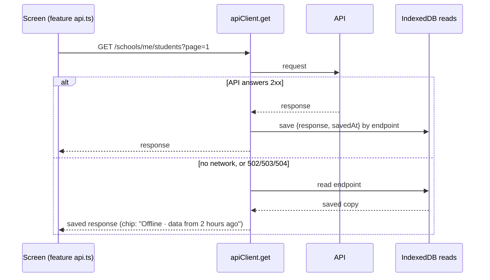
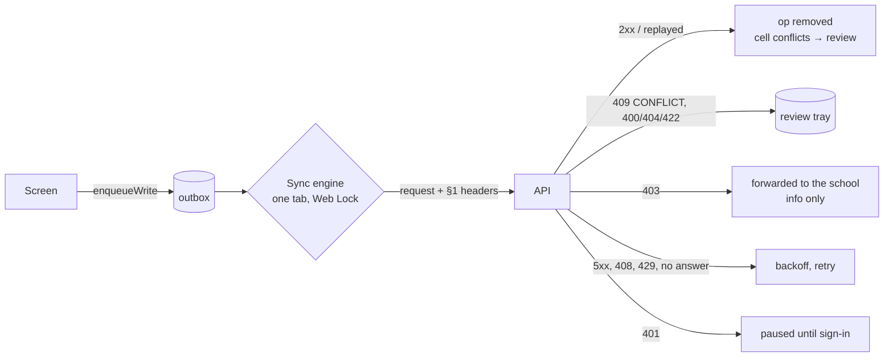

# Offline staff portal: frontend

**Status:** phase 1 frontend built (30 Oct 2026): offline reads, the status chip and the staff service worker. Phase 2 has started: the outbox, the sync engine and the sign-out guard are built (30 Oct). No screen queues writes yet, because only payments are idempotent on the backend (B1). Attendance and marks join once the backend marks those routes (its order: `refreshExpiresAt`, the §6.2 store, then the two write routes, then the B3 feed).
**Contract:** [sync-contract.md](./sync-contract.md) (v0.4.1). **Plan:** `humming-tumbling-codd.md` (F1–F5). **QA:** [../qa/offline-sync-qa.md](../qa/offline-sync-qa.md).

## Code

| File | What it does |
| --- | --- |
| `src/lib/offline/db.ts` | One IndexedDB database per staff user, `fastrack-<userId>`. Stores: `reads`, `records`, `outbox`, `conflicts`, `meta`, `blobs`. A registry in `localStorage` (`fastrack_offline_users`) backs up `indexedDB.databases()`. |
| `src/lib/offline/session.ts` | `activateOffline(userId)` opens the store, turns on saved reads and asks for persistent storage. `deactivateOffline()` stops using it and keeps its data. `discardOfflineData(userId)` deletes it. |
| `src/lib/offline/OfflineSession.tsx` | Mounted in `src/app/school-admin/layout.tsx` inside `AuthProvider`. It activates the store for the stored user on page load, before the session restore reads, and then follows the signed-in user. Only staff with a school get a store, never platform or parent sessions. |
| `src/lib/offline/readCache.ts` | Saved reads (below). |
| `src/lib/offline/connectivity.ts`, `useConnectivity.ts` | Whether the API can be reached. |
| `src/lib/offline/outbox.ts` | Queued writes (`OutboxOp`), review tray items (`ReviewItem`) and the device id. |
| `src/lib/offline/syncEngine.ts`, `useSyncStatus.ts` | Sends the outbox (below), and its counts for the chip and the sign-out guard. `enqueueWrite`, `syncNow`, `onSyncApplied`. |
| `src/lib/offline/syncOutcome.ts` | The contract §6 response table as a pure function (`classify`), with `backoffMs` and `retryAfterMs`. Checked by `pnpm test:sync` (`scripts/check-sync-outcome.cjs`). |
| `src/features/workspace/SyncStatusChip.tsx` | The header chip. |
| `src/features/workspace/SignOutButton.tsx` | The guarded sign-out in the header. |
| `src/lib/api-client.ts` | `setReadCache`, `onReachability`, `errorCode`. `get` uses the read cache. `exchange` returns the status and headers too, and `ApiError.headers` keeps an error's headers (`Retry-After`). |
| `public/school-sw.js` | The staff service worker, scope `/school-admin` (below). |
| `src/features/workspace/pwa/` | `ServiceWorkerRegistrar` (registration, the page list, the update prompt), `staffPages.ts` (`staffPagePaths()`), `OfflinePage`. |
| `public/school-app/` | Manifest (installable as "Fastrack School", start URL `/school-admin/dashboard`) and icons. `next.config.mjs` serves `/school-sw.js` with no-cache. |

## Offline reads (phase 1)

- Every successful GET made by a staff session is saved, keyed by its endpoint, query string included. When a GET can't reach the API (`ApiError(0)`, or a 502, 503 or 504), it returns the saved copy instead of failing. With no saved copy, the screen shows the same error as before.
- The feature `api.ts` signatures and the screens are unchanged. A screen shows the data it showed the last time that exact page, filter and query was opened online.
- Other errors (401, 403, 404, 4xx, 500) are never replaced by a saved copy.
- Collections move from `reads` to the synced `records` store as the change feed (B3) covers them.
- Not yet capped: `reads` grows with every distinct query. Pruning comes in phase 5 (hardening).

## Service worker (F2)

- **Pages:** network first. A page is saved by its path; the query is ignored, because staff pages render it on the client. A page that can't be fetched gets its saved copy, and a page never saved gets `/school-admin/offline` ("You are offline · This page has not been saved on this device yet").
- **Every staff page is saved up front.** Offline, Next turns a link to a screen whose code isn't loaded into a full page load. So once the worker is ready, the registrar posts `staffPagePaths()`: every `APP_ROUTES` path under `/school-admin` except platform, the marks-sheet and class-report sub-pages, every dashboard area and sign-in. The worker saves each page that isn't saved yet, one at a time, along with every `/_next/static` script and style its HTML names. The list comes from the app, so a new route is covered automatically. Scripts that a page loads only on demand are cached the first time they're used.
- **`/_next/static`:** cache first, since the files are content-hashed. Lookups search every release's cache. **Icons, fonts and images:** stale while revalidate.
- **New releases (OFF-1, fixed 30 Oct).** Each build has an ID: `next.config.mjs` sets `FASTRACK_BUILD_ID` once per build, and it becomes Next's `generateBuildId` and a client env value. The registrar sends it with the page list. Each release keeps its static files in its own cache, `school-static-v1-<buildId>`.
  - When the ID differs from the saved one, the worker saves **every** page again, into the new release's cache.
  - Only once all pages and their files have saved does the new ID become the saved one, and the older releases' caches are deleted.
  - A run that fails (offline, or a file that won't load) keeps the old caches, so every saved page still has its files. It retries on the next page load.
  - For the same release, only pages not saved yet are fetched; visits keep the rest fresh.
- **A page is kept only with all its files (OFF-2, fixed 30 Oct).** Both the up-front save and the copy kept from an online visit download the page's scripts and styles first. The HTML is stored only when every one of them is in the release's cache. A file that another release's cache already holds is copied over, so pruning that cache can't take it away. If a download fails, the page isn't kept, and the previous saved copy, with its own files, still opens offline.
  - Checked with two production builds. Release 1 saved 43 pages, naming 87 files, with 0 missing. On release 2, Students was visited with every `/_next/static` download failing. The page wasn't kept, the saved build stayed on release 1, and offline Students showed release 1's subtitle rather than a spinner. After a normal visit, everything moved to release 2 with 0 missing files, and offline Students showed release 2.
  - Checked with two production builds of one profile (release 2 changed only the Staff subtitle, and `school-sw.js` was unchanged). After opening Students online on release 2, the saved build moved to release 2 and one static cache was left. Fully offline, Staff showed release 2's subtitle.
- **API calls** go to another origin and are never touched; their offline copies are the saved reads above. Pages hold no personal data, so caching them is safe on a shared device.
- **Updates:** the first install takes over at once. A later version waits and shows **"Update available · A new version of Fastrack is ready · Reload"**. Reload makes the waiting version take over, and the page reloads onto it.
- **Development:** the registrar only registers in production builds. In `next dev` it removes any existing registration, so hot reload never serves stale pages.
- **Smoke test (30 Oct, production build of 0bb1d29 in a separate worktree, with the server stopped):**
  - 43 pages and 87 static files were saved.
  - Offline, fees, attendance and a dashboard area loaded from the cache, as did the marks sheet with a query. The app's own guards then redirected the sheet and the area as usual.
  - An in-app link to Students worked.
  - An unknown path got the offline page.
  - The chip read "Offline".
  - Playwright's `context.setOffline(true)` doesn't cut the service worker's own fetches in Chromium, so stop the server (or block its host) to test the worker.

## Connectivity and the status chip

- **Signal:** each API request reports whether it got an HTTP answer below 502. The browser's `offline` event counts as offline straight away. Coming back online is believed only when a request succeeds, because `navigator.onLine` is true on a Wi-Fi with no internet.
- **Chip:** next to the term badge in the header. It's hidden while the API answers and nothing waits.
  - Offline, it reads **"Offline · data from 2 hours ago"**, using the oldest saved copy shown since going offline, or just **"Offline"**.
  - With queued changes: **"Offline · 3 waiting"** offline, and **"Syncing 3"** or **"3 waiting"** online until they land.
  - With review items: **"· 2 need review"** is added, and the chip turns red.
  - The tooltip explains each part, and adds "Last synced 5 minutes ago" while anything waits.
  - **"Couldn't download school data"** (orange) shows online while the device has never downloaded its records and the last pull got a server error rather than no answer (OFF-17: the snapshot gave 500, so offline pages were empty with no sign why). The tooltip reads "Fastrack couldn't send this device the school's records, so pages may be empty offline. It keeps trying; tell your admin if this lasts." The engine keeps `pullFailed` in `meta`, so every tab shows it, and the chip goes once a pull succeeds. Checked with a forced 500 on `/sync/snapshot` (Playwright, 3/3).

## Outbox and sync engine (phase 2)

- **An op** is one request to an existing endpoint: method, path, the JSON body serialised once at enqueue, an optional base version, the entity it writes, `dependsOn` and a label for people. Its `opId` is the `Idempotency-Key`. Its `seq` comes from a counter in `meta`, shared by all tabs.
- **Headers (contract §1):** `Idempotency-Key`, `X-Client-Recorded-At` (raw device time at enqueue), `X-Client-Sent-At` (raw device time of this send; the only value that changes on a retry), `X-Device-Id` (one per user per device, in `meta`) and `X-Base-Version` when set. The body and every other header are byte for byte the same on each retry.
- **Order:** one op at a time, oldest first. An op waits while an older op on the same entity, or one in its `dependsOn`, is still queued. Other entities carry on.
- **Responses** follow the contract §6 table (`classify`):
  - 2xx, replayed or not: the op leaves the queue. Each entry of a batch-cell `conflicts[]` becomes its own review item. `onSyncApplied` listeners get the op and the body, so a screen can refresh its saved reads.
  - 409 `CONFLICT` / `LIKELY_DUPLICATE`: review, as a conflict, keeping `current` and `conflictingFields`.
  - 400, 404, 422 and the other 409s (`IDEMPOTENCY_MISMATCH`, `DUPLICATE_ID`, `DUPLICATE_REFERENCE`), or any 4xx without a code: review, as rejected. Never resent. A `REFERENCE_NOT_FOUND` for an id that is still queued is retried instead.
  - 403 with `reason.forwardedTo`: forwarded. The server has kept the op for a head or admin (§6.2). It leaves the user's own tray and is counted separately as information. A 403 **without** `reason.forwardedTo` goes to review as rejected, because the server kept it nowhere. So until backend §6.2, the change still blocked sign-out and wasn't lost (QA merge-order condition, 30 Oct). From backend 5fa1c04, every 403 on a queued write carries `reason.forwardedTo`, and the server stores it once per key. Checked 30 Oct: a real teacher payment 403 was counted as forwarded, stored once (`FORBIDDEN`, `open`) and listed under "Sent to the head teacher". The head's review screen is built (below).
  - 409 `IDEMPOTENCY_IN_PROGRESS`, 408, 429, 5xx: retried after `Retry-After`, else after an exponential backoff (about 2 s, 4 s, 8 s …, up to 5 min, with jitter). No answer, or 502–504, also ends the run, because nothing else would get through. A timer is still set for when the backoff ends (OFF-3, fixed 30 Oct: the retry used to wait for the 30 s poll, with the chip saying "Offline" although the API was back).
  - 401: the queue pauses, and the op stays. It resumes once the access token changes (the same user signed in again). A session that ends stops the engine anyway, and the next sign-in starts it again.
- **Age:** an op queued more than 25 days ago goes to review as rejected (`OP_TOO_OLD`) instead of being sent, because the server keeps keys for 30.
- **When it runs:** on enqueue, when the API answers again, on window focus and the browser's `online` event, every 30 s while ops wait, and when a backing-off op is due. A send is also how the engine notices the API is back.
- **Tabs:** only the tab holding the Web Lock `fastrack-sync-<userId>` sends. Every tab keeps counts, and a `BroadcastChannel` tells the others to recount (and to send, if they can take the lock).
- **Not yet:** Background Sync. Attendance and marks queue their writes (below). In development, `window.__fastrackSync` (`enqueueWrite`, `syncNow`, `syncStatus`, `registerReviewResolver`) queues ops from the console; it's absent from production builds.

## Pull: records from the change feed (backend B3)

- **What:** each staff user's device keeps its own copy of the school records it may see, in the `records` store by `[collection, id]` (`src/lib/offline/pull.ts`). Collections: years, terms, classes, subjects, students, attendance (the last 120 days), mark sheets and marks. A teacher gets only their classes' records. The server decides the scope.
- **How (contract v0.4.1 §7):**
  - The first pull pages through `/sync/snapshot`, up to 1000 records a page, resuming from its page token after an interruption. Every later pull reads `/sync/changes` from the stored cursor.
  - Each page is applied together with the cursor in one IndexedDB transaction: an upsert only when its version is higher, a delete when its version is at or above.
  - Deletes are kept as tombstones (`deleted: 'deleted' | 'out_of_scope'`), so an older upsert can't bring a record back. Screens skip them.
  - Feed pages go through `apiClient.request`, so they don't fill the saved reads.
  - **Any 410** (`NO_CURSOR`, `CURSOR_EXPIRED`, `SCOPE_CHANGED`, `CURSOR_AHEAD`) clears the records and re-snapshots everything, then continues from the new cursor. The outbox is kept. Re-snapshotting only `reason.collections` and moving to the new cursor could skip other collections' changes, so v0.4.1 makes the full re-snapshot the rule.
- **When:** only in the tab holding the sync lock, after its queue is sent. It pulls on start, after an op lands, on **Sync now**, and every 5 minutes while the app is open. A pull that's offline or refused tries again on the next run. The chip's "Last synced" counts pulls too (`lastPulledAt`).
- **What the screens get:**
  - **Attendance:** a register, whether live, saved or built offline, gets newer synced marks laid over it (`withSynced`, by `rowVersion`). A saved copy opened offline therefore shows marks other devices made since. A change on top of it carries the right `from`, so it lands instead of clashing. Offline with no saved register for the class at all, the register is built from the synced class list (banner: "The pupils come from the class list synced to this device.").
  - **A built register adds the day's pupils (31 Oct, from QA's note).** Synced attendance records carry the class each pupil was in on their day, so pupils marked in this class that day who have moved since are listed too, with their marks. A day nobody marked can't be known offline, and today's pupils are listed as well. If one of them wasn't in the class that day, the server refuses the register and the tray offers "Send without …".
  - **The class picker works offline** on a device that never loaded it. Heads see the synced classes; a teacher sees their homeroom plus the classes their synced pupils are in (`offlineClassesFor`).
  - Checked: a fresh device that had synced but never opened Attendance opened it offline. 30 Oct listed Kwame, Kojo and Kobby, who have since moved, with Kwame's synced Late.
  - **Marks:** an opened sheet, live or saved, takes newer synced sheet fields (status, version, return reason) and pupil rows (`withSyncedSheet`). A sheet submitted or returned on another device shows that way offline.
  - Both screens reload when a pull changes records (`onRecordsPulled`), unless the user has unsaved edits.
- **Privacy:** records live in the user's own database and are deleted at sign-out with everything else. Only staff sessions run the engine, never parents or platform users.
- **Checked (31 Oct, `next dev` against backend 9db902b, then 9c8c6d1, on `fastrack_fe18`, Playwright, 8/8):**
  - The first pull filled the records and stored a cursor. At 9c8c6d1 Yaw's Basic 1 snapshot holds 10 attendance records, including pupils moved since; before the backend fix it held 2.
  - The principal's mark arrived through the feed. Offline, a 27 Oct register saved before that mark showed it (Late). A change to Present queued with `from` Late, then landed as v2 with nothing in review.
  - A forced 410 (`/dev/sync/expire-cursors`) re-snapshotted with a new cursor.
  - A saved mark sheet opened offline showed a mark the principal entered after it was saved (17).
  - The attendance (23), marks (15), tray (12) and review (19) suites still pass.

## Offline attendance (phase 2, backend step 4a)

- **Saving goes through the outbox, online or not** (`src/features/attendance/sync.ts`, `saveRegister`). One op is queued per class and day (`PUT /schools/me/attendance/register`, up to 200 marks each), and ops on one register are sent in order.
- **Each mark** carries the pupil's `schoolStudentId` (or `studentId` on a register saved before the field existed) and `from`, the value the device saw: `null` when unmarked, otherwise `{status, arrivalTime, note}`. A mark someone else changed meanwhile comes back as a cell conflict for review, instead of being overwritten (contract §5).
- **Save waits up to 8 s** for the op to land, then says one of:
  - "Register saved · 4 marks saved for Basic 1";
  - "Register saved, with changes to check" (some cells clashed);
  - "Register not saved" (refused; see the tray);
  - "Passed to the head teacher" (403, forwarded);
  - offline or slow: "Saved on this device · 1 mark for Basic 1 will be sent when you're back online."
- **Queued marks show on the register.** They're laid over the loaded or saved copy, and each row reads **Waiting to sync**, also after a reload offline. A second change to the same pupil chains its `from` from the first. When an op lands, the register reloads from the server, unless the teacher has unsaved changes.
- **Edits made while a save is on its way are kept (OFF-11, fixed 31 Oct).** After a save the register reloads, but any pupil changed since Save was pressed keeps the newer edit, and Save offers it again. Before the fix it was silently reset to the saved value. Checked offline: Kwame Late, then Save, then Absent two seconds later. Absent stayed, "Save register (1)" sent it as a second op chained from Late, and the server ended Absent v2.
- **A day never opened online:** offline, the register is built from the class's latest saved register: the same pupils, all unmarked. An orange banner reads "Offline: this day's register isn't saved on this device · The pupils come from the register of Fri 30 Oct …". The server checks each mark when it arrives.
- **Review:**
  - A clashing cell is titled with the pupil ("Attendance for Basic 1, Fri 30 Oct · Admissiontest, Kwesi"), with Now / Yours. **Keep mine** resends that one pupil with `from` set to the server's current value. Pupil names are kept on the op locally (`names`) and never sent.
  - A register refused because one pupil wasn't in the class that day (422 `NOT_ENROLLED_ON_DATE`) saves none of its marks. The tray says "Adjei, Esi wasn't in this class on Wed 28 Oct, so none of these marks were saved." and offers **Send without Adjei, Esi**, which resends the rest. Features supply that wording with `registerReviewText`.
  - A teacher who no longer has the class gets 403 `OUT_OF_SCOPE`, which is forwarded to the head's Changes to review.
- **Without an offline store** (e.g. a private window), Save sends directly, as before.
- **Checked (31 Oct, `next dev` against backend a0e58b5 on `fastrack_fe18`, yaw.darko@bis.test on Basic 1, Playwright, 19/19):**
  - Online save landed with a keyed op.
  - Offline:
    - Two saves (Kwame Present → Absent, then Late plus Kwesi Excused) showed "Saved on this device", "Waiting to sync" rows and the chip "Offline · 2 waiting".
    - The second op's `from` was Absent.
    - The marks survived a reload.
  - Meanwhile the principal set Kwesi Absent. Back online, Kwame ended Late (v3) and Kwesi wasn't overwritten. "1 need review" → Keep mine → Excused.
  - A never-opened day offline was built from the class list, then all 4 landed.
  - A register with a pupil from another class was refused whole (nothing saved). "Send without …" saved the rest.

## Offline marks (phase 2, backend step 4b)

- **Saving goes through the outbox, online or not** (`useMarkSheet.ts`, `src/features/results/marks-sync.ts`). Typed marks still gather per cell for 700 ms. They're then queued as one save of the sheet (`PUT /schools/me/mark-sheets/:id/marks`), and saves of one sheet are sent in order.
- **Every mark carries `from`**, so the server works cell by cell (contract §5):
  - `from` is the cell as this device saw it: the saved sheet plus saves already queued, in wire form (`{status, rawScore, descriptorBandId}`, or `null` when nothing was entered).
  - A stale sheet version is accepted.
  - A cell someone else changed meanwhile isn't overwritten. It's outlined in orange, a notice says so, and it goes to the review tray.
  - The old 409 reload-and-rebase runs only on the direct path (no offline store).
- **Status line:** "Saving…", "Unsaved changes", **"2 marks waiting to sync"** or "All changes saved". Queued marks show in their cells, and the pupils' previews include them, also after a reload offline. When a save lands, its rows and the sheet's `rowVersion` are taken from the response.
- **Submit waits** up to 15 s for this sheet's queued saves. If some are still waiting it says "Not submitted yet · 1 mark is still waiting to be sent. Submit once they've been sent.", so the head never reviews a sheet missing marks that are still on a device.
- **Review:**
  - A clashing cell is titled "Marks: Mathematics, Primary 1 · Seed03 Paging · Test 1", with Now / Yours. Band ids show as band names, and the field reads "Descriptor band". **Keep mine** resends that mark with `from` set to the server's current value.
  - A save with refused cells (422 `details.cells`) saved nothing. The tray says how many were refused and offers **Send without those marks**.
  - A sheet submitted or approved before the save arrived (422 `SHEET_LOCKED`) saved nothing. The tray reads "The sheet was submitted before these marks arrived, so they weren't saved. Once it's returned to you, send them again.", with **Send again**.
  - A teacher who may no longer enter that class and subject gets 403 `OUT_OF_SCOPE`, which is forwarded.
- **Checked (31 Oct, `next dev` against backend 58d7b6f on `fastrack_fe18`, teacher@qpm.test on the Primary 1 Mathematics sheet, Playwright, 14/14, twice):**
  - Online: 15 landed, sent with `from: null` and the sheet version.
  - Offline: two pupils showed "2 marks waiting to sync". A second change chained `from` = 12, and the marks survived a reload.
  - The principal entered 5 meanwhile. Back online, Seed02 = 13, Seed03 kept 5 and went to review, and Keep mine → 18.
  - Submit with a mark waiting offline → "1 mark is still waiting", and the sheet stayed draft. It landed, then the submit went through.
  - A save arriving after the submit → `SHEET_LOCKED` explained, with Send again.
  - The attendance (19/19) and tray (12/12) suites still pass.

## Offline cash payments (phase 3, backend step 5a, contract v0.5.3 §9.1)

- **Every payment goes through the outbox, online too** (`src/features/fees/payments-sync.ts`, `RecordPaymentModal.tsx`). `payment-attempts.ts` and `feesApi.recordPayment` are gone. The op's key is the payment's Idempotency-Key, and the queued op survives a closed window, a reload or a crash.
  - The body carries:
    - a client `id` (the `groupId`);
    - `provisionalRef`: `OFF-<first 4 of the device id>-<n>`;
    - `paymentDate`: the day the cash was taken. It's set at queue time, by the server's clock when the device has heard from it, otherwise by the device's clock. Resends and renumbering keep it. (OFF-15, fixed 1 Nov: before, a payment synced days later was dated the day it synced.)
    - `seenBalance`;
    - `seenCursor` offline (the feed cursor), or `seenAsOf` online (server time, from `apiClient.serverNow()`).
  - `n` is a **device-wide** counter in localStorage (`fastrack_offline_receipt_n`). It survives sign-out, so two users of one device never reuse a number.
  - `seenBalance` is the picked bill's balance **less the payments still queued for it on this device**.
  - A pupil's queued payments `dependsOn` the earlier ones, so they land in the order they were taken, and each one's `seenBalance` is right. A first payment that is backing off can't be overtaken.
  - The same payment already queued (same pupil, bill, amount, method and reference) isn't queued again. The window says "Already waiting to sync · saved as OFF-…".
- **Reading the balance:**
  - Online, the window reads the bills **straight from the server** (`liveBills`). It never uses a saved read, because a saved copy from before the device's last payment would show the wrong balance. The payments list does the same (`livePayments`).
  - Offline, the bills come from the synced `invoices` and the account balance from `fee-accounts`. The pupil search uses the synced `students`.
- **After queuing**, the window waits up to 8 s for the payment to land. It stops waiting as soon as the device is known to be offline: if it was offline before queuing, or when the first send gets no answer. The provisional receipt then shows at once (OFF-14, fixed 1 Nov: it always waited the full 8 s offline; now 0.2 s when already offline, about 0.7 s when the send finds out). Outcomes:
  - **Landed:** the official receipt as before, from the response, or found by its OFF number when another tab sent it. Warnings show as toasts, and a possible double payment's toast stays up.
  - **Not answered** (offline, or slow): a **provisional receipt**.
    - It's titled "Provisional Payment Receipt", has a yellow **PROVISIONAL — PENDING SYNC** badge and shows the OFF number as "Provisional Number".
    - It reads "It gets an official RCT number when the device syncs; keep this receipt until then."
    - The school's crest comes from the copy the engine keeps in `blobs`. The engine fetches it at pull from the `school` record's `logoUrl`, and again only when that changes.
  - **More than owed, or a shared reference:** the existing questions.
    - **Keep as credit** and **Yes, same transfer** resend the refused op from the tray with `allowCredit` or `sharedReference`, keeping the same `id` and OFF number.
    - **Change amount** and **Change reference** discard it.
    - **Escape, × or Cancel** while the question is on screen discard it too, rather than leaving it in the tray as if the cash were taken (QA-285).
  - **Anything else refused** shows in the window. Once the window is closed, it stays in the tray.
- **Payments list:**
  - Queued payments come first, on page 1, filtered on the device. The OFF number is in yellow, with **Provisional · waiting to sync**.
  - A synced payment shows its RCT number with "was OFF-…". Its receipt says "Provisional receipt OFF-… is now RCT/…", plus "renumbered OFF-…" when it was renumbered.
  - Warning badges: **Possibly paid twice** (red), **Bill changed**, **Credit kept** and **Moved to another bill**.
  - A warnings filter (All payments, Needs checking (any), or one warning) sends `?warning=`, so a head or account officer sees the warnings from every device.
  - Offline, the list comes from the synced `payments` and says "Offline: showing the payments synced to this device".
  - The receipt lists each warning in words.
- **Review tray:**
  - Every refused payment card starts **"Nothing was recorded: the GHS x is still in the cash drawer."** The rest depends on the code:
    - `PAYMENT_EXCEEDS_BALANCE`: how much more than owed, with **Keep as credit**.
    - `SHARED_TRANSFER_REFERENCE`: **Same transfer for siblings**.
    - `NO_BILL`: bill the pupil first, then **Send again**.
    - `PAYMENT_DATE_TOO_EARLY`, or a 400 "can't be in the future": the device's date was probably wrong. The card shows the date sent and offers **Send dated today**.
    - `DUPLICATE_REFERENCE` and `RECEIPT_NUMBER_TAKEN`: discard only.
    - Too old to send (more than 25 days): discard only. A resend could record the payment twice, because its key may have expired after it landed. Its badge reads **Not sent** (any feature's too-old op does), not "Not accepted". This card alone leads with **"This payment may not have been recorded."**, with no cash-drawer line, because the device can't know whether it landed. It says to correct the device's date if it was wrong, look for the OFF number under Payments, and record the payment again only if it isn't there.
  - A **possible double payment** is applied, but it lands in the tray as a red **"Saved, but check this"** notice, with only **I've checked it**. It names the other receipt and the credit kept, and says the school may owe a refund. Notices count in "N need review".
- **Renumbering:** 409 `PROVISIONAL_REF_TAKEN` gives the op the next number and keeps the first one in `printedRef`. The op is resent under a new key, in the same place in the queue. Ops that depended on it, and anyone waiting for it, follow it (`outbox.replace`, `opAlias:` in meta). It is never sent to review.
- **Device clocks (OFF-16, fixed 1 Nov):**
  - The server clock offset (from `X-Server-Time`) is saved with the session (`fastrack_server_offset_ms`, cleared at sign-out). An offline reload with a clock that's days off still dates payments by the server's day.
  - An op's `createdAt`, and so its 25-day age, is on that clock. A slow device clock no longer makes a fresh payment look too old.
  - A device clock changed while the page is open (for example corrected while offline) is noticed: `Date.now()` against `performance.timeOrigin + performance.now()` moves by more than a minute. The saved offset is then dropped, and the device clock is used until the server is heard from again. It isn't adjusted by the measured jump, because `performance.now()` can pause while a laptop sleeps.
  - Known limits:
    - A clock changed while the app was closed can't be noticed. The saved offset then shifts the date by the change until the next server contact.
    - `X-Server-Time` comes only on auth, sync and keyed writes.
- **Clock jumps:** an op whose next try is more than 10 minutes away is sent now. The backoff caps at 5 minutes, so a longer wait only happens when the device clock jumped back after the op backed off. A review card made while the clock was ahead reads "Made this minute", not "in 4,320 minutes".
- **Engine fix:** an op queued while the engine was in the middle of a run (for example a long first pull) waited for the 30 s poll. A kick during a run now starts another run straight after it.
- **Known limit:** right after an online payment, a device that goes offline before its next pull still has the bill's old balance. The next offline payment then gets `BILL_CHANGED`, which is accurate about what the device showed. The pull runs as soon as the payment lands, so this only happens if the device drops within a second or so.
- **Checked (1 Nov, `next dev` against backend `feat/offline-payments` cb08fa7 on `fastrack_fe18`, accounts@bis.test, Playwright):**
  - **Online and offline (12/12):**
    - An online payment got an RCT number, and the server stored its OFF number and group id.
    - An offline payment got a provisional receipt with the cached crest and a pending row. So did a second offline payment for the same pupil.
    - Back online, both landed in order with no warnings. The row read "was OFF-…" and the receipt "OFF-… is now RCT/…".
  - **Refusals and renumbering (15/15):**
    - Online overpayment: the question, then Keep as credit landed it.
    - Offline overpayment: a tray card with the cash line, then Keep as credit landed it under the same OFF number.
    - A taken OFF number was renumbered: a new number, the printed one kept, and nothing in review.
  - **Double payment (6/6):** an offline payment of a whole bill while the principal paid it online. The server flagged `POSSIBLE_DOUBLE_PAYMENT`. The tray notice named RCT/… by Ama Boateng and the credit kept, the filter found the red list badge, and the receipt showed the warning.
  - **Dates (OFF-15, 7/7):**
    - A payment taken offline with the device clock 2 days behind, after a reload so the server offset was gone, showed that day on the provisional receipt and in the queued body, and kept it at sync.
    - One taken with the clock 3 days ahead was refused as a future date. The card showed the date and the cash line, and **Send dated today** landed it dated today under the same OFF number.
  - **Clock corrected while offline, and the too-old card (OFF-16, 4/4):**
    - The clock was 2 days behind at sign-in, then corrected while offline. The payment was dated today, not 2 days ahead.
    - A payment queued and then a 26-day jump with no server contact: the card led with "This payment may not have been recorded", with no cash line and discard only.
    - When a background request reaches the server first, the offset is learned again and the payment, really only minutes old, is rightly sent.
  - **Clock 30 days behind for a whole session (OFF-16, 5/5):** after an offline reload, the receipt and the queued body were dated today, and the payment landed with nothing in review.
  - The earlier suites still pass: tray 12/12, attendance 23/23, marks 15/15, Changes to review 19/19, pull 8/8, past days 3/3.

## Offline admissions (phase 3, backend step 5b, contract v0.5.5 §9.2)

- **Every admission goes through the outbox, online too** (`src/features/students/admissions-sync.ts`, `AdmitStudentModal.tsx`). `studentsApi.admit` is gone.
  - The body carries a client `id`, which becomes the pupil's `schoolStudentId`. Writes for the new pupil can name them before the admission lands.
  - The student code is given by the server at sync.
- **After queuing**, the window waits up to 8 s, but not once the device is known to be offline (`waitUnlessOffline`, shared with payments):
  - **Landed:** "enrolled with code …", as before.
  - **Not answered, or offline:** "Saved on this device · … will be admitted when the device is back online; the student code comes then."
  - **Likely duplicate** (409 `LIKELY_DUPLICATE`, online too, Q6): the window shows "This may be a pupil already in the school", listing each candidate with their code, class, birth date, guardian phone (only with `students:read_sensitive`) and status if not active. The choices are:
    - **It's this pupil:** not admitted.
    - **Admit anyway:** resent with `confirmNotDuplicate`.
    - **Check the details:** back to the form; the refused admission is dropped.
    - **Escape, × or Cancel** drop it too, rather than leaving it in the tray as a Possible duplicate (QA merge-state check, 2 Nov; admissions suite 18/18).
  - **Other refusals** show in the form, and nothing is left in the tray.
- **Students list offline (OFF-18, fixed 2 Nov):** offline, the list comes from the synced `students` records, even on a device that never opened it online. Search, the class and status filters, paging and the active count all run on the device (`src/features/students/offline-list.ts`), and the page says "Offline: showing the pupils synced to this device." The class filter falls back to the synced classes, as the attendance picker does. Online, the list is read live, never from a saved copy. A saved copy is used only when nothing has synced yet. Checked on a fresh device against backend e6c9e22 (Playwright, 6/6: 20 of 24 rows, the count, search, the class options and filter).
- **Students list:** pupils admitted on this device and not yet synced are listed first on page 1, filtered on the device, with **Code pending · waiting to sync**. They can't be opened yet, because the server doesn't know them. The list reloads when an admission lands.
- **Attendance:** registers include pupils admitted to the class on this device and not yet synced, from their admission day on. The device sends `admissionDate` as the day the admission was made, on the server's clock (as payments are dated). Earlier days leave them out, as the server's registers do: since contract v0.5.6 (backend b1665ca) a mark for a day before the admission date is 422 `NOT_ENROLLED_ON_DATE`. Their code reads **Code pending**, as on the Students list, so a likely duplicate listed twice can be told apart. Their marks `dependsOn` the admission op, so they're sent after it.
- **Engine rules for writes that depend on another (v0.5):**
  - An op whose dependency is **in review** (conflict or rejected) waits; it isn't sent for a pupil the server doesn't know.
  - A resend from the tray takes the dependents along: they now wait on the new op (`outbox.takeFromReview`).
  - A dismissed dependency releases them. They're then sent, and come back with the server's answer.
- **Review tray, admissions:**
  - A likely duplicate has a **Possible duplicate** card (not a "Now / Yours" table). It reads "Not admitted yet: this looks like a pupil already in the school (Kojo Owusu · BIS-001/STD/2026/004 · Basic 2 · born … · guardian …). If it's the same child, pick them, and anything recorded for this admission moves to them. If it's a different child, admit anyway."
  - The buttons are **Discard my change**, one **It's <pupil> (<code>)** per candidate, and **Admit anyway**.
  - **It's <pupil>** moves every queued op that names the new pupil (key, path and body) to the candidate, drops their wait on the admission, and clears the card (`remapQueued`, `outbox.remap`). That covers attendance, and payments or photos once those can be queued for a new pupil.
  - Features add buttons like this with `registerReviewText(…, { actions })`.
  - `ID_MISMATCH_RETURNING` and `DUPLICATE_ID` are explained in words. The form never sends a returning pupil's `studentId`, so the first can't come from it today.
- **Not covered:** marks for a pupil admitted offline. A mark sheet's pupils come from the server, so a pupil admitted offline isn't on a sheet until the admission lands.
- **Checked (2 Nov, `next dev` against backend `feat/offline-admissions` 56ae093 on `fastrack_fe18`, principal@bis.test, Playwright, 14/14):**
  - **Online:**
    - An admission got a code, and the record's id is the device's.
    - An admission matching Esi Adjei (same name and birth date) showed her in the window; Check the details left the tray empty.
  - **Offline:**
    - An admission was listed with Code pending and appeared in the Basic 1 register. A Late mark was queued with `dependsOn` the admission.
    - Back online, the admission landed with a code under the device's id, then the mark landed.
  - **Offline duplicate of Kojo Owusu, with an Excused mark queued:**
    - The admission went to review and the mark was held, not sent.
    - The card showed the candidate with "It's Kojo Owusu (BIS-001/STD/2026/004)" and Admit anyway.
    - "It's Kojo" moved the mark to the existing Kojo, where it landed. No second Kojo was admitted.
  - The earlier suites still pass: tray 12/12, attendance 23/23, marks 15/15, Changes to review 19/19, pull 8/8, past days 3/3, payments 14/14, double payment 6/6, dates 7/7.

## Offline pupil edits (phase 3, backend step 5c part 1, contract v0.5.6 §9.3)

- **Every edit to a pupil's Profile or Guardians tab goes through the outbox, online too** (`src/features/students/edits-sync.ts`). `studentsApi.update` is gone.
  - The body is `changes`: each changed field with `from` (the value on screen) and `to`. `X-Base-Version` is the record's `rowVersion`. A cleared field is sent empty; names, gender and the birth date can't be blanked.
  - Edits to one pupil send in order. A second edit made before the first lands starts from the first one's values, so its `from` matches once the first applies.
  - An edit to a pupil admitted on this device waits for the admission (`dependsOn`).
- **After saving**, the tab waits up to 8 s, but not once the device is known to be offline:
  - **Landed:** "Student updated" / "Guardian contacts updated", as before.
  - **Offline or no answer:** "Saved on this device · The changes to … will be sent when the device is back online."
  - **A clash:** "Someone else changed this pupil · Changes that clash are in Needs review. Any others were saved."
- **The student drawer** reads the server's copy online, never a saved read, so the base version is current. Offline, it reads the synced `student-details` record, or a saved read for a pupil outside the synced scope. It shows:
  - the device's queued edits on top, with a **Changes waiting to sync** badge;
  - an **Offline copy** badge when read from the device;
  - a photo waiting to sync from the device's copy, or none for a queued removal.

  The drawer reloads when one of this pupil's edits lands. The Profile and Guardians forms restart from the record whenever its version moves, so `from` is always what is on screen.
- **Clashes (contract §5 step 4, in the engine for any `changes` update):** a 409 `CONFLICT` with `conflictingFields` and `current.rowVersion` is split (`src/lib/offline/rebase.ts`):
  - the clashing fields go to review, under the first op;
  - the other fields are resent at once as a new op in its place, with `from` taken from `current` and `X-Base-Version = current.rowVersion`. Ops waiting on the first now wait on the resend.

  `waitForOp` follows the resend and still reports the review item. The card is **Changed by someone else** with a Now / Yours table of only the clashing fields. **Keep mine** resends them, each from the server's value now. 404, `RECORD_DELETED` and validation refusals are explained in words. `scripts/check-sync-outcome.cjs` checks the split.
- **Photos (5c part 2, contract v0.5.7 §9.4).** **Replace photo** and **Remove** go through the outbox too, so they work offline. `studentsApi.uploadPhoto` and `removePhoto` are gone.
  - **A new photo** is one `PUT …/photo` op. The file's bytes are kept in the `blobs` store (`upload:<key>`) until the op lands or its review item is discarded, and a resend from review reuses them. At send time the engine builds the multipart body from those bytes, along with `from`. It also sends `X-Content-SHA256` (hex SHA-256 of the bytes), which is part of the request hash.
  - **A removal** is `DELETE …/photo?from=<mediaId>`.
  - **`from`** is the photo the device last saw (the detail's `photoId`, or `''` for none), so a photo someone else changed meanwhile clashes. It's left out when another photo change for the pupil is already queued, because that one's media id isn't known yet; the later change wins.
  - A photo for a pupil admitted offline waits for the admission. If the bytes are gone (site data cleared), the op goes to review as "The file for this change is no longer on this device."
  - **Clash:** the card reads "Someone else changed <pupil>'s photo after your device last saw it. Keep theirs, or keep yours.", with the photo there now (`current.photoUrl`, a signed URL) beside the queued one. **Keep mine** resends it with `from` set to `current.photoId`.
  - **Checked (2 Nov, against backend e6c9e22 on `fastrack_fe18`, Playwright, 13/13):**
    - Online, a photo showed "Photo updated" and was sent as a keyed op.
    - Offline, a replacement showed "Saved on this device", with the device copy (`blob:`) and **Changes waiting to sync**. The op carried `from` (the first photo's id) and the SHA-256, and its bytes were in `blobs`.
    - Someone else put another photo meanwhile. Back online, theirs was kept and the tray showed the clash in words with Now (signed URL) and Yours (device copy). **Keep mine** landed a new photo, and the bytes were dropped.
    - An offline **Remove** was queued as `DELETE …/photo?from=<id>`, showed no photo while waiting, and landed.
    - Edits 13/13, tray 12/12, admissions 17/17 and Changes to review 19/19 pass against e6c9e22.
- **Not yet:** `updatedBy`/`updatedAt` on `current` (the card has no "changed by"). `RECORD_DELETED` (backend e6c9e22: a queued edit, photo or removal for a deleted pupil) reads "Not saved: <pupil>'s record was removed."; not tested through the UI. A write to a field hidden without `students:read_sensitive` is a 403, handled as any 403 (QA-283, backend PR #14). The Guardians tab is read-only without that permission.
- **Checked (2 Nov, `next dev` against backend `feat/offline-student-edits` a41e650 on `fastrack_fe18`, principal@bis.test, Playwright, 13/13).** "Someone else" was the principal on another device, editing through the API.
  - **Online:** a Religion edit showed "Student updated" and was sent through the outbox.
  - **Stale base, other field:** someone else changed the religion. The open drawer, still on the old version, then saved a Residence edit. It applied, and their religion was kept.
  - **Offline:** Nationality and Digital address were queued as one `changes` op with `from`, `to` and the base version. The drawer showed "Saved on this device" and **Changes waiting to sync**. Reopened offline, it showed the queued values and **Offline copy**.
  - **Clash:** someone else changed the nationality meanwhile. Back online, the digital address landed and theirs was kept for the nationality. The tray showed "Changed by someone else" with only Nationality (Now / Yours). **Keep mine** landed mine.
  - **Guardians tab:** a mother's occupation edit showed "Guardian contacts updated".
  - **Earlier suites:** tray 12/12, admissions 17/17 and Changes to review 19/19 still pass. Payments was 13/14. The logo check failed because the school's saved logo URL points at the backend on :3000, which wasn't running. That's the environment, not this change.

## Needs review tray

- **Opening it:** click the header chip whenever it shows "N need review" or "N sent to head teacher". It opens a drawer on the right, full width on a phone (`ReviewTray.tsx`).
- **Each item** shows the op's label, when it was made, and who changed it on the server (`current.updatedBy`).
  - **Changed by someone else** (409 `CONFLICT`, or a batch-cell conflict): a **Now / Yours** table of the fields that differ. For a field conflict these are the `conflictingFields`, with the device's `changes[f].to` or plain value. For a cell, they're the cell's `current` and `mine`. The buttons are **Keep theirs** (dismiss) and **Keep mine**.
  - **Not accepted** (rejected): the server's message, e.g. "amount must not be less than 0.01". A 403 that wasn't forwarded reads "You no longer have permission to make this change, so it wasn't saved. Ask the head teacher or an admin if it's still needed.", not the server's "Forbidden resource". The buttons are **Discard my change**, and **Send again** where offered.
  - **Sent to the head teacher** (forwarded, §6.2): listed under their own heading for information, with **OK** to clear them.
  - **Saved, but check this** (a notice, v0.5): an op that applied, but with something the user must see, such as a possible double payment. A feature adds these with `registerAppliedNotices`. The only button is **I've checked it**.
- **Keep mine / Send again** queue a new op with a new key (§4), built by the feature's resolver: `registerReviewResolver(collection, item => EnqueueInput | null)`. For attendance, for example, that's one cell with `from` set to the server's current value. Queuing the new op and removing the item happen in one IndexedDB transaction (`outbox.takeFromReview`). A failure can't lose the change, and when two tabs press the button together, the second finds the item already gone (OFF-4, fixed 30 Oct: both used to send it, each with its own new key). A collection without a resolver can only be dismissed. None are registered yet; attendance and marks add theirs when they start queuing.
- **Checked (30 Oct, `next dev` against f60fc3d, Playwright, 12/12):**
  - A real 400 payment: shown, and discarded.
  - A routed 409 field conflict: "First name: Ama / Amma, changed by Mrs A. Mensah". Keep mine sent a new key through a test resolver.
  - A routed batch-cell conflict (only Status shown) and a forwarded 403: listed apart, then cleared.
  - The chip hides once the tray is empty. The layout was checked at 1280 px and 390 px.
- **Checked (30 Oct, `next dev` against backend `feat/offline-sync` f60fc3d on a copy of the dev DB, Playwright):** payments queued from the console as principal@qpm.test.
  - Online: sent once with all five headers (`sync_operations` row 201, with the device and recorded time). The chip stayed hidden.
  - API blocked: the op stayed queued with a backoff, the chip read "Offline · 1 waiting" and sign-out was blocked. Once unblocked, it was sent.
  - Answer dropped after the server saved: the retry replayed, and one payment was created.
  - A 400 went to review once ("1 need review"). Three ops (two on one entity, one depending on the first) were sent in order behind a 503 backoff. An op queued in a second tab was sent once, and both tabs recounted.
  - A teacher's payment (403) was counted as forwarded, not as review. After the merge-order fix, the same 403 (with no `reason.forwardedTo` at f60fc3d) goes to review. After the OFF-3 fix, the reconnect retry came from the backoff timer, with no focus or poll (21/21).
  - Sign-out with a review item showed the guard. "Discard 1 change and sign out" deleted the database.

## Changes to review (head teacher, contract §6.2 v0.4)

- **Who:** the principal and the academic head (`sync:review`). It's the sidebar entry **Changes to review**, at `/school-admin/sync-review` (`src/features/sync-review/`). Teachers don't see it.
- **What:** queued writes that the server refused with a 403 and kept for the school. For example, a teacher who lost a class or a role that lost a permission. Tabs: **To review**, **Applied** and **Dismissed**.
- **Each change** shows:
  - a description, e.g. "Fee payment of GHS 3.00 · Cash", "Attendance register for 2026-10-28 · 30 pupils" or "Marks · 12 entries";
  - who sent it and when they made it;
  - why it was refused, e.g. "Their role no longer allows this" or "They no longer teach this class or pupil";
  - its fields, with a pupil shown by name and code ("Seed01 Paging · QPM-402/STD/2026/007") rather than by id.
- **Apply** re-sends the stored change through its normal route as the reviewer (`syncReviewApi.apply`):
  - The key is the row's server-issued `applyOpKey`, with `X-Base-Version` when the row has one and no `X-Client-Recorded-At`, so the server keeps the sender's time.
  - It then calls `POST …/rejections/:id/applied`.
  - A retry replays, so a lost answer never applies twice.
  - `IDEMPOTENCY_IN_PROGRESS` waits and asks again.
  - **Stale cards (OFF-8, fixed 30 Oct; OFF-7 narrowed).** The row is re-read before sending. If it was resolved meanwhile, nothing is sent, and the card switches to its current state with the reason:
    - "Already applied by Ofori Retest on 30 Oct, 23:14 with the original values, so your edit wasn't saved."
    - "Dismissed by … so it wasn't applied."
  - An **unedited** apply of a row that's already applied counts as done (a lost answer).
  - `IDEMPOTENCY_MISMATCH` means the key was used with other content. The row is re-read, and the outcome depends on what it shows:
    - Applied, and this apply was unedited: done.
    - Applied with an edit, or dismissed: reported as above.
    - Still open, with an edit (the original was saved by this reviewer's own lost attempt): "This change was already saved with its original values, so your edit wasn't saved. Apply it without edits to mark it done." The change stays open.
    - Before the fix, every mismatch was marked applied, so a stale tab's edit was silently dropped.
  - **Same-instant races (OFF-7, closed with backend 2b376d1):**
    - The server refuses a re-send under the `applyOpKey` of a row that's no longer open with 409 `ALREADY_RESOLVED`. The screen re-reads the row and reports "Dismissed by …" just as it does for a stale card. An unedited apply of a row that's already applied still counts as done.
    - Apply and dismiss lock the row, so a dismiss after the re-send was saved gets 409. The card then reads "Already applied by … so it can't be dismissed."
  - **What was applied (OFF-6):** rows carry `appliedBody` and `appliedWithEdits`. An applied change is titled by what was saved, reads "Applied with edits by …", and marks each edited field, e.g. "Amount GHS 7.00 (sent as GHS 5.00)". Amounts in the field table are formatted as money, as in the title.
  - A refusal (a conflict, a closed term) shows on the card, and the change stays open.
  - A batch write that applied with `conflicts[]` says how many entries had changed since and were left as they are.
- **Registers and mark sheets read plainly (OFF-12, fixed 31 Oct):**
  - A forwarded register is titled "Attendance register · Basic 1 · Thu 22 Oct · 2 pupils". Its fields show the class name, the day, and an entries table, e.g. "Kwame Adjei Late · 08:15".
  - Mark-sheet entries show pupil, test and mark.
  - Server-only fields (`from`, `rowVersion`) are hidden.
  - Names come from one lookup per page: pupils, including those in `marks[]`, and classes.
- **Edit** opens the change as JSON (pretty-printed) to correct before **Apply edited change**, which checks that it's valid. It isn't reformatted when the box loses focus. That used to push the button down under a click on compact one-line JSON, so the click was lost (OFF-9, fixed 30 Oct). Feature-specific editors can replace this when attendance and marks arrive.
- **Dismiss** asks for an optional note. Applied and dismissed changes show who resolved them, when, and the note.
- **Checked (30 Oct, `next dev` against backend c44f008 on `fastrack_fe18`, Playwright, 13/13):** four teacher payments were forwarded.
  - Apply: one payment, the row applied with its `applyOpKey`, and the head's op `recorded_at` equal to the teacher's.
  - The `/applied` answer dropped, then Apply again: still one payment.
  - Edit 5 → 7: one payment of 7 and none of 5.
  - Dismiss with a note.
  - The tabs show who resolved each change.
  - At 390 px there's no sideways scroll.
  - Against backend ed00507 (19/19): "Applied with edits" with "7 (sent as 5)". A true race (tab B's re-read faked as still open) was refused by the server with `ALREADY_RESOLVED`, with no payment. A stale dismiss after an apply reported "Already applied … can't be dismissed".
  - **List order:** "To review" lists the oldest action first. From backend b41cf9c, Applied and Dismissed list the most recently resolved first, so what was just handled is on page 1.
  - After the OFF-8 fix (17/17): a stale tab's edit after another tab applied, a stale tab's apply after another tab dismissed, and an edit after the reviewer's own lost answer (refused; a plain Apply then marked it done with one payment).

## Session-expiry warning

- **Source:** login and refresh return `refreshExpiresAt` (backend 9ecbbf7). Every refresh gives the token a fresh lifetime, 14 days for staff. `apiClient.setTokens` stores it in `localStorage` (`fastrack_session_expires_at`), converted to the device clock using the offset from the last `X-Server-Time` the API sent. `clearSession` removes it with the rest of the session.
- **Online**, there is nothing to see. In the last 2 days (from day 12), `SessionExpiryWarning` renews the session (`apiClient.renewSession()`), which brings the expiry back to 14 days. While the API answers, the banner never shows, whatever the device clock says.
- **Rate limit (OFF-5, fixed 30 Oct):** a device clock far ahead kept every expiry "near", and the old guard (once per expiry value) renewed in a loop: QA saw 2,315 refreshes in 20 s with the clock a year ahead. Now:
  - An automatic renewal runs at most once per 10 minutes per device. A successful one stamps `fastrack_session_renewed_at`, which holds across tabs and reloads.
  - A renewal that failed offline isn't stamped, so the next try isn't blocked.
  - Inside a tab, only one runs at a time. Across tabs, the refresh Web Lock refreshes once.
  - The backend also caps `/auth/refresh` at 10 per sign-in per minute (ed00507). A 429 is treated like an outage: the session and its token are kept, and nothing is stamped, so a later try is free.
- **Offline from day 12**, a yellow banner shows at the top of every staff page: **"Connect to the internet by Sat 31 Oct, 22:43 to stay signed in."** It says that after that the user will need to sign in again, and when changes are waiting, that the N changes saved on this device are kept until they do. Once the time has passed it turns red: **"Your sign-in has ended"**, with "Connect and sign in again to send the N changes saved on this device." Queued changes are never dropped for this; they're sent after the same user signs in.
- **Clock correction:** from backend 5fa1c04, `/auth/login` and `/auth/refresh` send `X-Server-Time` too, so the stored expiry is corrected at sign-in. At 9ecbbf7 it came only on queued writes and `/sync/` routes.
- **Checked (30 Oct, `next dev` against backend 9ecbbf7, Playwright, 7/7):**
  - Login stored 14.000 days, with no banner.
  - Offline with the expiry set to 1 day away and 1 change waiting: the deadline banner, with "1 change saved on this device".
  - Expiry already passed: "Your sign-in has ended".
  - Online with the expiry 1 day away: renewed to about 14 days, a new refresh token, and no banner.
  - After the OFF-5 fix (9/9): with the device clock 365 days ahead and online, 1 refresh in 26 s and two reloads, and no banner.

## Sign-out and shared devices

- **Explicit sign-out** (`logout` in `auth-context.tsx`) deletes the user's offline database.
- **The header's sign-out is guarded** (`SignOutButton`). While changes wait or need review, it asks first: **"1 change hasn't been sent yet. Signing out deletes it from this device."** Offline, it adds that staying signed in sends them later. The choices are **Stay signed in**, **Sync now** (when changes wait) and **Discard N changes and sign out**. If everything lands while it's open, it reads "All your changes have been sent." The platform console's sign-out isn't guarded, since platform users have no offline data.
- **A session that ends by itself** (the refresh token is rejected or expires) keeps the database. It is reopened when the same user signs in again, so queued changes survive.
- **Money on shared devices (v0.5):** the `invoices`, `payments` and `fee-accounts` records, queued payments and the cached logo are all in the user's own database, so the sign-out guard and the wipe cover them. Only the device-wide OFF counter is kept, and it holds no money data. Teachers never receive the money collections, because the server scopes them.
- Each user's data lives in their own database, and a session only opens its own. Another user signing in on the same browser sees none of it.
