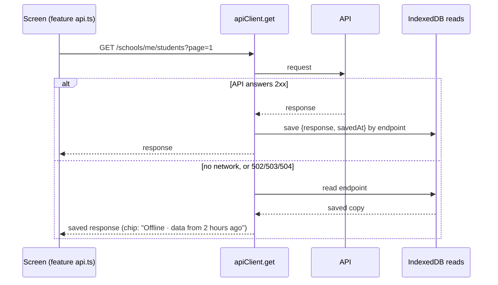
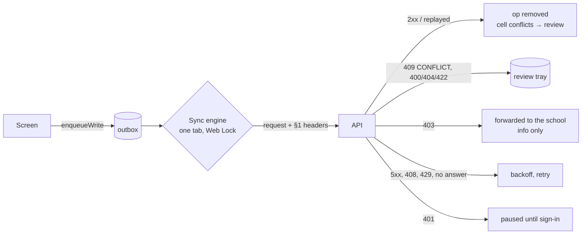

# Offline staff portal: frontend

**Status:** phase 1 frontend built (30 Oct 2026): offline reads, the status chip and the staff service worker. Phase 2 has started: the outbox, the sync engine and the sign-out guard are built (30 Oct). No screen queues writes yet, because only payments are idempotent on the backend (B1). Attendance and marks join once the backend marks those routes (its order: `refreshExpiresAt`, the §6.2 store, then the two write routes, then the B3 feed).
**Contract:** [sync-contract.md](./sync-contract.md). **Plan:** `humming-tumbling-codd.md` (F1–F5). **QA:** [../qa/offline-sync-qa.md](../qa/offline-sync-qa.md).

## Code

| File | What it does |
| --- | --- |
| `src/lib/offline/db.ts` | One IndexedDB database per staff user, `fastrack-<userId>`. Stores: `reads`, `records`, `outbox`, `conflicts`, `meta`, `blobs`. A registry in `localStorage` (`fastrack_offline_users`) backs up `indexedDB.databases()`. |
| `src/lib/offline/session.ts` | `activateOffline(userId)` opens the store, turns on saved reads and asks for persistent storage. `deactivateOffline()` stops using it and keeps its data. `discardOfflineData(userId)` deletes it. |
| `src/lib/offline/OfflineSession.tsx` | Mounted in `src/app/school-admin/layout.tsx` inside `AuthProvider`. It activates the store for the stored user on page load, before the session restore reads, and then follows the signed-in user. Only staff with a school get a store, never platform or parent sessions. |
| `src/lib/offline/readCache.ts` | Saved reads (below). |
| `src/lib/offline/connectivity.ts`, `useConnectivity.ts` | Whether the API can be reached. |
| `src/lib/offline/outbox.ts` | Queued writes (`OutboxOp`), review tray items (`ReviewItem`) and the device id. |
| `src/lib/offline/syncEngine.ts`, `useSyncStatus.ts` | Sends the outbox (below), and its counts for the chip and the sign-out guard. `enqueueWrite`, `syncNow`, `onSyncApplied`. |
| `src/lib/offline/syncOutcome.ts` | The contract §6 response table as a pure function (`classify`), with `backoffMs` and `retryAfterMs`. Checked by `pnpm test:sync` (`scripts/check-sync-outcome.cjs`). |
| `src/features/workspace/SyncStatusChip.tsx` | The header chip. |
| `src/features/workspace/SignOutButton.tsx` | The guarded sign-out in the header. |
| `src/lib/api-client.ts` | `setReadCache`, `onReachability`, `errorCode`. `get` uses the read cache. `exchange` returns the status and headers too, and `ApiError.headers` keeps an error's headers (`Retry-After`). |
| `public/school-sw.js` | The staff service worker, scope `/school-admin` (below). |
| `src/features/workspace/pwa/` | `ServiceWorkerRegistrar` (registration, the page list, the update prompt), `staffPages.ts` (`staffPagePaths()`), `OfflinePage`. |
| `public/school-app/` | Manifest (installable as "Fastrack School", start URL `/school-admin/dashboard`) and icons. `next.config.mjs` serves `/school-sw.js` with no-cache. |

## Offline reads (phase 1)

- Every successful GET made by a staff session is saved, keyed by its endpoint, query string included. When a GET can't reach the API (`ApiError(0)`, or a 502, 503 or 504), it returns the saved copy instead of failing. With no saved copy, the screen shows the same error as before.
- The feature `api.ts` signatures and the screens are unchanged. A screen shows the data it showed the last time that exact page, filter and query was opened online.
- Other errors (401, 403, 404, 4xx, 500) are never replaced by a saved copy.
- Collections move from `reads` to the synced `records` store as the change feed (B3) covers them.
- Not yet capped: `reads` grows with every distinct query. Pruning comes in phase 5 (hardening).

## Service worker (F2)

- **Pages:** network first. A page is saved by its path; the query is ignored, because staff pages render it on the client. A page that can't be fetched gets its saved copy, and a page never saved gets `/school-admin/offline` ("You are offline · This page has not been saved on this device yet").
- **Every staff page is saved up front.** Offline, Next turns a link to a screen whose code isn't loaded into a full page load. So once the worker is ready, the registrar posts `staffPagePaths()`: every `APP_ROUTES` path under `/school-admin` except platform, the marks-sheet and class-report sub-pages, every dashboard area and sign-in. The worker saves each page that isn't saved yet, one at a time, along with every `/_next/static` script and style its HTML names. The list comes from the app, so a new route is covered automatically. Scripts that a page loads only on demand are cached the first time they're used.
- **`/_next/static`:** cache first, since the files are content-hashed. Lookups search every release's cache. **Icons, fonts and images:** stale while revalidate.
- **New releases (OFF-1, fixed 30 Oct).** Each build has an ID: `next.config.mjs` sets `FASTRACK_BUILD_ID` once per build, and it becomes Next's `generateBuildId` and a client env value. The registrar sends it with the page list. Each release keeps its static files in its own cache, `school-static-v1-<buildId>`.
  - When the ID differs from the saved one, the worker saves **every** page again, into the new release's cache.
  - Only once all pages and their files have saved does the new ID become the saved one, and the older releases' caches are deleted.
  - A run that fails (offline, or a file that won't load) keeps the old caches, so every saved page still has its files. It retries on the next page load.
  - For the same release, only pages not saved yet are fetched; visits keep the rest fresh.
- **A page is kept only with all its files (OFF-2, fixed 30 Oct).** Both the up-front save and the copy kept from an online visit download the page's scripts and styles first. The HTML is stored only when every one of them is in the release's cache. A file that another release's cache already holds is copied over, so pruning that cache can't take it away. If a download fails, the page isn't kept, and the previous saved copy, with its own files, still opens offline.
  - Checked with two production builds. Release 1 saved 43 pages, naming 87 files, with 0 missing. On release 2, Students was visited with every `/_next/static` download failing. The page wasn't kept, the saved build stayed on release 1, and offline Students showed release 1's subtitle rather than a spinner. After a normal visit, everything moved to release 2 with 0 missing files, and offline Students showed release 2.
  - Checked with two production builds of one profile (release 2 changed only the Staff subtitle, and `school-sw.js` was unchanged). After opening Students online on release 2, the saved build moved to release 2 and one static cache was left. Fully offline, Staff showed release 2's subtitle.
- **API calls** go to another origin and are never touched; their offline copies are the saved reads above. Pages hold no personal data, so caching them is safe on a shared device.
- **Updates:** the first install takes over at once. A later version waits and shows **"Update available · A new version of Fastrack is ready · Reload"**. Reload makes the waiting version take over, and the page reloads onto it.
- **Development:** the registrar only registers in production builds. In `next dev` it removes any existing registration, so hot reload never serves stale pages.
- **Smoke test (30 Oct, production build of 0bb1d29 in a separate worktree, with the server stopped):**
  - 43 pages and 87 static files were saved.
  - Offline, fees, attendance and a dashboard area loaded from the cache, as did the marks sheet with a query. The app's own guards then redirected the sheet and the area as usual.
  - An in-app link to Students worked.
  - An unknown path got the offline page.
  - The chip read "Offline".
  - Playwright's `context.setOffline(true)` doesn't cut the service worker's own fetches in Chromium, so stop the server (or block its host) to test the worker.

## Connectivity and the status chip

- **Signal:** each API request reports whether it got an HTTP answer below 502. The browser's `offline` event counts as offline straight away. Coming back online is believed only when a request succeeds, because `navigator.onLine` is true on a Wi-Fi with no internet.
- **Chip:** next to the term badge in the header. It's hidden while the API answers and nothing waits.
  - Offline, it reads **"Offline · data from 2 hours ago"**, using the oldest saved copy shown since going offline, or just **"Offline"**.
  - With queued changes: **"Offline · 3 waiting"** offline, and **"Syncing 3"** or **"3 waiting"** online until they land.
  - With review items: **"· 2 need review"** is added, and the chip turns red.
  - The tooltip explains each part, and adds "Last synced 5 minutes ago" while anything waits.

## Outbox and sync engine (phase 2)

- **An op** is one request to an existing endpoint: method, path, the JSON body serialised once at enqueue, an optional base version, the entity it writes, `dependsOn` and a label for people. Its `opId` is the `Idempotency-Key`. Its `seq` comes from a counter in `meta`, shared by all tabs.
- **Headers (contract §1):** `Idempotency-Key`, `X-Client-Recorded-At` (raw device time at enqueue), `X-Client-Sent-At` (raw device time of this send; the only value that changes on a retry), `X-Device-Id` (one per user per device, in `meta`) and `X-Base-Version` when set. The body and every other header are byte for byte the same on each retry.
- **Order:** one op at a time, oldest first. An op waits while an older op on the same entity, or one in its `dependsOn`, is still queued. Other entities carry on.
- **Responses** follow the contract §6 table (`classify`):
  - 2xx, replayed or not: the op leaves the queue. Each entry of a batch-cell `conflicts[]` becomes its own review item. `onSyncApplied` listeners get the op and the body, so a screen can refresh its saved reads.
  - 409 `CONFLICT` / `LIKELY_DUPLICATE`: review, as a conflict, keeping `current` and `conflictingFields`.
  - 400, 404, 422 and the other 409s (`IDEMPOTENCY_MISMATCH`, `DUPLICATE_ID`, `DUPLICATE_REFERENCE`), or any 4xx without a code: review, as rejected. Never resent. A `REFERENCE_NOT_FOUND` for an id that is still queued is retried instead.
  - 403 with `reason.forwardedTo`: forwarded. The server has kept the op for a head or admin (§6.2). It leaves the user's own tray and is counted separately as information. A 403 **without** `reason.forwardedTo` goes to review as rejected, because the server kept it nowhere. So until backend §6.2, the change still blocked sign-out and wasn't lost (QA merge-order condition, 30 Oct). From backend 5fa1c04, every 403 on a queued write carries `reason.forwardedTo`, and the server stores it once per key. Checked 30 Oct: a real teacher payment 403 was counted as forwarded, stored once (`FORBIDDEN`, `open`) and listed under "Sent to the head teacher". The head's review screen is built (below).
  - 409 `IDEMPOTENCY_IN_PROGRESS`, 408, 429, 5xx: retried after `Retry-After`, else after an exponential backoff (about 2 s, 4 s, 8 s …, up to 5 min, with jitter). No answer, or 502–504, also ends the run, because nothing else would get through. A timer is still set for when the backoff ends (OFF-3, fixed 30 Oct: the retry used to wait for the 30 s poll, with the chip saying "Offline" although the API was back).
  - 401: the queue pauses, and the op stays. It resumes once the access token changes (the same user signed in again). A session that ends stops the engine anyway, and the next sign-in starts it again.
- **Age:** an op queued more than 25 days ago goes to review as rejected (`OP_TOO_OLD`) instead of being sent, because the server keeps keys for 30.
- **When it runs:** on enqueue, when the API answers again, on window focus and the browser's `online` event, every 30 s while ops wait, and when a backing-off op is due. A send is also how the engine notices the API is back.
- **Tabs:** only the tab holding the Web Lock `fastrack-sync-<userId>` sends. Every tab keeps counts, and a `BroadcastChannel` tells the others to recount (and to send, if they can take the lock).
- **Not yet:** Background Sync, and screens that queue writes. In development, `window.__fastrackSync` (`enqueueWrite`, `syncNow`, `syncStatus`, `registerReviewResolver`) queues ops from the console; it's absent from production builds.

## Needs review tray

- **Opening it:** click the header chip whenever it shows "N need review" or "N sent to head teacher". It opens a drawer on the right, full width on a phone (`ReviewTray.tsx`).
- **Each item** shows the op's label, when it was made, and who changed it on the server (`current.updatedBy`).
  - **Changed by someone else** (409 `CONFLICT`, or a batch-cell conflict): a **Now / Yours** table of the fields that differ. For a field conflict these are the `conflictingFields`, with the device's `changes[f].to` or plain value. For a cell, they're the cell's `current` and `mine`. The buttons are **Keep theirs** (dismiss) and **Keep mine**.
  - **Not accepted** (rejected): the server's message, e.g. "amount must not be less than 0.01". A 403 that wasn't forwarded reads "You no longer have permission to make this change, so it wasn't saved. Ask the head teacher or an admin if it's still needed.", not the server's "Forbidden resource". The buttons are **Discard my change**, and **Send again** where offered.
  - **Sent to the head teacher** (forwarded, §6.2): listed under their own heading for information, with **OK** to clear them.
- **Keep mine / Send again** queue a new op with a new key (§4), built by the feature's resolver: `registerReviewResolver(collection, item => EnqueueInput | null)`. For attendance, for example, that's one cell with `from` set to the server's current value. Queuing the new op and removing the item happen in one IndexedDB transaction (`outbox.takeFromReview`). A failure can't lose the change, and when two tabs press the button together, the second finds the item already gone (OFF-4, fixed 30 Oct: both used to send it, each with its own new key). A collection without a resolver can only be dismissed. None are registered yet; attendance and marks add theirs when they start queuing.
- **Checked (30 Oct, `next dev` against f60fc3d, Playwright, 12/12):**
  - A real 400 payment: shown, and discarded.
  - A routed 409 field conflict: "First name: Ama / Amma, changed by Mrs A. Mensah". Keep mine sent a new key through a test resolver.
  - A routed batch-cell conflict (only Status shown) and a forwarded 403: listed apart, then cleared.
  - The chip hides once the tray is empty. The layout was checked at 1280 px and 390 px.
- **Checked (30 Oct, `next dev` against backend `feat/offline-sync` f60fc3d on a copy of the dev DB, Playwright):** payments queued from the console as principal@qpm.test.
  - Online: sent once with all five headers (`sync_operations` row 201, with the device and recorded time). The chip stayed hidden.
  - API blocked: the op stayed queued with a backoff, the chip read "Offline · 1 waiting" and sign-out was blocked. Once unblocked, it was sent.
  - Answer dropped after the server saved: the retry replayed, and one payment was created.
  - A 400 went to review once ("1 need review"). Three ops (two on one entity, one depending on the first) were sent in order behind a 503 backoff. An op queued in a second tab was sent once, and both tabs recounted.
  - A teacher's payment (403) was counted as forwarded, not as review. After the merge-order fix, the same 403 (with no `reason.forwardedTo` at f60fc3d) goes to review. After the OFF-3 fix, the reconnect retry came from the backoff timer, with no focus or poll (21/21).
  - Sign-out with a review item showed the guard. "Discard 1 change and sign out" deleted the database.

## Changes to review (head teacher, contract §6.2 v0.4)

- **Who:** the principal and the academic head (`sync:review`). It's the sidebar entry **Changes to review**, at `/school-admin/sync-review` (`src/features/sync-review/`). Teachers don't see it.
- **What:** queued writes that the server refused with a 403 and kept for the school. For example, a teacher who lost a class or a role that lost a permission. Tabs: **To review**, **Applied** and **Dismissed**.
- **Each change** shows:
  - a description, e.g. "Fee payment of GHS 3.00 · Cash", "Attendance register for 2026-10-28 · 30 pupils" or "Marks · 12 entries";
  - who sent it and when they made it;
  - why it was refused, e.g. "Their role no longer allows this" or "They no longer teach this class or pupil";
  - its fields, with a pupil shown by name and code ("Seed01 Paging · QPM-402/STD/2026/007") rather than by id.
- **Apply** re-sends the stored change through its normal route as the reviewer (`syncReviewApi.apply`):
  - The key is the row's server-issued `applyOpKey`, with `X-Base-Version` when the row has one and no `X-Client-Recorded-At`, so the server keeps the sender's time.
  - It then calls `POST …/rejections/:id/applied`.
  - A retry replays, so a lost answer never applies twice.
  - `IDEMPOTENCY_MISMATCH` counts as already applied, and `IDEMPOTENCY_IN_PROGRESS` waits and asks again.
  - A refusal (a conflict, a closed term) shows on the card, and the change stays open.
  - A batch write that applied with `conflicts[]` says how many entries had changed since and were left as they are.
- **Edit** opens the change as JSON to correct before **Apply edited change**. Feature-specific editors can replace this when attendance and marks arrive.
- **Dismiss** asks for an optional note. Applied and dismissed changes show who resolved them, when, and the note.
- **Checked (30 Oct, `next dev` against backend c44f008 on `fastrack_fe18`, Playwright, 13/13):** four teacher payments were forwarded.
  - Apply: one payment, the row applied with its `applyOpKey`, and the head's op `recorded_at` equal to the teacher's.
  - The `/applied` answer dropped, then Apply again: still one payment.
  - Edit 5 → 7: one payment of 7 and none of 5.
  - Dismiss with a note.
  - The tabs show who resolved each change.
  - At 390 px there's no sideways scroll.

## Session-expiry warning

- **Source:** login and refresh return `refreshExpiresAt` (backend 9ecbbf7). Every refresh gives the token a fresh lifetime, 14 days for staff. `apiClient.setTokens` stores it in `localStorage` (`fastrack_session_expires_at`), converted to the device clock using the offset from the last `X-Server-Time` the API sent. `clearSession` removes it with the rest of the session.
- **Online**, there is nothing to see. In the last 2 days (from day 12), `SessionExpiryWarning` renews the session (`apiClient.renewSession()`), which brings the expiry back to 14 days. While the API answers, the banner never shows, whatever the device clock says.
- **Rate limit (OFF-5, fixed 30 Oct):** a device clock far ahead kept every expiry "near", and the old guard (once per expiry value) renewed in a loop: QA saw 2,315 refreshes in 20 s with the clock a year ahead. Now:
  - An automatic renewal runs at most once per 10 minutes per device. A successful one stamps `fastrack_session_renewed_at`, which holds across tabs and reloads.
  - A renewal that failed offline isn't stamped, so the next try isn't blocked.
  - Inside a tab, only one runs at a time. Across tabs, the refresh Web Lock refreshes once.
- **Offline from day 12**, a yellow banner shows at the top of every staff page: **"Connect to the internet by Sat 31 Oct, 22:43 to stay signed in."** It says that after that the user will need to sign in again, and when changes are waiting, that the N changes saved on this device are kept until they do. Once the time has passed it turns red: **"Your sign-in has ended"**, with "Connect and sign in again to send the N changes saved on this device." Queued changes are never dropped for this; they're sent after the same user signs in.
- **Clock correction:** from backend 5fa1c04, `/auth/login` and `/auth/refresh` send `X-Server-Time` too, so the stored expiry is corrected at sign-in. At 9ecbbf7 it came only on queued writes and `/sync/` routes.
- **Checked (30 Oct, `next dev` against backend 9ecbbf7, Playwright, 7/7):**
  - Login stored 14.000 days, with no banner.
  - Offline with the expiry set to 1 day away and 1 change waiting: the deadline banner, with "1 change saved on this device".
  - Expiry already passed: "Your sign-in has ended".
  - Online with the expiry 1 day away: renewed to about 14 days, a new refresh token, and no banner.
  - After the OFF-5 fix (9/9): with the device clock 365 days ahead and online, 1 refresh in 26 s and two reloads, and no banner.

## Sign-out and shared devices

- **Explicit sign-out** (`logout` in `auth-context.tsx`) deletes the user's offline database.
- **The header's sign-out is guarded** (`SignOutButton`). While changes wait or need review, it asks first: **"1 change hasn't been sent yet. Signing out deletes it from this device."** Offline, it adds that staying signed in sends them later. The choices are **Stay signed in**, **Sync now** (when changes wait) and **Discard N changes and sign out**. If everything lands while it's open, it reads "All your changes have been sent." The platform console's sign-out isn't guarded, since platform users have no offline data.
- **A session that ends by itself** (the refresh token is rejected or expires) keeps the database. It is reopened when the same user signs in again, so queued changes survive.
- Each user's data lives in their own database, and a session only opens its own. Another user signing in on the same browser sees none of it.
