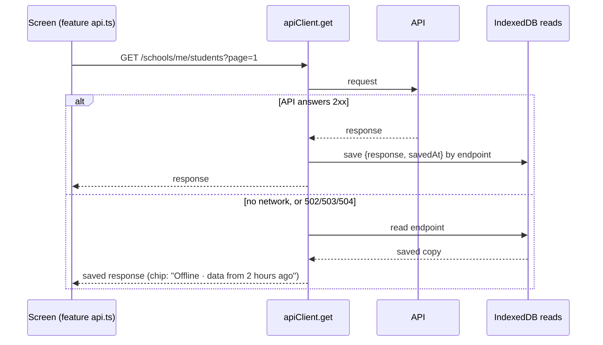

# Offline staff portal: frontend

**Status:** phase 1 in progress (30 Oct 2026). Offline reads and the status chip are built. The service worker (F2) is next, followed by the outbox and sync engine.
**Contract:** [sync-contract.md](./sync-contract.md). **Plan:** `humming-tumbling-codd.md` (F1–F5). **QA:** [../qa/offline-sync-qa.md](../qa/offline-sync-qa.md).

## Code

| File | What it does |
| --- | --- |
| `src/lib/offline/db.ts` | One IndexedDB database per staff user, `fastrack-<userId>`. Stores: `reads`, `records`, `outbox`, `conflicts`, `meta`, `blobs`. A registry in `localStorage` (`fastrack_offline_users`) backs up `indexedDB.databases()`. |
| `src/lib/offline/session.ts` | `activateOffline(userId)` opens the store, turns on saved reads and asks for persistent storage. `deactivateOffline()` stops using it and keeps its data. `discardOfflineData(userId)` deletes it. |
| `src/lib/offline/OfflineSession.tsx` | Mounted in `src/app/school-admin/layout.tsx` inside `AuthProvider`. It activates the store for the stored user on page load, before the session restore reads, and then follows the signed-in user. Only staff with a school get a store, never platform or parent sessions. |
| `src/lib/offline/readCache.ts` | Saved reads (below). |
| `src/lib/offline/connectivity.ts`, `useConnectivity.ts` | Whether the API can be reached. |
| `src/features/workspace/SyncStatusChip.tsx` | The header chip. |
| `src/lib/api-client.ts` | `setReadCache`, `onReachability`, `errorCode`. `get` uses the read cache. |

## Offline reads (phase 1)

- Every successful GET made by a staff session is saved, keyed by its endpoint, query string included. When a GET can't reach the API (`ApiError(0)`, or a 502, 503 or 504), it returns the saved copy instead of failing. With no saved copy, the screen shows the same error as before.
- The feature `api.ts` signatures and the screens are unchanged. A screen shows the data it showed the last time that exact page, filter and query was opened online.
- Other errors (401, 403, 404, 4xx, 500) are never replaced by a saved copy.
- Collections move from `reads` to the synced `records` store as the change feed (B3) covers them.
- Not yet capped: `reads` grows with every distinct query. Pruning comes in phase 5 (hardening).

## Connectivity and the status chip

- **Signal:** each API request reports whether it got an HTTP answer below 502. The browser's `offline` event counts as offline straight away. Coming back online is believed only when a request succeeds, because `navigator.onLine` is true on a Wi-Fi with no internet.
- **Chip:** next to the term badge in the header. It's hidden while the API answers. Offline, it reads **"Offline · data from 2 hours ago"**, using the oldest saved copy shown since going offline, or just **"Offline"**. A tooltip explains it. Waiting changes and "Synced N min ago" join the chip with the outbox (phase 2).

## Sign-out and shared devices

- **Explicit sign-out** (`logout` in `auth-context.tsx`) deletes the user's offline database. Phase 2 blocks sign-out while changes are waiting.
- **A session that ends by itself** (the refresh token is rejected or expires) keeps the database. It is reopened when the same user signs in again, so queued changes survive.
- Each user's data lives in their own database, and a session only opens its own. Another user signing in on the same browser sees none of it.
