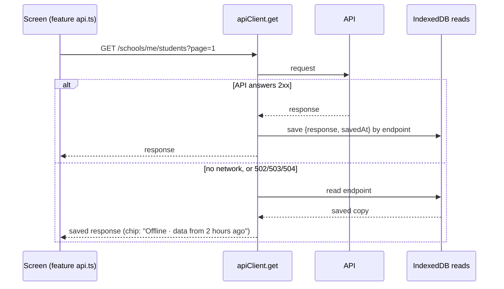

# Offline staff portal: frontend

**Status:** phase 1 frontend built (30 Oct 2026): offline reads, the status chip and the staff service worker. Next is the outbox and sync engine, for the phase 2 writes.
**Contract:** [sync-contract.md](./sync-contract.md). **Plan:** `humming-tumbling-codd.md` (F1–F5). **QA:** [../qa/offline-sync-qa.md](../qa/offline-sync-qa.md).

## Code

| File | What it does |
| --- | --- |
| `src/lib/offline/db.ts` | One IndexedDB database per staff user, `fastrack-<userId>`. Stores: `reads`, `records`, `outbox`, `conflicts`, `meta`, `blobs`. A registry in `localStorage` (`fastrack_offline_users`) backs up `indexedDB.databases()`. |
| `src/lib/offline/session.ts` | `activateOffline(userId)` opens the store, turns on saved reads and asks for persistent storage. `deactivateOffline()` stops using it and keeps its data. `discardOfflineData(userId)` deletes it. |
| `src/lib/offline/OfflineSession.tsx` | Mounted in `src/app/school-admin/layout.tsx` inside `AuthProvider`. It activates the store for the stored user on page load, before the session restore reads, and then follows the signed-in user. Only staff with a school get a store, never platform or parent sessions. |
| `src/lib/offline/readCache.ts` | Saved reads (below). |
| `src/lib/offline/connectivity.ts`, `useConnectivity.ts` | Whether the API can be reached. |
| `src/features/workspace/SyncStatusChip.tsx` | The header chip. |
| `src/lib/api-client.ts` | `setReadCache`, `onReachability`, `errorCode`. `get` uses the read cache. |
| `public/school-sw.js` | The staff service worker, scope `/school-admin` (below). |
| `src/features/workspace/pwa/` | `ServiceWorkerRegistrar` (registration, the page list, the update prompt), `staffPages.ts` (`staffPagePaths()`), `OfflinePage`. |
| `public/school-app/` | Manifest (installable as "Fastrack School", start URL `/school-admin/dashboard`) and icons. `next.config.mjs` serves `/school-sw.js` with no-cache. |

## Offline reads (phase 1)

- Every successful GET made by a staff session is saved, keyed by its endpoint, query string included. When a GET can't reach the API (`ApiError(0)`, or a 502, 503 or 504), it returns the saved copy instead of failing. With no saved copy, the screen shows the same error as before.
- The feature `api.ts` signatures and the screens are unchanged. A screen shows the data it showed the last time that exact page, filter and query was opened online.
- Other errors (401, 403, 404, 4xx, 500) are never replaced by a saved copy.
- Collections move from `reads` to the synced `records` store as the change feed (B3) covers them.
- Not yet capped: `reads` grows with every distinct query. Pruning comes in phase 5 (hardening).

## Service worker (F2)

- **Pages:** network first. A page is saved by its path; the query is ignored, because staff pages render it on the client. A page that can't be fetched gets its saved copy, and a page never saved gets `/school-admin/offline` ("You are offline · This page has not been saved on this device yet").
- **Every staff page is saved up front.** Offline, Next turns a link to a screen whose code isn't loaded into a full page load. So once the worker is ready, the registrar posts `staffPagePaths()`: every `APP_ROUTES` path under `/school-admin` except platform, the marks-sheet and class-report sub-pages, every dashboard area and sign-in. The worker saves each page that isn't saved yet, one at a time, along with every `/_next/static` script and style its HTML names. The list comes from the app, so a new route is covered automatically. Scripts that a page loads only on demand are cached the first time they're used.
- **`/_next/static`:** cache first, since the files are content-hashed. Lookups search every release's cache. **Icons, fonts and images:** stale while revalidate.
- **New releases (OFF-1, fixed 30 Oct).** Each build has an ID: `next.config.mjs` sets `FASTRACK_BUILD_ID` once per build, and it becomes Next's `generateBuildId` and a client env value. The registrar sends it with the page list. Each release keeps its static files in its own cache, `school-static-v1-<buildId>`.
  - When the ID differs from the saved one, the worker saves **every** page again, into the new release's cache.
  - Only once all pages and their files have saved does the new ID become the saved one, and the older releases' caches are deleted.
  - A run that fails (offline, or a file that won't load) keeps the old caches, so every saved page still has its files. It retries on the next page load.
  - For the same release, only pages not saved yet are fetched; visits keep the rest fresh.
  - Checked with two production builds of one profile (release 2 changed only the Staff subtitle, and `school-sw.js` was unchanged). After opening Students online on release 2, the saved build moved to release 2 and one static cache was left. Fully offline, Staff showed release 2's subtitle.
- **API calls** go to another origin and are never touched; their offline copies are the saved reads above. Pages hold no personal data, so caching them is safe on a shared device.
- **Updates:** the first install takes over at once. A later version waits and shows **"Update available · A new version of Fastrack is ready · Reload"**. Reload makes the waiting version take over, and the page reloads onto it.
- **Development:** the registrar only registers in production builds. In `next dev` it removes any existing registration, so hot reload never serves stale pages.
- **Smoke test (30 Oct, production build of 0bb1d29 in a separate worktree, with the server stopped):**
  - 43 pages and 87 static files were saved.
  - Offline, fees, attendance and a dashboard area loaded from the cache, as did the marks sheet with a query. The app's own guards then redirected the sheet and the area as usual.
  - An in-app link to Students worked.
  - An unknown path got the offline page.
  - The chip read "Offline".
  - Playwright's `context.setOffline(true)` doesn't cut the service worker's own fetches in Chromium, so stop the server (or block its host) to test the worker.

## Connectivity and the status chip

- **Signal:** each API request reports whether it got an HTTP answer below 502. The browser's `offline` event counts as offline straight away. Coming back online is believed only when a request succeeds, because `navigator.onLine` is true on a Wi-Fi with no internet.
- **Chip:** next to the term badge in the header. It's hidden while the API answers. Offline, it reads **"Offline · data from 2 hours ago"**, using the oldest saved copy shown since going offline, or just **"Offline"**. A tooltip explains it. Waiting changes and "Synced N min ago" join the chip with the outbox (phase 2).

## Sign-out and shared devices

- **Explicit sign-out** (`logout` in `auth-context.tsx`) deletes the user's offline database. Phase 2 blocks sign-out while changes are waiting.
- **A session that ends by itself** (the refresh token is rejected or expires) keeps the database. It is reopened when the same user signs in again, so queued changes survive.
- Each user's data lives in their own database, and a session only opens its own. Another user signing in on the same browser sees none of it.
