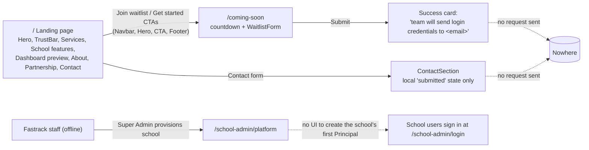

# Product overview: Fastrack EduSuite

## What it is

Fastrack EduSuite is a multi-tenant, cloud school-management system (a "School ERP") for private and public basic and secondary schools in Ghana. One deployment serves many schools ("tenants"). Fastrack's platform operator, the **Super Admin**, provisions each school and decides which modules it may use. Inside a school, each user signs in with one of six school roles. Each role sees only the pages, actions and records it needs (strict RBAC, enforced by the NestJS backend and mirrored in the UI).

It is built and sold by **Fastrack Management Services** (Mallam, Accra; founded 2014). Contact details live in `src/data/businessInfo.ts`.

## Who it is for

| Persona | Role key | Main job in the product |
| --- | --- | --- |
| Fastrack platform operator | `SUPER_ADMIN` | Provision schools, switch modules on and off per school, suspend or activate schools, see platform analytics |
| Head of school / proprietor | `PRINCIPAL` | Whole-school oversight: enrolment, fees, staff, academics, communication |
| Academic head / headmaster (academics) | `ACADEMIC_HEAD` | Academic performance, timetable, grading, staffing for academics |
| Teacher | `TEACHER` | Own classes: attendance, gradebook, timetable, question bank |
| Accountant / bursar | `ACCOUNT_OFFICER` | Invoices, payments and receipts, budgets, payment plans |
| Administrative secretary / front office | `SECRETARY` | Admissions and enquiries, enrolment, staff records, school-life content |
| Parent / guardian | `PARENT` | Their own children's fees, attendance, results, school communication |

Market framing on the site: Ghanaian institutions, GES and WAEC alignment, Mobile Money, Bulk SMS, the Data Protection Act 2012 (Act 843), and a WhatsApp support line.

## The company's other services

The landing page (`ServicesGridSection`, `businessInfo.services`) also sells non-product services:

1. IT consultancy (strategy, audits, digital transformation)
2. Database management (design, backup and DR, tuning)
3. Software engineering (custom web apps and APIs)
4. Mobile apps (iOS and Android)
5. Bulk SMS (transactional alerts, campaigns, 2FA APIs)
6. Accounting and auditing (bookkeeping, payroll, statutory audit support)

EduSuite is presented as the flagship product. Bulk SMS is pitched as both a standalone service and a part of EduSuite.

## Module and subscription model

- **Modules** are rows in the backend `modules` table. Each school has one entitlement row per module (`isEnabled`). The frontend knows these keys (`src/lib/rbac/modules.ts`): `students`, `attendance`, `timetable`, `fees`, `discounts`, `other_income`, `expenses`, `payroll`.
- The **Super Admin** toggles entitlements per school, from the console's "Modules" drawer or the school detail page's Modules tab (`POST /super-admin/modules/schools/:schoolId/toggle`).
- After sign-in, the school's enabled modules load into the session (`GET /schools/me/modules`). A disabled module hides its pages and sidebar areas for everyone in the school:
  - `students` covers Students, Enrollment, Enquiries and Online admissions;
  - `fees` covers Fees & Billing, Outstanding debts and Payment plans;
  - `attendance` covers Attendance;
  - `timetable` covers Timetable;
  - `expenses` covers Budgets & expenses.

  The backend's ModuleGuard refuses those endpoints regardless.
- `discounts`, `other_income` and `payroll` have **no frontend surface** yet. Payroll is marketed heavily (GRA PAYE, SSNIT) but nothing in the app uses it.
- There is **no pricing, plan, billing, trial or invoicing-of-schools** surface anywhere in the product or site. "Subscription" means only which modules are switched on. The marketing site has no price list. The waitlist promises "3 months complimentary SMS credits and free data migration" (`/coming-soon` metadata).

## Marketing to waitlist funnel

- The marketing site has **no "Sign in" link**. School users reach `/school-admin/login` only by typing the URL or following a link sent to them.
- Both the waitlist and contact forms only set `submitted = true` (`WaitlistForm.tsx:28-32`, `ContactSection.tsx:31-35`). **No lead is ever captured.** See finding F-03.
- The `/coming-soon` countdown starts at 45 days, 18 hours on every page load (`ComingSoonTemplate.tsx:25-30`), so it never reaches a real date.

## Live vs preview, by feature

"Live" means the feature reads and writes the backend. "Preview" means sample data in the browser, which is lost on reload or on a term or child change.

| Feature | Route | Status | Notes |
| --- | --- | --- | --- |
| Sign in, session restore, token refresh | `/school-admin/login` | **Live** | No forgot-password, no invite acceptance, no change-password screens |
| Role landing page (Overview KPIs, chart, "Your focus today") | `/school-admin/dashboard` | Preview | Every school user's first page. KPIs are sample numbers ("Active sample students") |
| Students: list, search, class and status filters | `/school-admin/students` | **Live** | 10 per page |
| Students: 4-step admission | `/school-admin/students` (modal) | **Live** | `POST /schools/me/students` |
| Student dossier, edit, transfer, exit or withdraw | — | Missing | The page subtitle promises "personal dossiers"; rows are not clickable |
| Fees: invoices list, search, filter, breakdown drawer, parent link | `/school-admin/fees` | **Live** | KPI cards cover only the current page of 20 |
| Fees: batch invoice generation | `/school-admin/fees` (modal) | **Live** | Current term only |
| Fees: record payment and receipt | `/school-admin/fees` (modal) | **Live** | Manual entry; no MoMo or bank integration in the UI |
| Fees: payments list and receipt reprint | `/school-admin/fees` (tab) | **Live** | |
| Fees: fee structures list | `/school-admin/fees` (tab) | **Live**, read-only | No UI to create fee types or structures |
| Discounts, other income, expenses | — | Missing (backend modules exist) | |
| Staff directory | `/school-admin/staff` | **Live** | Up to 100 rows |
| Staff invitations: invite, resend, revoke | `/school-admin/staff` | **Live** | |
| Attendance register | `/school-admin/attendance` | Preview | Hard-coded 10 students; "Save Register" does nothing |
| Online admissions portal | `/school-admin/admissions` | Preview | Behind staff login; `BroadcastChannel` demo only |
| Enquiries, payment plans, budgets, calendar, meals, gallery, documents, question bank, timetable, grading, reports, gradebook | `/school-admin/dashboard/<area>` | Preview | Phase-one workspaces |
| Communication (compose message) | `/school-admin/dashboard/communication` | Preview | "No message is sent" |
| Parent portal (children, fees, attendance, results, messages) | `/school-admin/dashboard/...` | Preview | Shows sample children "Abena Osei" and "Kwesi Osei" to every parent |
| Super Admin: schools list, analytics, provision school, activate/deactivate, module drawer | `/school-admin/platform` | **Live** | Up to 50 schools; search is client-side |
| Super Admin: school detail, edit profile, students, staff, modules | `/school-admin/platform/schools/:id` | **Live** | No way to assign a Principal |
| Payroll | — | Missing | Marketed (GRA PAYE, SSNIT) |
| Bulk SMS, automated SMS receipts, attendance SMS | — | Missing | Marketed |
| Mobile Money payment collection | — | Missing | Marketed ("MTN MoMo, Vodafone Cash, AirtelTigo") |
| Student ID cards with QR | — | Missing | Marketed |
| Offline attendance with sync, native mobile apps | — | Missing | Marketed |
| Waitlist and contact capture | `/coming-soon`, `/#contact` | **Not connected** | No network request |

## Marketing claims vs product reality

| Claim (where) | Reality |
| --- | --- |
| "Trusted by 260+ schools", "99.98% platform uptime", "1,447 students managed", "GHS 824k fees this term" (login page, `login/page.tsx:24-43`; hero) | Hard-coded figures shown to every school on the sign-in page; not tied to data. Uptime is 99.98% on the login page but 99.9% in `businessInfo.stats` |
| "Integrated with MTN MoMo, Vodafone Cash, AirtelTigo and bank APIs for instant receipting" (`schoolModules.ts`, fees) | Payments are entered manually; "MoMo" is only a payment-method label |
| "Automated SMS payment receipts", "morning attendance SMS" | No SMS anywhere in the app |
| "Online application & admission processing portal" | Preview only, and it sits behind staff login, so applicants cannot reach it |
| "Customizable grading scales (GES, Cambridge, IB, WASSCE)", terminal reports | Preview only (phase-one Academics) |
| "Parent mobile portal for checking report cards and fee history" | Parent pages are entirely sample data |
| "Offline-capable attendance marking with automatic cloud sync" | Attendance is a static preview |
| "Role-based security: Headmaster, Teacher, Bursar, Parent, **Student**" | There is no Student role |
| "Tamper-proof audit logs" (`PartnershipSection`) | No audit-log UI; the `audit_logs:read` key exists but nothing uses it |
| "Cryptographically Signed & Tamper-Evident" tooltip on invoices (`InvoicesTab.tsx:138`) | Shown whenever `signature` is non-empty; the UI performs no verification |
| "OFFICIAL RECEIPT — PAID & VERIFIED" (`ReceiptModal.tsx:56`) | Printed on every receipt, including part payments |
| "Data Protection Act 2012 compliant", "bank-grade security" | Access and refresh tokens and the user profile sit in `localStorage` |
| "Payroll, GRA PAYE, SSNIT" | No payroll screens |
