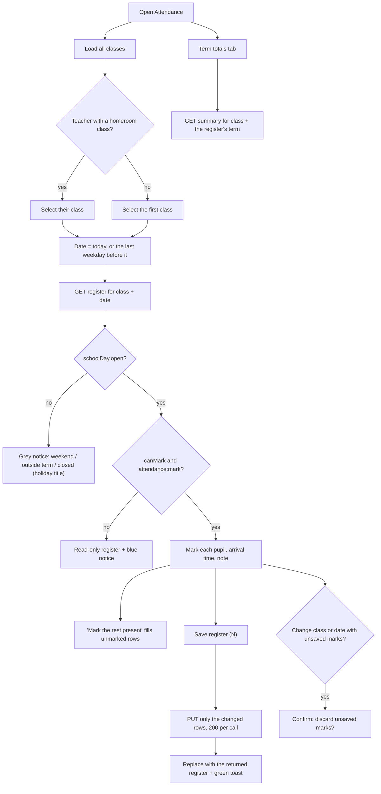

# Flow: Attendance

**Status: Live** (21 October 2026). Staff mark a daily register per class at `/school-admin/attendance` and see each pupil's term totals. Parents see their child's month at `/parent/attendance` (see [parent-experience.md](./parent-experience.md)).

> **Updated 26 Oct 2026 (QA-016, backend `3c4a1ed`):** a teacher's class picker offers only the classes they teach: their subject assignments (`GET /schools/me/teaching-assignments`) plus any class where they're the homeroom teacher (`setupApi.classesFor`). Others return 403 "You can only see the classes you teach."

Code:
- staff page: `src/features/attendance/AttendancePage.tsx`, API in `src/features/attendance/api.ts`, mounted by `src/app/school-admin/(app)/(school)/attendance/page.tsx`;
- parent view: `src/features/parent/attendance/AttendancePage.tsx`, through `parentApi.attendance`.

Backend: the attendance module on `feat/attendance` (commits 9df8958 and 8301857), not yet on `main`.

## Who can reach it

| Role | Opens the page | Can mark |
| --- | --- | --- |
| Principal | Yes | Any class |
| Academic Head | Yes | Any class |
| Secretary | Yes, by URL (not in the role's sidebar) | Any class |
| Teacher | Yes | Only the class where they are the homeroom teacher. Other classes are view-only. |
| Account Officer | No (`attendance:read` missing; the backend returns 403) | — |
| Parent | `/parent/attendance` for linked children | No |

Every staff entry also needs the school's `attendance` module. The page shows the editor only when the register's `canMark` is true **and** the user has `attendance:mark`.

## Diagram

## States

| State | Behaviour |
| --- | --- |
| Loading | Loader while the first register loads. The class picker reads "Loading…" until classes arrive. |
| No classes | Blue notice: add classes under School setup first. |
| Closed day | Grey notice: "This day is a weekend.", "…is not in any academic term.", or "The school is closed (title)." The register still lists pupils, read-only. |
| View-only | Blue notice: only the class teacher or a school leader can mark it. Marks appear as badges. |
| Empty class | "This class has no active pupils." |
| Error | Red alert with the backend's message and Try again. |
| Saved | Green toast "N marks saved for <class>"; the counts and "marked by" update from the response. |
| Save failed | Red toast with the backend's message. The draft is kept so nothing typed is lost. |

The six count cards (Present, Late, Half day, Absent, Excused, Not marked) follow the draft, so they change as you mark.

**Term totals** shows each pupil's present, late, half day, absent, excused and not-marked counts for the term, plus an attended rate: (present + late + half day) ÷ marked days, leaving out excused and unmarked days. The term is the one the register reports for the selected date, not the school's "current" flag (see QA-061).

## Validation rules

Enforced by the backend and mirrored in the UI where possible:

- Status is one of Present, Late, Half Day, Absent, Excused.
- Arrival time (HH:MM) is only allowed with Present, Late or Half Day. The UI clears and disables it for Absent and Excused.
- No marks on weekends, closures, days outside every term, or future days. The date picker's `max` is today.
- Each student once per save, and only students in that class.
- At most 200 marks per call. The client splits bigger saves.
- Students left out of a save keep their mark. Re-sending a student corrects their mark.

## Backend endpoints

| Call | Used for |
| --- | --- |
| `GET /schools/me/classes` (all pages) | Class picker; `homeroomStaffId` picks a teacher's own class |
| `GET /schools/me/attendance/register?classId&date` | The day's register: `schoolDay`, `canMark`, students, counts |
| `PUT /schools/me/attendance/register` | Save `{ classId, date, marks[] }`; returns the updated register |
| `GET /schools/me/attendance/summary?classId&termId` | Term totals |
| `GET /parents/me/wards/:studentId/attendance?from&to` | Parent month view: marked days only, plus a summary with `halfDay` and `unmarked` |

## Parent view

- Month grid coloured by mark, with half days in yellow. Hovering a day shows the arrival time and note.
- The rate is (present + late + half day) ÷ (school days − excused − unmarked). A month the school hasn't marked shows "–" instead of 0%.
- "N school days have not been marked yet" appears under the summary when any are.
- With `NEXT_PUBLIC_PARENT_API_MOCK=1` the view uses generated sample marks.

## Edge cases checked

- **Unsaved marks:** changing class or date asks first. Refresh reloads without asking.
- **Teacher on another class:** opens read-only (`canMark: false`). The backend also refuses a save with 403 "Teachers can only mark their own class's register".
- **Flagged current term in the future:** the summary takes the register's term, so totals stay right. The backend now also defaults to the term containing today.
- **Opening on a weekend:** the page starts on the last weekday instead.
- **Rejected arrival time:** a save with an arrival time on Absent returns 400, and the UI never sends one.

## Not covered yet

- No SMS or email to parents on absence, even though marketing promises it (`src/data/schoolModules.ts`).
- No offline marking.
- No school-wide daily overview page across classes. The Overview's "Present today" tile (live since 26 Oct, QA-034) sums each class's register; see [Overview dashboard](./overview-dashboard.md).
