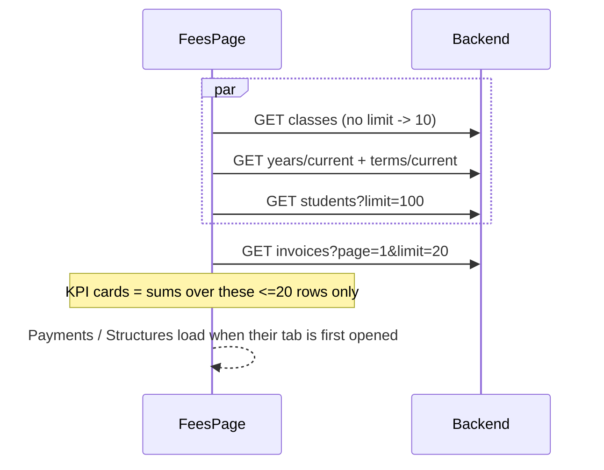
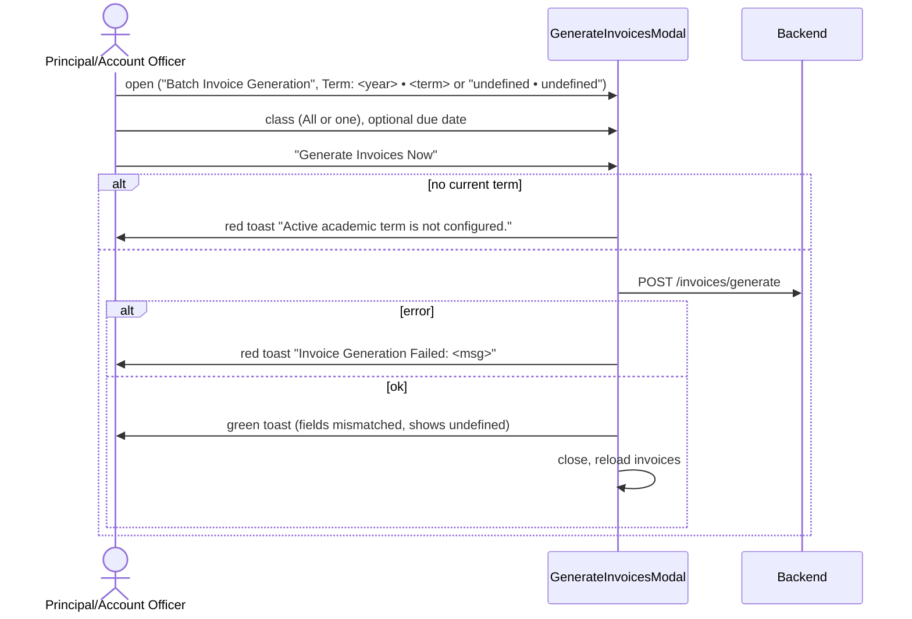
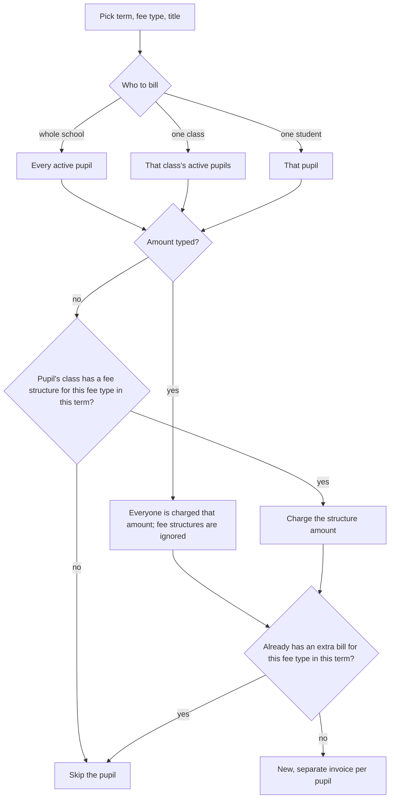
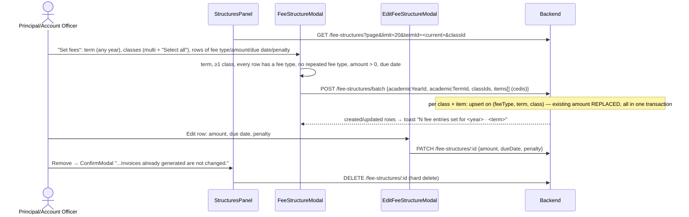

# Flow: Fees, invoices, payments, receipts and fee structures

Code: `src/features/fees/*` (`FeesPage.tsx` orchestrates; `api.ts` holds every call; money in integer pesewas in `money.ts`).

> **Updated 26 Oct 2026 (QA-030):** the pupil pickers (Record Payment, the payments and discounts filters, Add discount, the extra bill for one pupil) are `StudentPicker`. It searches `GET /schools/me/students?search=` as you type, a page at a time, ignoring slower stale answers, so any pupil can be found however large the school. The Fees page no longer loads a pupil list. Staff, invitations, the platform school's staff, schools, classes and the setup staff pickers fetch every page (`fetchAll` in `lib/pagination.ts`).
>
> **Updated 26 Oct 2026 (QA-061):** Generate Term Invoices, the extra bill and the fee-structure form have a **Term** picker. It defaults to the current term, shows the term's dates ("Runs 8 Jan 2027 – 9 Apr 2027"), and lists undated terms disabled. When the chosen term doesn't include today, an orange "Not today's term" alert says e.g. "Term 2, 2026/27 runs 8 Jan 2027 – 9 Apr 2027. Today is in Term 1, 2026/27. These bills will be for Term 2, 2026/27." (or "Today isn't in any term."). School setup → Years & terms shows "The current term isn't today's term" with **Make Term 1 current** when today falls in another term.
>
> **Updated 26 Oct 2026 (billing batch, backend `80fb344`):**
>
> - **Leavers:** the Invoices tab has a **Leavers** switch (`GET /schools/me/invoices?leavers=true`, with the same filter on `/summary`). Leavers' bills stay owed and payable.
> - **Exit:** recording a pupil's exit (Class & status → Record exit) now shows what they still owe before confirming, from `/invoices/summary?studentId=` (QA-224). It reads "They still owe GHS 499.00. Their bills stay owed and can still be paid after they leave.", or "They owe nothing." It's shown only with `invoices:read` and the fees module.
> - **Extra bills:** an extra bill may repeat a term-bill fee type under a different title. The backend's 409 wording is shown as is.
> - **Notes:** the Notes section's "Show the late-payment penalty" toggle and the `invoice.latePenalty` placeholder come from the catalogue.
>
> **Snapshot note (updated 21 Oct 2026):** most of this page was written against the committed fees module (`2cfc910`). Since then:
>
> - **Fee setup landed in `5be7b6c`**: Fee Types, Fee Structures (set, edit, remove) and Discounts tabs. It is documented in [Fee setup](#fee-setup-fee-types-structures-discounts) below. Several of those files (`FeeTypesPanel/Tab`, `StructuresPanel/Tab`, `DiscountsPanel/Tab`, `FeesPage`, `api.ts`) **also have uncommitted working-tree changes**, mainly a load-error row with "Try again" instead of a silent empty table. The section describes the **working tree**.
> - **The list-shape worry is resolved.** `apiClient` sends `X-Api-Contract: 2` (`src/lib/api-client.ts:9,191`), and the backend's `transform.interceptor.ts:46-55` then returns lists as `data[]` plus `meta`, which is what `toPage` (`src/lib/pagination.ts:20`) reads.
> - **`41eeb3b` changed Record Payment.** It added an `Idempotency-Key` header and a typed-amount guard, and shows `CARRIED_FORWARD` invoices as "MOVED TO NEXT BILL". The payment section below is updated for these changes.
> - Other parts (generate response, KPIs, class cap) were changed by later work and are not re-verified here.

**Who:**
- The page: staff with `invoices:read` and module `fees` (Principal, Account Officer).
- Payments tab: `payments:read`.
- Record Payment: `payments:collect`.
- Generate: `invoices:generate`.
- Structures tab: `fee_structures:read`.

The backend restricts every fees route to `@Role(PRINCIPAL, ACCOUNT_OFFICER)` plus module `fees`, so the two sides agree.

## Backend endpoints

| UI | Call | Shape match |
| --- | --- | --- |
| Invoices tab | `GET /schools/me/invoices?page&limit=20&search&classId&status` | ✓ `{items,total,page,limit}` |
| Breakdown drawer | `GET /schools/me/invoices/:id` | ✓ includes `lineItems` |
| Payment modal: balance | `GET /schools/me/invoices/students/:studentId/latest` | ✓ |
| Generate modal | `POST /schools/me/invoices/generate` `{academicTermId, classId?, dueDate?}` | ✗ **Mismatch.** The frontend reads `totalInvoicesGenerated` and `totalFeePayable` (`api.ts:182-189`). The backend returns `{generatedCount, skippedCount, totalProcessed, termLabel, …}`. The success toast reads "Generated undefined student invoices totaling GHS 0.00". |
| Metric cards | `GET /schools/me/invoices/summary` (same filters as the list) | ✓ `{invoiceCount, totalBilled, totalCollected, outstanding, overpaid, collectionRate}` |
| Extra bill | `POST /schools/me/invoices/supplementary` `{academicTermId, title, feeTypeId, classId?, studentId?, amount?, dueDate?}` | ✓ `{generatedCount, skippedCount, message}` |
| Payments tab | `GET /schools/me/payments?page&limit=20&studentId&paymentMethod` | ✓ |
| Record payment | `POST /schools/me/payments` `{studentId, invoiceId?, amount (cedis), paymentMethod, bankType?, transactionReference?}` | ✓ returns `PaymentResponse[]`; the frontend takes `[0]` |
| Structures tab | `GET /schools/me/fee-structures?page&limit=20&termId&classId` | ✓ |
| Lookups | `GET /schools/me/classes` (**default limit 10**), `GET /schools/me/students?limit=100` (maximum 100), current year and term | Truncated |

These backend fees endpoints have no UI:
- async generation and job status
- broadcast or send invoice links (SMS and email)
- ~~fee type CRUD and seeding; fee structure create, batch, edit, delete; discounts~~: now have UI (`5be7b6c`, see [Fee setup](#fee-setup-fee-types-structures-discounts)). Still without UI: `GET /fee-types/:id`, single `POST /fee-structures`, the class summary `GET /fee-structures/classes/:classId/terms/:termId/summary`, and `GET /discounts/students/:studentId`
- optional-fee preferences
- payment `paymentDate` (back-dating) and manual `receiptNumber`

## Page load



## Generate term invoices



- **Validation:** none on the client. The due date can be in the past. Only the current term can be billed.
- **Double submit:** the button is disabled while loading. Cancel, the close X and Esc stay active. The class and due date persist when the modal reopens.
- **Idempotency:** the backend skips students who already have an invoice (`skippedCount`), but the frontend never shows how many were skipped.
- **No confirmation** step and no preview of how many students or what total will be billed.

## Record a payment and print the receipt

```mermaid
sequenceDiagram
  actor U as Cashier
  participant M as RecordPaymentModal
  participant API as Backend
  participant R as ReceiptModal
  U->>M: pick student (searchable, only first 100 students)
  M->>API: GET invoices/students/:id/latest
  alt ok
    M->>U: "Target Invoice", "Outstanding Debt"; amount prefilled with balance ONLY if the cashier has not typed one (41eeb3b)
  else error / no invoice
    M->>U: red toast "Could not load the student's balance" (can still submit, invoiceId omitted)
  end
  U->>M: amount, method (MoMo/Cash/Bank transfer/Cheque), channel, reference
  U->>M: "Record Payment & Print Receipt"
  M->>M: student required, amount > 0, not already saving
  M->>API: POST /schools/me/payments + header Idempotency-Key: <uuid per student pick>
  alt 409 (same key or same non-cash reference already recorded)
    M->>U: red toast "Payment Failed: This payment was already recorded (receipt X)" (no receipt shown, lists not reloaded)
  else other error
    M->>U: red toast "Payment Failed: <msg>" (modal stays)
  else ok
    M->>U: green toast "Receipt <no> issued for GHS x"
    M->>R: open receipt (first allocation only)
    M->>API: reload invoices + payments
    U->>R: Print Receipt -> window.print() (prints the whole page, no print stylesheet for #printable-receipt)
  end
```

**Validation:**
- Client: a student must be selected, and the amount must be more than 0 (`NumberInput` min 0.01, two decimals).
- Server: amount ≥0.01 with two decimals; method must be one of the enum values; channel up to 50 characters; reference up to 100.
- There is no warning when the amount exceeds the balance, so the invoice silently becomes OVERPAID.
- A reference is not required for MoMo, bank or cheque payments.

**Typed amount (QA-055, fixed in `41eeb3b`):** the amount field remembers whether the cashier typed it (`RecordPaymentModal.tsx:38-42, 195-199`), and the balance lookup fills it only when it was not typed (`:66-70`). A typed amount is also **kept when the cashier switches to another student** (`:57`). When the amount differs from the balance, the field shows "Outstanding balance is GHS x" (`:200-207`).

**Double submit and network failure (after `41eeb3b`):**
- The submit button is disabled while saving, and `submit` returns early when `saving` is set (`:86`). The Cancel button is also disabled, but the modal's X, Esc and outside-click **still close it mid-save** (`:128-130`: `onClose` is not guarded).
- One `Idempotency-Key` (a `crypto.randomUUID()`) is generated per student pick (`:46, 56`) and sent as a header (`api.ts:352-360`).
  - The backend honours it (backend `main`, checked in the `fastrack-backend` checkout on `fix/invoice-run-class-label`, which contains `18b3c9a`). The header is validated as 8-100 safe characters (`payments/idempotency-key.ts:8-16`).
  - The key is looked up under the student's fee lock, along with a matching non-cash `transactionReference` (`payments.service.ts:88-101`, `fees-payment.repository.ts:133-160`). A match returns **409** "This payment was already recorded (receipt X)".
  - A partial unique index `UQ_PAYMENTS_SCHOOL_IDEMPOTENCY_KEY` backs this up. A concurrent race is mapped from 23505 to 409 (`payments.service.ts:133-140`). Only the first allocation of a waterfall split carries the key (`payment-processor.strategy.ts:198-199`).
- Still open:
  - The key is compared by value only, not against the request body. A retry with a corrected amount returns the *old* receipt number as a 409.
  - The frontend shows the 409 as a red "Payment Failed" toast and does not open the receipt or reload the lists. A cashier who then closes the modal and starts again gets a **new key**, so a cash payment can still be recorded twice. Non-cash payments are protected by the reference check.
- You can submit before the latest-invoice lookup finishes. `invoiceId` is then omitted, and the backend waterfall decides which invoice the payment goes to.

**Receipt:**
- Every receipt says "OFFICIAL RECEIPT — PAID & VERIFIED", including part payments.
- `paymentDate` is printed raw (an ISO string).
- When the waterfall splits a payment across several invoices, only the **first** allocation is shown.
- Receipts can be reprinted from the Payments tab ("Receipt" button per row).

## Extra bills (supplementary invoices)

**More billing → Extra bill (exam, excursion…)** in Fees & Billing. Principal and Account Officer only (`invoices:generate`; the backend allows only those two roles).



- **A fee type alone bills nobody.** A fee type is a label. A fee structure is its price for one class and term. Charges come only from Generate Term Invoices (every structure, on the term bill) or from an extra bill (one fee type, a separate invoice).
- **One class or the whole school.** You can't pick several classes. To bill only some classes, bill the whole school with the amount empty, and only classes with a structure for that fee type are charged.
- **The term defaults to the school's flagged current term**, not the term that contains today. See QA-061.
- **The duplicate check ignores term bills.** A fee that is both in the term's fee structures (so on the term bill) and sent as an extra bill is charged twice. See QA-062.
- **Result message:** "Successfully generated N supplementary invoice(s) for <title> (<term>) (<class> | whole school)", plus "(M already billed)" when any were skipped. Before backend e28166d, a whole-school run named one class (QA-063).
- **`isRecurring`** on a fee type is stored, but no billing logic reads it.

## Fee setup: fee types, structures, discounts

Added in `5be7b6c`. Several of these files also have **uncommitted working-tree changes** (load-error rows with "Try again", wiring in `FeesPage.tsx`); this section describes the working tree.

Code:
- `FeeTypesPanel.tsx`, `FeeTypesTab.tsx`, `FeeTypeModal.tsx`
- `StructuresPanel.tsx`, `StructuresTab.tsx`, `FeeStructureModal.tsx` (create), `EditFeeStructureModal.tsx`
- `DiscountsPanel.tsx`, `DiscountsTab.tsx`, `DiscountModal.tsx`
- `ConfirmModal.tsx`, `LoadErrorRow.tsx`

Backend checked: `fastrack-space/fastrack-backend` on branch `fix/invoice-run-class-label`. That branch contains backend `main`; the fee setup code there is the same as on `main`.

A school needs four steps before "Generate" bills anything:
1. Fee types.
2. Fee structures (amount per fee type × class × term).
3. Optionally, discounts.
4. Then generate. Generating with no structures still yields zero invoices.

### Who can use it

| Tab | Shown when (FE, `FeesPage.tsx:69-74, 352-365`) | Write actions shown when | Backend guard |
| --- | --- | --- | --- |
| Fee Types | `fee_types:read` | `fee_types:manage`: Add, Edit, "Add the standard fee types" | `@Role(PRINCIPAL, ACCOUNT_OFFICER)` + `FEE_TYPES_*` + module `fees` (`fee-types.controller.ts:30-92`) |
| Fee Structures | `fee_structures:read` | `fee_structures:manage`: Set fees, Edit, Remove | same roles + `FEE_STRUCTURES_*` + module `fees` (`fee-structures.controller.ts:38-151`) |
| Discounts | `discounts:read` | `discounts:manage`: Add, Remove | same roles + `DISCOUNTS_*` + module **`discounts`** (`discounts.controller.ts:34-88`) |

- **Principal and Account Officer get identical fee-setup rights.** Both hold every read and manage permission above (`common/auth/role-permissions.matrix.ts:59-67, 148-156`). FE permissions come from the server's login payload (`src/lib/rbac/policy.ts:44-50`), so the role checks on the two sides agree.
- **Mismatch:** the frontend never checks the **`discounts` module**. A school that has `fees` but not `discounts` still sees the Discounts tab. The list then fails with the module guard's 403, which shows in the error row.
- A read-only session (`subject.readOnly`) loses every manage action (`policy.ts:46`).

### Fee types

```mermaid
sequenceDiagram
  actor U as Principal/Account Officer
  participant P as FeesPage
  participant M as FeeTypeModal
  participant API as Backend
  P->>API: GET /schools/me/fee-types (on page load, plain array, no paging)
  alt load fails
    P->>U: error row + "Try again" (tab count blank)
  else empty
    P->>U: "No fee types yet." + "Add the standard fee types"
    U->>P: click (no loading state, not guarded)
    P->>API: POST /fee-types/seed-defaults
    P->>API: GET /fee-types (reload)
  end
  U->>M: Add fee type / Edit
  U->>M: name (required, max 100), description, "Charged every term", "Optional"
  M->>API: POST /fee-types or PATCH /fee-types/:id
  alt 409 duplicate name
    M->>U: red toast "Could not save the fee type: Fee type "X" already exists in this school"
  else ok
    M->>U: green toast; modal closes; list, structure form and discount form pickers reload
  end
```

- **No delete.** There is no FE action and no backend `DELETE /fee-types/:id`. A mistaken fee type stays in every picker forever.
- **Duplicate names:** the backend trims and checks an exact, **case-sensitive** match (`fee-types.service.ts:29-36, 84-93`; `fee-type.repository.ts:33-42`), backed by `UQ_FEE_TYPES_SCHOOL_NAME`. So "Tuition Fee", "tuition fee" and "Tuition  Fee" (double space) can all exist.
- **Edits are retroactive.** Invoice line items store a foreign key to the fee type, not a copy of its name (`invoice-line-item.entity.ts:30-32`). The line-item response reads `feeType.name` and `feeType.isOptional` live (`invoice-line-item-response.dto.ts:30-32`). Renaming a fee type, or toggling Optional, changes **already-issued** invoices and receipts. The modal does not warn about this.
- **The description cannot be cleared on edit.** An empty description is sent as `undefined` (`FeeTypeModal.tsx:29`), and the backend only updates the description when it is not `undefined` (`fee-types.service.ts:96`).
- **Double submit:** the Save button shows a loading state. "Add the standard fee types" has no loading or in-flight guard (`FeeTypesPanel.tsx:32-43`, `FeeTypesTab.tsx:77-85`). On a double-click, both requests can see the defaults missing. The second insert then hits the unique constraint, which surfaces as a 500 "Could not add the standard fee types" even though the first request succeeded.

### Fee structures (set, edit, remove)



**Validation:**

| Rule | FE | BE |
| --- | --- | --- |
| Amount | > 0 (`FeeStructureModal.tsx:76`, `EditFeeStructureModal.tsx:30`), 2 decimals, `min 0`, **no max** | `@Min(0)` (0 allowed), 2 decimals, column `decimal(12,2)`, no `@Max` |
| Penalty | ≥ 0 optional, no max, no relation to amount | `@Min(0)`, 2 decimals |
| Due date | required, any date (past, or outside the term) | `@IsDateString` only |
| Same fee type twice in one form | blocked ("Each fee type can appear only once.") | the second upsert would overwrite the first |
| Same fee type, class and term already set | allowed, and the form warns "its amount is replaced" | upsert (`fee-structure.repository.ts:115-150`) |
| Year/term pair | taken together from one term option | not cross-checked (`fee-structures.service.ts` `createBatch`) |

**Edge cases:**
- **Huge amounts:**
  - A value of 10,000,000,000 or more overflows `decimal(12,2)`. No exception filter maps Postgres 22003, so the user sees a 500 "Internal server error" toast.
  - JavaScript float limits are not reached first, because `toPesewas` rounds (`money.ts:8-11`).
- **Decimal precision:** `NumberInput decimalScale={2}` trims extra digits. Amounts travel as cedis (`api.ts:370-390`).
- **Issued invoices:**
  - Edit and remove never touch invoices that already exist. Line items reference the fee type, not the structure, so removing a structure is safe.
  - Generation skips students who already have an invoice. A **mid-term change** therefore applies only to students billed later, such as late enrolments, so two students in one class can be billed different amounts for the same term. The only way to correct an issued bill is the Principal-only modify action.
- **Penalty and per-fee due date are not used for billing.** Nothing in invoices or payments reads `fee_structures.penalty`. The invoice due date comes from the Generate form. The bill template hard-codes "A penalty of 10% will be charged…" (`documents/layout/blocks/bill.blocks.ts:186`), regardless of the penalty set here. The "GHS x if late" text in the table is decorative.
- **Overlap:** structures are unique per (fee type, term, class) (`UQ_FEE_STRUCTURES_TYPE_TERM_CLASS`), so terms cannot overlap for one fee. Setting fees again for "Select all classes" silently replaces every class's amount for those fee types.
- **Stale list:** `StructuresPanel.load` has no stale-response guard (`StructuresPanel.tsx:51-63`); a slow response for an old filter can overwrite a newer one. Removing the only row on the last page reloads the same, now empty, page and shows "No fee structures match this term and class." with the pager still visible.
- **Errors are not shown as empty.** A failed load shows `LoadErrorRow` with "Try again" (`StructuresTab.tsx:123-124`). This is a working-tree change.
- **Pickers:** the fee type picker uses the page-level list. If that list failed to load, the picker is empty with no explanation. The class picker now holds every class (`setupApi.allClasses()`).

### Discounts

```mermaid
sequenceDiagram
  actor U as Principal/Account Officer
  participant D as DiscountsPanel
  participant M as DiscountModal
  participant API as Backend
  D->>API: GET /discounts?page&limit=20&studentId(enrolment id)
  alt 403 (no "discounts" module) / other error
    D->>U: error row + "Try again"
  end
  U->>M: student (first 100 only), applies to (whole bill / one fee type), term (one term / every term), type, value, reason
  M->>M: student chosen; value > 0; percentage ≤ 100
  M->>API: POST /discounts {studentId, feeTypeId?, termId?, discountType, discountValue}
  Note over API: if (student, feeType|null, term|null) already has a discount it is OVERWRITTEN
  API-->>M: toast "Discount added"
  U->>D: Remove → confirm → DELETE /discounts/:id (hard delete)
```

- **Types:**
  - `percentage` sends the raw percentage.
  - `flat` and `special` send cedis. `special` behaves exactly like `flat` in billing.
- **Validation:**
  - FE: value > 0, and a percentage ≤ 100. The `NumberInput max={100}` only clamps on blur; `submit` re-checks.
  - BE: `@Min(0)`, 2 decimals, and percentage ≤ 100 (`discounts.service.ts:72-76`). There is no cap on a flat value.
- **"Add" can silently replace.** The backend upserts on (student, fee type or null, term or null) (`discounts.service.ts:87-112`). Adding a second "whole bill, this term" discount replaces the first, but the UI says "Discount added". There is no edit action.
- **Stacking:**
  - At generation, every discount for the student whose term is this term **or null** applies. Whole-bill and per-fee discounts are summed (`invoice-generation.service.ts:146, 280-324`).
  - Each percentage is taken from the gross amount, not applied in sequence. For example, "every term 60%" plus "this term 60%" gives a 120% discount.
  - The total is capped at gross fees (`:324`), so a bill can reach zero but never go negative. The UI copy ("never takes a fee below zero") matches, but the form never warns about stacking.
- **After invoices exist:** discounts apply only at generation. Adding or removing one after the term's invoices exist changes nothing. The modal and the confirmation both say so; the only remedy is the Principal-only invoice modify.
- **Student picker:** the same first-100 student list as Record Payment. Students past 100 cannot get a discount from the UI.
- **Filters:** student only. `DiscountQuery.termId` exists in `api.ts:157` but is unused.

### States

| State | Fee Types | Fee Structures | Discounts |
| --- | --- | --- | --- |
| Loading | Loader row; tab count blank | Loader row | Loader row |
| Empty | "No fee types yet." + seed button (managers) | "No fee structures match this term and class." | "No discounts yet." / "This student has no discounts." |
| Error | `LoadErrorRow` + Try again | `LoadErrorRow` + Try again | `LoadErrorRow` + Try again |
| Save error | red toast, modal stays | red toast, modal stays | red toast, modal stays |
| Delete error | n/a | `ConfirmModal` red toast, stays open | same |

### Endpoints (all exist on backend `main`)

| UI | Call | Notes |
| --- | --- | --- |
| Fee types list | `GET /schools/me/fee-types` | plain array |
| Add / edit fee type | `POST /schools/me/fee-types`, `PATCH /schools/me/fee-types/:id` | 409 on exact duplicate name |
| Standard fee types | `POST /schools/me/fee-types/seed-defaults` | inserts only the missing ones |
| Structures list | `GET /schools/me/fee-structures?page&limit&termId&classId` | v2 `data[]` + `meta` |
| Set fees | `POST /schools/me/fee-structures/batch` | upsert, transactional |
| Edit / remove | `PATCH` / `DELETE /schools/me/fee-structures/:id` | delete is a hard delete |
| Discounts list | `GET /schools/me/discounts?page&limit&studentId` | module `discounts` required |
| Add / remove discount | `POST /schools/me/discounts`, `DELETE /schools/me/discounts/:id` | POST upserts |
| Fee type delete | none | not implemented on either side |

## States (all tabs)

| State | Invoices | Payments | Structures |
| --- | --- | --- | --- |
| Loading | Row "Loading invoices…" | Loader row | Loader row |
| Empty | "No invoices match your search or filter." (also shown for a brand-new school) | "No payments match your filter." / no-payments text with a Record Payment call to action | Empty text |
| Error | Toast "Could not load invoices"; **previous rows stay visible** | Toast | Error row + Try again (see Fee setup) |
| Count | Tab label `(total)` | `(total)` after the first load | `(total)` after the first load |

## Known issues

- ~~**KPIs cover the visible page only.**~~ Fixed 21 October 2026: the four cards come from `GET /schools/me/invoices/summary` and total every invoice matching the table's filters. Against a backend without that endpoint they fall back to the page totals and say "invoices shown". Updated 26 Oct (QA-271): balances carried to a later bill count as not collected, and Outstanding Arrears then reads "GHS x moved to later bills" (the summary's `carriedForward`).
- **Invoice search** is debounced (300ms, `FeesPage.tsx:53`) but has no stale-response guard.
  - Typing on page 3 resets the page to 1, which fires an immediate request with the *old* search term. The debounced request follows.
  - Whichever response arrives last wins.
  - Class and status changes are not debounced or guarded either.
- **The status filter** (`InvoicesTab.tsx:35`) offers All, UNPAID, PARTIAL and PAID only. It has no OVERPAID option, and no CARRIED_FORWARD option, a status that `41eeb3b` now labels "MOVED TO NEXT BILL" (`InvoicesTab.tsx:27-33`). Those invoices are reachable only under "All".
- **The student pickers** (record payment, payments filter) hold only the first 100 students of every status, sorted however the backend sorts them. Students past 100 cannot be paid for from the UI.
- **Classes** are capped at 10 in every class filter.
- **Refresh** does not show a loading state for the structures tab.
