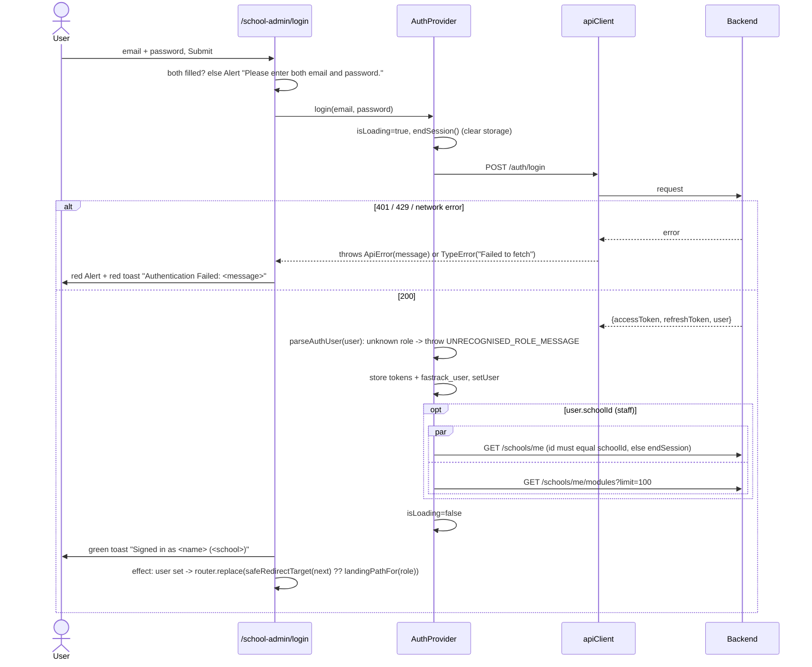

# Flow: Login and session

Code:
- `src/app/school-admin/login/page.tsx`
- `src/lib/auth/auth-context.tsx`
- `src/lib/auth/RouteGuard.tsx`
- `src/lib/auth/session.ts`
- `src/lib/api-client.ts`
- `src/lib/rbac/routes.ts` (`safeRedirectTarget`, `landingPathFor`)

## Backend endpoints

| Call | Method and path | Backend notes |
| --- | --- | --- |
| Sign in | `POST /api/auth/login` `{email, password}` | Public, throttled (10 per 60 s per IP plus email). Returns `{accessToken, refreshToken, expiresIn, user}`. Unknown or invited (no password) or wrong password gives 401 "Invalid credentials". A deactivated user gives 401 "Account is deactivated". **A suspended school is not checked.** |
| School profile | `GET /api/schools/me` | Staff roles only (`schools:read`). The response includes `isActive`; the frontend type omits it. |
| Modules | `GET /api/schools/me/modules?limit=100` | Staff roles. Standard list `data[]`. |
| Refresh | `POST /api/auth/refresh` `{refreshToken}` | **Rotates** the token. Re-using a revoked token revokes **all** of the user's tokens and returns 401. Returns a new `user` with recomputed permissions, which the frontend ignores. |
| Year and term badge | `GET /api/schools/me/academic-years/current`, `/academic-terms/current` | Called by AppShell |
| Logout | **not called.** `POST /api/auth/logout` `{refreshToken}` exists (204) | |
| Profile | **not called.** `GET /api/auth/profile` exists (there is no `/auth/me`) | |

Token lifetimes: access token 15 min. Refresh token 14 days for staff, 30 days for the Super Admin and 60 days for parents.

## Sign in

### States

| State | UI |
| --- | --- |
| Idle | Form with "School email" and "Password"; left panel with marketing stats (desktop only) |
| Submitting | Button `loading` (disabled); inputs stay editable |
| Error | Red `Alert` "Authentication Error" with the message, plus a red toast |
| Success | Green toast, then redirect. The form stays visible until the redirect fires. |
| Already signed in | The effect redirects straight away |

### Validation

- The client checks only that both fields are non-empty. The inputs are `required`, and the email field has no `type="email"`.
- Server: `email` must be a valid email of up to 255 characters, and `password` a non-empty string of up to 255. Validation errors come back as joined messages.

There is **no** "Forgot password?" link, no "Remember me" option, and no link back to the marketing site.

## Restore on reload

1. `AuthProvider` mounts and reads `fastrack_access_token` and `fastrack_user`. Without both, it calls `clearSession()` and sets `isLoading=false`.
2. `parseAuthUser(stored)`. **No server round-trip** checks the token or the role.
3. For staff: the cached `fastrack_school` shows straight away if its `id` matches, `GET /schools/me` refetches it, and `GET /schools/me/modules` holds `isLoading` until it settles.
4. RouteGuard decides from the stored role and permissions.

## Refresh and 401 handling

1. Any API call that returns 401 (other than login and refresh) awaits `refreshOnce()`. The in-flight promise is shared within one tab.
2. On success, the client stores the new access and refresh tokens and retries the call once.
3. On failure, the client clears the session and runs `window.location.href = '/school-admin/login'`. This is a hard navigation, so unsaved modal content is lost. There is **no `?next`**, so the user returns to their landing page, not the page they were on.
4. Special cases:
   - When no refresh token is stored, or the refresh response has no `accessToken`, the session is **not** cleared before the redirect. The login page then restores the stale user and redirects back, and the next 401 repeats the cycle (a possible redirect loop).
   - A network error during refresh (`catch`) **clears the session**, so a brief connectivity drop signs the user out.

## Logout

AppShell's "Sign out" icon (`aria-label="Sign out"`) or the platform's red icon calls `logout()`. That clears the four storage keys and runs `router.replace('/school-admin/login')`. There is no server call: the refresh token stays valid for up to 14 to 60 days and the access token for up to 15 minutes.

## The `?next` redirect

- RouteGuard sends a signed-out visitor to `/school-admin/login?next=<pathname>`. The query string and hash of the original URL are dropped.
- After login, `safeRedirectTarget(next, user)` accepts only values that start with `/school-admin/` and whose pathname the user may open. Crafted values such as `https://evil.example`, `//evil.example/school-admin/`, or another role's page fall back to the landing page (covered by `check-dashboard.cjs`).
- `next` is read from `window.location.search` when the login effect runs. It is not shown to the user and not preserved across a failed login, because the URL is unchanged.

## Session edge cases

| Scenario | What happens today | Evidence |
| --- | --- | --- |
| Phone capitalises the email, or adds a trailing space | Every account email field uses `emailInputProps` (`src/lib/email-input.ts`: `type=email`, `autocapitalize=none`, `autocorrect=off`, no spellcheck), so phones don't change it. The backend trims and lower-cases emails, so `Head@fastrack.school ` signs in (QA-201, backend `e226f97`). The client sends what was typed. | `src/lib/email-input.ts` |
| Access token expires mid-form | The next submit gets 401, refreshes silently, and retries. That works unless the refresh fails, in which case there is a hard redirect and the form data is lost. | `api-client.ts:121-135` |
| Two tabs, both idle past 15 min, resume together | Both tabs may refresh with the same refresh token. The backend treats the second refresh as reuse and revokes every token, so both tabs are logged out. `refreshOnce` dedupes only within one tab. | `api-client.ts:61-68`; backend `auth.service.ts:96-133` |
| Two tabs, different users | Tab B's login overwrites the shared `localStorage` tokens. Tab A keeps showing user A's name, role and menus, but its API calls now carry user B's token, so tab A acts as B inside A's UI. Nothing listens for `storage` events. | `auth-context.tsx` (no `storage` listener) |
| Role or permissions change on the server | The backend applies it on the next request. The frontend keeps the cached role and permissions until the next login (refresh ignores `user`, and restore never refetches), so menus show actions the backend now 403s, or hide newly granted ones. | `api-client.ts:86-93`, `auth-context.tsx:84-109` |
| User deactivated | The next API call returns 401, refresh returns 401, and the user goes to login. Login then shows "Account is deactivated". | Backend `jwt.strategy.ts` |
| School suspended (Super Admin "Deactivate") | **Nothing changes.** The backend never checks `schools.is_active`, and the frontend never reads it. | Backend inventory §2 |
| Module disabled mid-session | The menu keeps the page. API calls return 403 "The 'fees' module is not enabled for this school", which shows as a red toast such as "Could not load invoices". The page fixes itself only after a reload. | `auth-context.tsx:71-80` |
| Modules request fails | `modules` stays `undefined`, so every module page is shown (fail-open). | `policy.ts:64-66` |
| Refresh fails while a modal is open | Hard redirect: admission or payment drafts are lost with no warning. | `api-client.ts:128-130` |
| Crafted `?next` | Rejected (see above). | `routes.ts:86-90` |
| Shared or kiosk computer | Logout clears storage, but the server-side refresh token is not revoked. | `auth-context.tsx:139-142` |
| School profile belongs to another tenant | The session ends quietly with no message, and the user is bounced to login. | `auth-context.tsx:52-55` |
