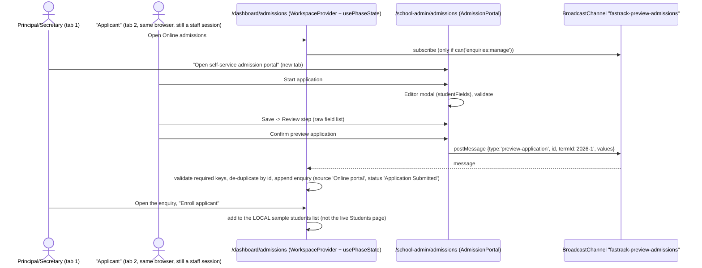

# Flow: Online admissions (preview)

**Status: UI preview, not connected to the backend.** Nothing in this flow sends a network request or persists past a reload.

Code: `src/app/school-admin/(app)/admissions/page.tsx` → `src/features/dashboard/phase-one/AdmissionPortal.tsx`; staff side in `phase-one/Enrollment.tsx` (area `admissions` / `enquiries`) and `phase-one/usePhaseState.ts` (the `BroadcastChannel` listener).

## Who can reach it

| Surface | Route | Rule |
| --- | --- | --- |
| "Applicant" portal | `/school-admin/admissions` | `APP_ROUTES.admissions`: staff audience + `enrollment:manage` + module `students` |
| Staff list "Online admission applications" | `/school-admin/dashboard/admissions` | Role layout contains `admissions` (Principal, Secretary) + `enrollment:manage` + module `students` |
| Staff "Admission enquiries" | `/school-admin/dashboard/enquiries` | Principal, Secretary + `enquiries:read` (frontend grant) + module `students` |

The "applicant-facing" portal is behind staff sign-in, so a real applicant or parent cannot open it. Academic Heads hold `enrollment:manage` too, so they can open `/school-admin/admissions` by URL, although no menu links them there.

## Diagram

## Steps and states

| Step | UI | State |
| --- | --- | --- |
| 0 Applicant | Title "Apply to {school.name}", blue alert "Preview only…", Stepper (Applicant, Review, Complete), "Start application" | Initial |
| Editor | Modal "Applicant & guardian details", blue alert "Frontend preview: saves update this workspace only." | Editing; `saving` disables close (instant here) |
| 1 Review | Each field printed as `<key with spaces>: value` (for example "birth Date"), "Edit details", "Confirm preview application" | Draft held |
| 2 Complete | Teal alert "Preview application complete… No real admission request was submitted." | Submitted (no way to start another without a reload) |
| Staff list | `Report` table "Online admission applications", filtered to `source === 'Online portal'` for the selected sample term | Empty when no staff tab was open at submit time |

There are no loading or error states: nothing is asynchronous. If no staff tab is on a `/dashboard` route at submit time, the application is silently lost, and the applicant still sees "complete".

## Validation rules (`Shared.Editor` + `Enrollment.validStudent`)

| Field | Rule |
| --- | --- |
| Student full name, Date of birth, Gender (Male, Female), Class applying for (sample classes), Nationality, Parent/guardian full name, Contact number, Email, Residential address | Required (non-blank after trim). Message "Complete all required fields." |
| Previous school | Optional |
| Date of birth | Not in the future ("Date of birth cannot be in the future.") |
| Contact number | `/^[+\d ()-]{7,20}$/` ("Enter a valid contact number.") |
| Email | Only the browser's `type="email"` check; no app-level rule |
| Staff enquiry form (extra) | Enquiry date, source, assigned to, follow-up date required; follow-up date on or after the enquiry date |

## Backend endpoints

None. `INTEGRATION.md` lists online admissions as "no backend endpoints yet". To go live, the flow needs a public, unauthenticated application endpoint (rate-limited, with CAPTCHA), a staff review queue, and conversion into a real `POST /schools/me/students` admission.

## Risks

- A staff user clicking "Enroll applicant" may believe the child is now on the live Students page; the child is only in browser memory.
- The portal's "Back to staff preview" button shows that the portal assumes a staff session.
- The term is fixed to `2026-1`, and the label "2026/27 · Term 1" is hard-coded.
