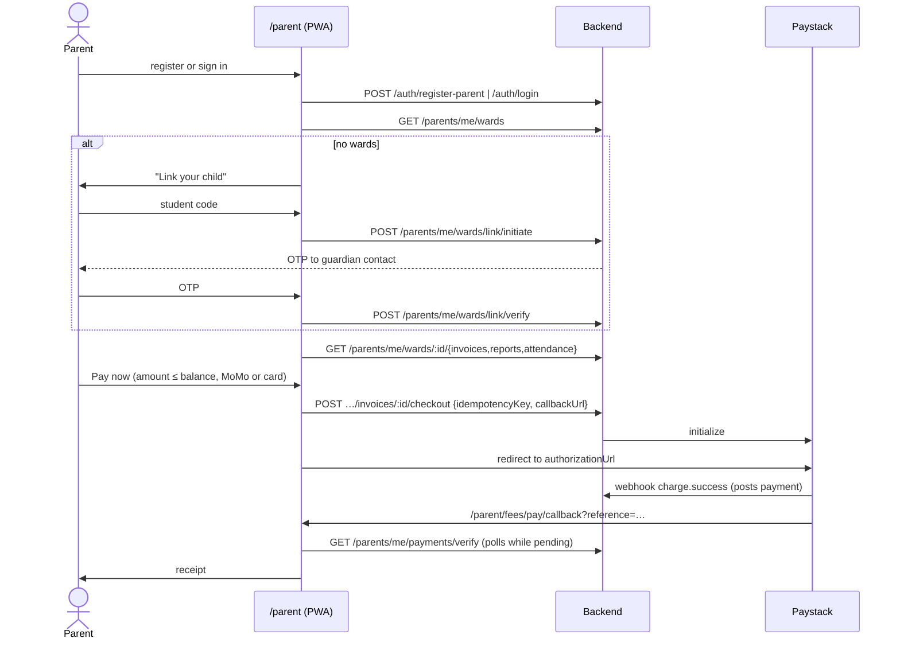

# Flow: Parent portal

**Status:** the portal is built at `/parent`, and the PWA can be installed. These work against the backend today:
- registering an account
- signing in
- listing, linking (code plus OTP) and unlinking children

As of 21 October 2026 these are live against the backend too (checked on localhost):
- the ward profile, with guardians on file, boarding status and the school's contacts
- fees, bills, payments and receipts, plus online checkout (needs `PAYSTACK_SECRET_KEY`; the local backend has a test key since 21 Oct. The webhook can't reach localhost, so locally a payment is confirmed when the return page calls `GET /parents/me/payments/verify`)
- optional-service requests
- attendance (see [attendance.md](./attendance.md))
- the school calendar ("Coming up this term" on Home)

**Reports** are live since results phase 4 (24 Oct; see [results-and-reports.md](./results-and-reports.md)). Parents see only published, not-withheld reports, always the last published version. To see every screen on sample data, set `NEXT_PUBLIC_PARENT_API_MOCK=1`.

**An area the school hasn't turned on** is left out (QA-262):
- the ward record carries `school.enabledModules` (backend `83aa165`+), so the Fees, Reports and Attendance tabs and their Home tiles show only when the child's school has `fees`, `results` or `attendance` turned on;
- if a page is opened anyway, or for an older ward record without the list, a 403 shows "Not offered by this school" with no Try again.

Checked 24 Oct:
- FIS-001 (no results): Home, Fees, Attendance and More;
- QAR (no fees): Home, Reports, Attendance and More;
- PRM-001 (no attendance): Home, Fees, Reports and More;
- no 403s in any of them.

Code: `src/features/parent/*`, with routes in `src/app/parent/*`.

| Area | Files |
| --- | --- |
| API and contract | `api.ts` (`parentApi`), `types.ts`, `mock.ts` (sample adapter) |
| Session-wide state | `ActiveWardProvider.tsx` (wards list and the selected child), `useParentQuery.ts` (reads with offline copies) |
| Frame | `shell/ParentShell.tsx`: child switcher, bottom tabs on phones, a rail on wide screens, offline banner |
| PWA | `pwa.tsx` (service worker registration, install card), `public/parent-sw.js`, `public/parent-app/*` (manifest and icons) |

## How a parent gets in

| Path | Screen |
| --- | --- |
| Self-registration | `/parent/register` → `POST /auth/register-parent` (signed in straight away) |
| Sign in | `/parent/login`. The staff login also works: `landingPathFor('PARENT')` is `/parent` |
| Link a child | `/parent/wards/link`: student code (and school code if asked) → 6-digit OTP sent to the guardian contact the school holds → linked |
| Unlink | `/parent/wards` → ⋮ → Remove from my account |
| Blocked by the school (QA-214) | When staff unlink with "Prevent this parent from linking again", the parent's next link attempt gets the ordinary "We could not link a child with those details…" message. The block isn't revealed, and it lasts until staff press "Allow again". |

Parents can no longer open `/school-admin/*`. Staff and Super Admins can't open `/parent/*`. A signed-out visitor to `/parent/*` is sent to `/parent/login?next=…`, and an expired session lands there too.

## Diagram

## Screens

| Tab | Route | Contents |
| --- | --- | --- |
| Home | `/parent` | Child card; tiles for fees owed, this month's attendance and the latest report (each hidden when the school hasn't turned it on); "Coming up this term" (next three events that aren't cancelled, with a postponed badge, needs `calendar:read`); other children; install card |
| Fees | `/parent/fees` | Bills (filter by term) and Payments. The Outstanding card comes from `GET /parents/me/wards/:id/invoices/summary` with the same term, not from the visible page: billed excludes arrears brought forward. The headline is outstanding minus credit, shown as "In credit" when below zero, and notes show amounts brought forward, moved to a later bill, or netted against a credit (QA-222, QA-243). A bill whose credit is bigger than its fees reads "GHS 200.00 credit · Nothing to pay" in the list; its detail shows "Credit after fees" and "Credit" in green instead of negative amounts. A zero balance with nothing payable reads "Covered by credit" (QA-244) |
| | `/parent/fees/[invoiceId]` | Breakdown, Pay now, printable bill |
| | `/parent/receipts/[paymentId]` | Receipt and printable receipt |
| Reports | `/parent/reports` | Published terminal reports: term, class, average, position (with "=" for a shared place) and grade; "Updated <date>" when republished |
| | `/parent/reports/[reportId]` | Average, grade, position, aggregate and attendance; a subject table with one column per part of the school's weighting (e.g. "CS 40%", "EX 60%"), or Class and Exam for older reports; descriptor subjects as cards with each strand's descriptor; remarks, promotion on the last term, next term's start; "The school corrected this report on …" for a republished one; the report card in the school's design |
| Attendance | `/parent/attendance` | Month calendar coloured by mark (present, late, half day, absent, excused); hover shows the arrival time and note; summary and the count of unmarked days |
| My children | `/parent/wards/[studentId]` | Profile: code, birth date, class, boarding status, admission date, guardians on file, school contacts |
| More | `/parent/more` | Profile, my children, link a child, install, appearance, sign out |

The child switcher sits in the header. The choice is kept in `fastrack_parent_active_ward`. Detail pages go back to their list when the parent switches child.

## States

| State | UI |
| --- | --- |
| Loading | A loader. If an offline copy exists, it shows immediately and is refreshed in place |
| Offline | Orange "You are offline" banner. Saved pages and data still show, with "Showing a saved copy from …" and Refresh. Pay is disabled |
| Never-visited page offline | `/parent/offline`, served by the service worker |
| 404 / 403 from the API | "This is not available yet…" or "Your school has not turned this on for parents." |
| No children | "Link your child" on every tab |
| Payment pending | "Confirming your payment…" (polls about 30 s), then "Payment still processing" with "Check again" |

## Safety

- **Duplicate payments (QA-004):** checkout sends an idempotency key per bill, amount and channel. It is kept in `sessionStorage` until the payment resolves, so a double tap or a retry can't charge twice.
- **Overpayment (QA-029):** the amount is capped at the balance in the UI. The backend must enforce it too.
- **Enumeration (QA-014):** registration and ward-link failures use one generic message (except validation and 429).
- **Shared devices:** sign-out (`apiClient.clearSession`) removes tokens, the selected child and every offline copy (`fastrack_cache:*`). The service worker caches only static assets and client-rendered page shells, never API data.
- **Documents:** bills, receipts and reports render in an `<iframe sandbox>` without `allow-scripts`.

## Permissions in play

- Route rules (`APP_ROUTES.parent*`):

  | Route | Needs |
  | --- | --- |
  | wards | `students:read` |
  | fees | `invoices:read` |
  | receipts | `payments:read` |
  | attendance | `attendance:read` |
  | reports | `marks:read` (from the backend since results phase 1) |

- Pay now needs the frontend grant `payments:make` (PARENT only).
- Module gating happens in the backend, against the ward's school (see the contract).
