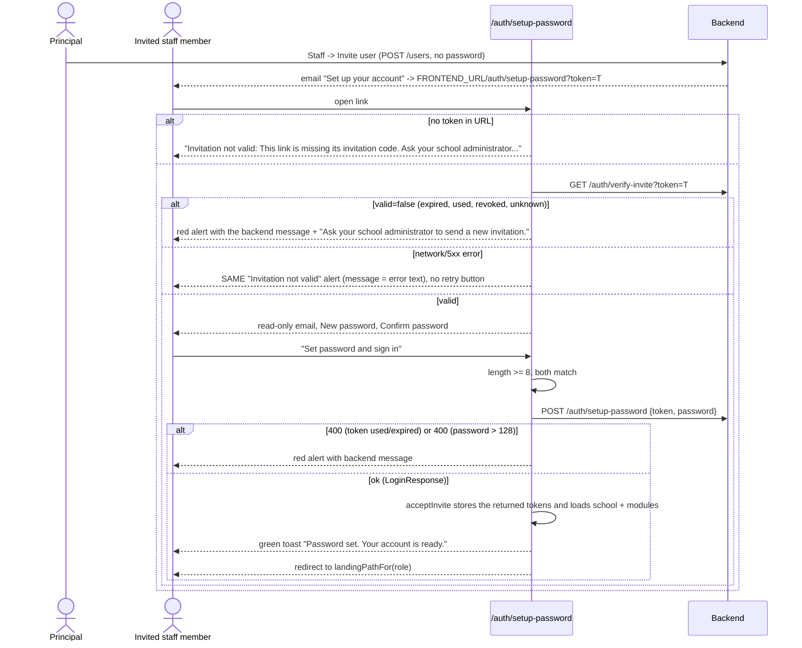
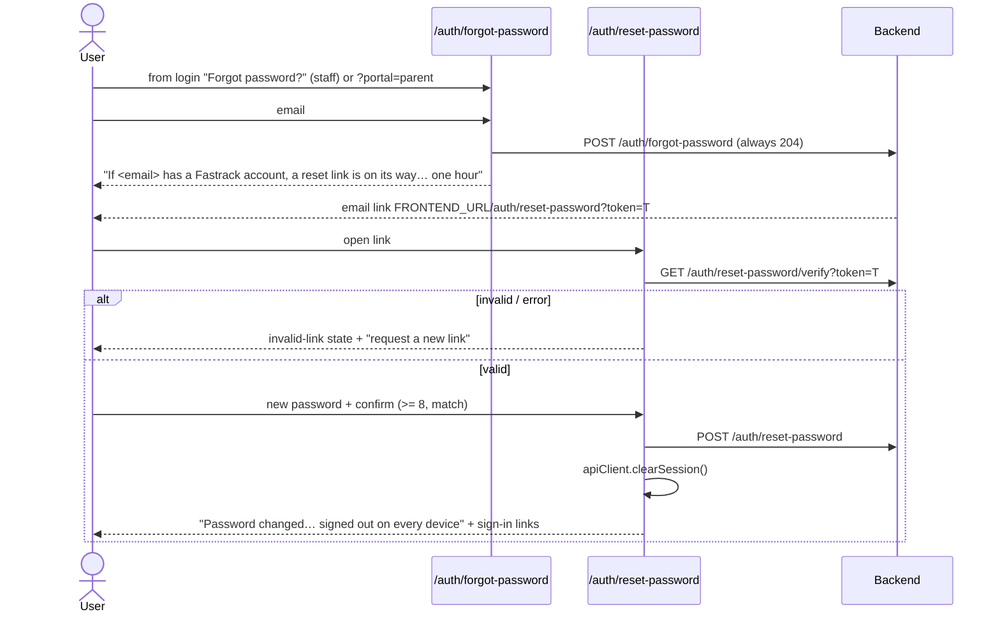

# Flow: Password reset and invite acceptance

> **Updated 22 Oct 2026.** QA-204 is fixed: `/auth/*` now has its own `AuthProvider` (`src/app/auth/layout.tsx`), and invite acceptance signs in once from the `setup-password` response.
>
> **Updated 21 Oct 2026.** This page first said neither flow existed. Both now exist:
>
> - **Invite acceptance:** `src/app/auth/setup-password/page.tsx` was committed in `41eeb3b` (QA-015). The working tree changes it further: it now uses a shared `AuthShell` from `src/app/auth/AuthShell.tsx`, which is **untracked**. Committing `page.tsx` without `AuthShell.tsx` breaks the build.
> - **Forgot and reset password:** the pages are **untracked work in progress**: `src/app/auth/forgot-password/page.tsx` and `src/app/auth/reset-password/page.tsx`. The staff login page's "Forgot password?" link (`src/app/school-admin/login/page.tsx:306-314`) is also uncommitted.
> - **Backend:** checked in the `fastrack-space/fastrack-backend` checkout on branch `fix/invoice-run-class-label`, which contains `main`. Forgot and reset password exist there since `08954f5`.

| Capability | Backend (`main`) | Frontend | Status |
| --- | --- | --- | --- |
| Verify an invite token | `GET /api/auth/verify-invite?token=`. Public, `@SensitiveRoute` throttled. Returns `{valid, email?, role?, firstName?, schoolName?, message?}` and never throws. | `setup-password/page.tsx:62-82`. Shows only `email`; ignores school, role and first name. | Done |
| Accept the invite and set a password | `POST /api/auth/setup-password {token, password 8-128}`. Returns a LoginResponse (tokens issued). 400 when the token is invalid, accepted, revoked or expired. 403 when the school is suspended, *after* the password is saved (`auth.service.ts:233-253`). | `page.tsx` calls `acceptInvite(token, password)` (`src/lib/auth/auth-context.tsx`), which starts the session from the returned tokens. | Done |
| Invite link target | `${FRONTEND_URL}/auth/setup-password?token=…` (`invitations.service.ts:338`) | Route exists | Done |
| Forgot password | `POST /api/auth/forgot-password {email}`. Always 204, throttled (`auth.controller.ts:47-58`). | `forgot-password/page.tsx` (untracked). Shows "If <email> has a Fastrack account, a reset link is on its way. The link works for one hour." | WIP (FE uncommitted) |
| Reset by link | `GET /api/auth/reset-password/verify?token=` returns `{valid}`. `POST /api/auth/reset-password {token, password}` returns 204 and **revokes all refresh tokens** (`password-reset.service.ts:119`). Tokens are kept in Redis, single use, one per user, TTL 1 hour (`:22, 34`). The link goes to `${FRONTEND_URL}/auth/reset-password` unless `FRONTEND_RESET_PASSWORD_URL` is set (`configuration.ts:35-37`). | `reset-password/page.tsx` (untracked): verify, form, then clears the local session and shows "signed out on every device" | WIP (FE uncommitted) |
| Change password (signed in) | `POST /api/auth/change-password {currentPassword, newPassword 8-128}` returns 204 | No screen (no profile or account menu) | Not done (not re-checked) |
| Parent self-registration | `POST /api/auth/register-parent` | Not re-checked here (see the parent portal docs) | n/a |

## Invite acceptance today

**Validation:**
- FE: at least 8 characters, and the confirmation must match (`page.tsx:25, 87-94`). There is no 128 maximum on the client; the backend's 400 then shows.
- BE: 8-128 characters (`setup-password.dto.ts`).

**Edge cases:**
- **Second sign-in — fixed 22 Oct (QA-204).** The page now uses the tokens from `POST /setup-password`, so there's one login record and one refresh token per acceptance. *Previously:* `POST /setup-password` already issued tokens and records a login. The page throws those away and calls `login()` again (`page.tsx:97, 103`), so every acceptance leaves an extra unused refresh token and a second login record. The two-step approach also causes a problem if `login()` fails after the password is saved (a 403 for a suspended school, or a network blip):
  - The user sees an error under the form.
  - Pressing the button again sends the now-used token and gets 400 "already accepted".
  - The user's real next step is to sign in normally, but the page never says so.
- **A network error looks like a dead invite.** A failed verify call is shown as "Invitation not valid … Ask your school administrator to send a new invitation" (`page.tsx:71-77, 134-138`), so a brief outage sends staff to request new invites.
- **Double submit:** the button shows a loading state. The handler has no `submitting` guard, but a loading Mantine button blocks a second click.
- **Already signed in as someone else:** the shared `apiClient` attaches the current Bearer token to the public calls. Then `login()` replaces the session with the new user's. This is acceptable, but nothing warns the user.

## Password reset (WIP, frontend uncommitted)

- The emailed link carries no `portal` parameter, so a parent who resets from the email is offered both sign-in links (`reset-password/page.tsx:35`).
- A verify error (network) is treated as an invalid link (`.catch(() => setValid(false))`), the same problem as on the invite page.
