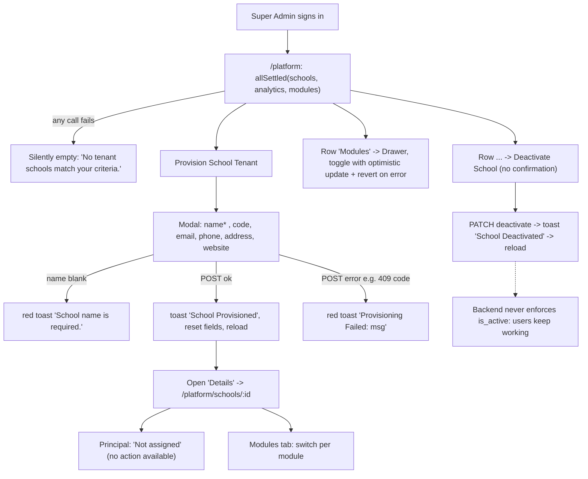

# Flow: Platform provisioning (Super Admin)

Code:
- `src/app/school-admin/(app)/platform/page.tsx` (console)
- `src/features/platform-schools/*` (school detail at `/school-admin/platform/schools/:schoolId`)

**Who:** `SUPER_ADMIN` only. The route rule is the platform audience plus `schools:manage`. Every backend route has class-level `@Role(SUPER_ADMIN)`.

## Backend endpoints

| UI | Call | Notes |
| --- | --- | --- |
| Console load | `GET /super-admin/schools?limit=50` | `{items,total,page,limit,totalPages}`. Backend `search` and `isActive` filters are unused; the frontend filters the 50 rows in the browser. |
| | `GET /super-admin/analytics/overview` | ✓ |
| | `GET /super-admin/modules?limit=50` | ✓ (backend default 20, maximum 100) |
| Provision | `POST /super-admin/schools` `{name, code?, address?, phone?, email?, website?}` | Name ≤255, code ≤20 (409 if taken), phone ≤50 |
| Activate / deactivate | `PATCH /super-admin/schools/:id/activate\|deactivate` | **Only flips a flag.** Login, refresh and every API call keep working for that school's users. |
| Module drawer | `GET /super-admin/modules/schools/:id`, `POST …/toggle {moduleId, isEnabled}` | ✓ |
| Detail | `GET /super-admin/schools/:id` | `staffCount` counts teachers only; the UI labels it "Staff" |
| Edit | `PATCH /super-admin/schools/:id` | |
| Detail tabs | `GET /super-admin/schools/:id/students?page&limit=20&search`, `/staff?limit=100`, modules | Staff means teachers only |
| **Missing UI** | `POST /super-admin/schools/:id/school-head` | Assigns or invites the Principal. Without it a new school has no users. |
| Missing UI | academic years, terms, classes, departments, fee types and structures under `/super-admin/schools/:id/*`; `PUT …/logo`; `POST …/bulk-sync`; `/super-admin/users`; `/super-admin/system/audit/logins`; analytics finance, demographics, activity and comparison | |

## Diagram

## States

| Screen | Loading | Empty | Error | Success |
| --- | --- | --- | --- | --- |
| Console table | `LoadingOverlay` | "No tenant schools match your criteria." | Same empty text: failures are swallowed by `allSettled`, and the `catch` block never runs | Rows |
| Analytics cards | Show 0, or `schools.length` and a hard-coded "1:10" ratio fallback | — | Silent zeros | Values |
| Provision modal | Button loading. Cancel and the X stay active; click-outside is disabled | — | Toast | Toast, reload |
| Module drawer | Overlay. **The previous school's modules stay visible underneath** | — | Toast "Failed to load modules"; the old school's switches remain and can be toggled | Toast per toggle |
| School detail | Loader | "Not provided" per field | Alert | — |
| Edit modal | Button loading | — | Alert in modal | Toast, reload |

## Validation

| Field | Client | Server |
| --- | --- | --- |
| Name | Non-blank | Required ≤255 |
| Code | Optional ("auto-generated if empty"); required in edit | ≤20, unique (409) |
| Email | `type="email"` only | `IsEmail` |
| Phone, website, address | none | Length limits on create, none on edit |
| Edit, blank optional field | Omitted from the PATCH, so **an existing value cannot be cleared** | — |

## Issues

- **Onboarding dead end.** After provisioning, there is no UI to:
  - assign a Principal;
  - create academic years, terms or classes (needed before admission and invoicing);
  - seed fee types or structures.

  Every new tenant needs direct API, AdminJS or database work before anyone can use it.
- **Suspension is cosmetic.** Deactivate is one click with no confirmation, and it locks nobody out.
- **Truncation.** The console loads only 50 schools; search, status filters and the "Tenant Schools (n)" count apply to those 50 only.
- **Double clicks.** Activate and deactivate have no pending state in the console menu, so a double click sends two requests.
- **Invisible text.** The top bar renders "Fastrack" and the signed-in user's name in white on a white background (`page.tsx:324`, `354`). Icon-only buttons have `title` but no `aria-label`. The console has no responsive layout.
- **Currency.** Analytics shows "GHS" plus `toLocaleString(undefined)`, so the number format follows the browser locale.
