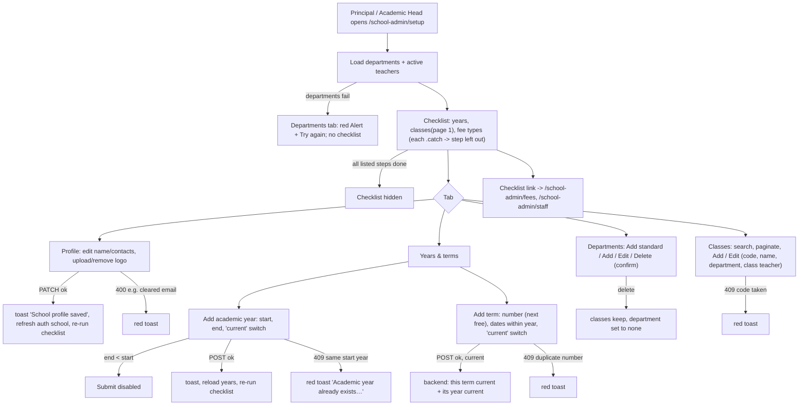

# Flow: School setup (Principal / Academic Head)

> **Updated 22 Oct 2026 (QA-206).** Setting a year or term current no longer returns 500 or leaves two current. The backend clears the old one in the same transaction, and unique indexes allow one current year and one current term per school (backend `bcb2e0b`, on `main`). Re-tested in the browser on BIS-001. Still open: QA-236 (a current year doesn't move the term) and QA-237 (the current term can be unticked to leave none).

Code:
- `src/features/school-setup/*` (`SetupPage`, `SchoolProfilePanel`, `YearsPanel` + `DatesModal`, `DepartmentsPanel` + `DepartmentModal`, `ClassesPanel` + `ClassModal`, `api.ts`)
- Route `/school-admin/setup` (`src/app/school-admin/(app)/(school)/setup/page.tsx`), registered as `APP_ROUTES.setup` in `src/lib/rbac/routes.ts`
- Not committed yet: the feature, the route and the `school_profile:manage` permission are untracked or modified on `feat/rbac-workspace`.

The page gives a school one place to fill in its profile, academic years and terms, departments and classes. A "Getting started" checklist at the top links to each tab, and to the Fees and Staff pages for fee types and invitations. Assigning the Principal is a separate Super Admin action ("Assign principal" on the platform school detail, `platform-schools/AssignPrincipalModal.tsx`, also uncommitted).

**Who:**
- Opening the page needs `classes:manage` (staff audience, no module gate). In the backend matrix only **Principal** and **Academic Head** have it.
- Tabs and actions are gated separately:

| Tab | View | Edit | Backend roles that may edit |
| --- | --- | --- | --- |
| School profile | `school_profile:manage` (tab hidden without it) | same | `PRINCIPAL` only |
| Years & terms | always shown | `academic_years:manage` (also used for terms) | `PRINCIPAL, ACADEMIC_HEAD`; terms need `academic_terms:manage`, which both roles also hold |
| Departments | always shown | `departments:manage` | `PRINCIPAL, ACADEMIC_HEAD` |
| Classes | always shown | `classes:manage` | `PRINCIPAL, ACADEMIC_HEAD` |
| Subjects | `subjects:read` (tab hidden without it) | `subjects:manage` | `PRINCIPAL, ACADEMIC_HEAD`; Teachers can view |

- Checklist entries: "fee types and structures" appears only with `fee_types:read` (Principal; not Academic Head). "Invite your staff" appears only with `staff:read`.

## Backend endpoints

Verified against `fastrack-space/fastrack-backend` on `fix/invoice-run-class-label` (`8301857`, the same commit as `main`). Every call exists.

| UI | Call | Notes |
| --- | --- | --- |
| Profile load | `GET /schools/me` | ✓ |
| Profile save | `PATCH /schools/me` (changed fields only, trimmed) | ✓ `@Role(PRINCIPAL)` + `school_profile:manage`. The DTO also accepts `code` and `logoUrl`, which the UI doesn't send |
| Logo | `PUT /schools/me/logo` (multipart), `DELETE /schools/me/logo` | ✓ Principal only |
| Years list | `GET /schools/me/academic-years?limit=100`, then `GET …/:id/terms?limit=100` **per year** | ✓ N+1 requests |
| Year add / edit | `POST /schools/me/academic-years`, `PATCH …/:id` `{startDate,endDate,isCurrent}` | ✓ The label (`2026/27`) comes from the start year; a duplicate label returns 409. No date-order, overlap or term-bounds checks |
| Term add / edit | `POST …/academic-years/:yearId/terms`, `PATCH …/terms/:id` `{termSequence,startDate,endDate,isCurrent}` | ✓ A duplicate sequence in the year returns 409. Making a term current also makes its year current. No bounds, overlap or order checks |
| Departments | `GET /schools/me/departments?limit=100`, `POST`, `PATCH /:id`, `DELETE /:id` | ✓ Code is upper-cased and unique (409). Delete sets the department of its classes to null |
| Standard departments | `POST /schools/me/departments/seed-defaults` | ✓ Adds only the codes that are missing |
| Classes | `GET /schools/me/classes?page&limit&search`, `POST`, `PATCH /:id` | ✓ Code is unique but **case-sensitive**. Each class has a `sequenceOrder` (the **Order** field and column, added 24 Oct for QA-207); lists come back in that order, and a new class with no order goes after the last one. Order numbers are unique per school (QA-245): a used number returns 409 "Order 2 is already used by Primary 2. Give each class its own number.", shown under the Order field. 0 means not ordered yet and may repeat; promotion asks for a target for such a class. Swapping two numbers needs a free number in between (1 → 99, 2 → 1, 99 → 2). Promotion moves pupils to the class with the next number. The backend's bulk create (`classes[]`) is unused |
| Subjects | `GET /schools/me/subjects?includeInactive=true`, `POST`, `PATCH /:id`, `DELETE /:id`; `GET\|PUT /schools/me/classes/:id/subjects`; `POST /schools/me/class-subjects/apply` | ✓ Live since 24 Oct (results phase 0; backend `4df1e64`, not pushed yet; contract in [`docs/api/results.md`](../api/results.md)). Checked through the UI on the throwaway PRM-001. The list isn't paged and refuses `limit`. A bad code gets 400 "Subject code must be 2–20 letters, digits or hyphens", which the form also checks before sending. |
| Teacher pickers | `GET /schools/me/staff?role=TEACHER&isActive=true&limit=100`; subject teachers use `GET /schools/me/staff?isActive=true&limit=100` (any role, since heads teach too) | ✓ First 100 only |
| Checklist | the year and class calls above, plus `GET /schools/me/fee-types` | ✓ |
| Not available anywhere | delete a year, a term or a class; "set current" without opening the edit form | The backend has no delete route for years, terms or classes |

## Diagram

## States

| Area | Loading | Empty | Error | Success |
| --- | --- | --- | --- | --- |
| Checklist | Not shown until departments load | Hidden when every listed step is done | **A failed read drops its step**, so the checklist can report "all done" and disappear | Progress bar "n of m done" |
| Profile | `Loader` | "Not provided" is not used; empty inputs | Alert + Try again | Toast; auth `school` refreshed |
| Years & terms | `Loader` | "No academic years yet. Add the current year, then its terms." / "No terms yet." | Alert + Try again | Toast "Academic year added / Term updated… Saved." |
| Departments | `Loader` | "No departments yet. Add the standard ones…" | Alert + Try again | Toast on add/edit/delete; **no toast after "Add standard departments"** |
| Classes | `Loader` | "No classes yet." / "No class matches that search." | Alert + Try again | Toast "Class added / updated" |
| Subjects | `Loader` per section | "No subjects yet. Start with the common subjects, then add your own." / "Primary 1 takes no subjects yet." / "Add classes first, in the Classes tab." | Alert + Try again per section | Toasts "14 subjects added", "Subjects saved", "2 added; 1 was already there" |
| Modals | Submit `loading`, Cancel disabled; X and Esc still close | — | Red toast, modal stays open | Modal closes, list reloads |
| Teacher pickers | — | Empty list | **Swallowed**: the pickers are empty and the checklist says no staff | — |

## Validation

| Field | Client | Server |
| --- | --- | --- |
| Year start / end | Both required; end ≥ start | `IsDateString` only; no end ≥ start, no overlap with other years; label must be unique |
| Year edit | Same | Doesn't check that existing terms still fit inside the new dates |
| Term number | `NumberInput` 1–6, default next free number; an empty value is sent as `0` | `IsInt`, `Min(1)`, unique within the year; no maximum |
| Term dates | Required, end ≥ start, inside the year | `IsDateString` only: no bounds, overlap or order-vs-number check (see QA-018) |
| Current year / term | Switch in the edit form | One current per school, enforced by unique indexes since QA-206. A current term forces its year current; **a current year does not move or clear the current term** (QA-236). Unticking the current term leaves none (QA-237). |
| Department code | Required, trimmed, upper-cased, ≤30 | `IsNotEmpty`, ≤30, unique per school (upper-cased) |
| Department name | Required, trimmed, ≤100 | ≤100; duplicates allowed |
| Display order | ≥0, blank → 0 | `Min(0)` |
| Class code | Required, trimmed, ≤20 | ≤20, unique per school **case-sensitively** (`B4` and `b4` both allowed) |
| Class name | Required, trimmed, ≤100 | Required on create; on update an empty string is accepted and not trimmed; duplicates allowed |
| School name | Required, trimmed, ≤255 | ≤255 |
| School email | `type="email"`; a cleared field is sent as `""` | `IsEmail`, so **the email can't be cleared** (400) |
| Logo | PNG/JPEG/WebP, ≤2 MB | Media service limits |

## Subjects tab (added 24 Oct, results phase 0)

Code: `src/features/school-setup/SubjectsPanel.tsx` and its modals. The rules come from the product owner (see [`docs/api/results.md`](../api/results.md#rules-the-product-owner-set)).

- **Subject list.** The school's catalogue. English is one subject however many classes take it.
  - **Add common subjects** offers starter lists (Primary and JHS GES subjects; Montessori and early-years areas), skipping names or codes the school already has. It adds them one by one, so a clash loses only that subject.
  - **Add subject** asks for a name, a code (2–20 letters, digits or hyphens; the backend upper-cases it), a short name for narrow report columns, and a category (free text with suggestions).
  - Names and codes are unique per school, ignoring case: a clash shows the 409 under the field.
  - **Edit** can turn a subject off ("In use"). **Remove** is offered only while no class takes it; the backend refuses with 409 otherwise.
- **Subjects by class.** Pick a class to see what it takes, in report order, with its teachers.
  - A subject with no teacher shows "Any teacher can mark".
  - **Edit <class>'s subjects** adds, removes and reorders subjects, and picks teachers from all active staff.
  - **Report options** reveals the name on the report (e.g. "Ga"), whether the subject counts in the average, and its role in a BECE-style aggregate.
  - **Add to several classes** adds subjects to a whole department or to chosen classes. Classes that already take a subject keep their settings.
- **Known gap (24 Oct):** turning a subject off locks every class that takes it. Saving that class's list gets 400 "Mathematics is inactive. Reactivate it before giving it to a class.", even for an unrelated change. The editor marks such rows "Not in use" so they can be removed. Reported to the backend: it should refuse only a newly added inactive subject.
- **Standing.** The lists hold every term and year until changed. There is no term picker. Pupils take their current class's subjects.

## Status

**Live**: every call reaches a real backend route. The feature is uncommitted in the frontend.

## Known gaps

- **QA-033 is partly resolved.** Years, terms, departments, classes and the school profile can now be set up in the UI; the Principal can be assigned from the platform console; the checklist links to Fees and Staff. Still missing: deleting a mistaken year, term or class (no backend route either); bulk class entry; a fee step that checks structures, not just fee types; any ordering guidance (fees need classes and terms).
- **Term and year dates aren't consistent (QA-018).** Overlapping terms, terms out of order, overlapping years, and year edits that leave terms outside the year are all accepted.
- **Current year and current term can disagree (QA-236).** Making another year current, or unticking "current" on a year, leaves the current term in the old year. Confirmed in the browser 22 Oct.
- **The current term can be unticked, leaving none (QA-237).** It saves with "Term updated" and no warning.
- *Fixed 22 Oct (QA-206):* saving "current" used to return "Internal server error" and leave two current years or terms.
- *Fixed 24 Oct (QA-246):* the checklist no longer asks for fee types when the school has no fees module, which used to give a 403 on load and on every class save.
- **Errors look like progress.** A failed checklist read removes the step; a failed teacher read empties the pickers silently.
- Class teachers who are inactive, or outside the first 100 teachers, show as "Assigned" without a name.
- "Invite your staff" counts only active teachers, so pending invitations and non-teaching staff don't tick it.
- The profile card uses `gridColumn: span 2` inside a one-column grid on phones (`SchoolProfilePanel.tsx:176`), which adds an implicit column.
- `api.ts:17` documents the year label as "2026/2027"; the backend returns "2026/27".
