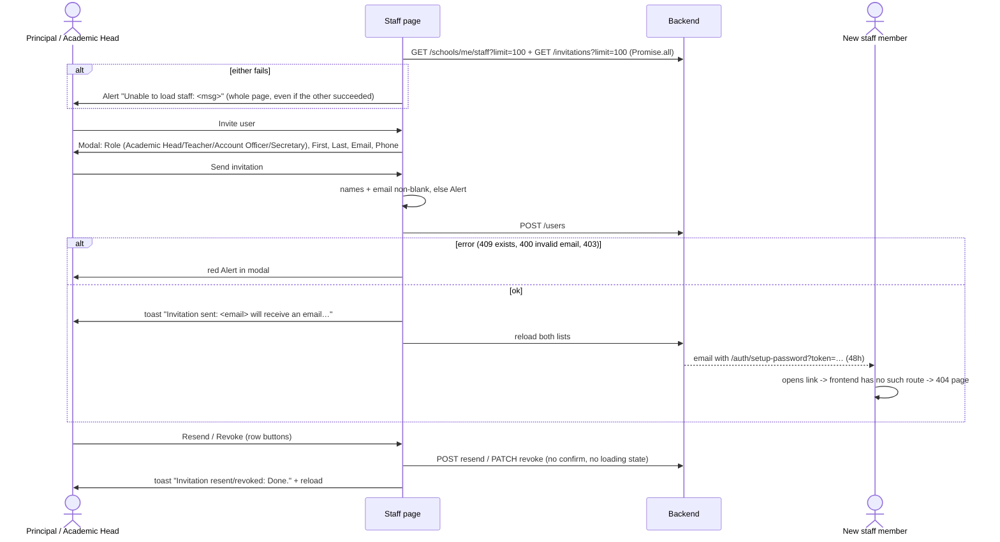

# Flow: Staff invitation

Code: `src/features/staff/StaffPage.tsx`, `src/features/staff/api.ts`, route `/school-admin/staff`.

> **Updated 22 Oct 2026 (QA-204, QA-208).** The invite link now opens a working set-up page. Anyone who never set a password shows as **Not set up** with **Resend invite**, Resend works even after a revoke (with a rank check), and Activate refuses accounts with no password. Older notes below are kept and marked where they changed.

**Who:**
- Viewing the page needs `staff:read`: Principal, Academic Head, Account Officer and Secretary. The backend's `GET /schools/me/staff` allows the same four roles plus the Super Admin.
- Inviting, resending, revoking and seeing invitations need `staff:manage`: Principal and Academic Head. The backend's `POST /users`, `GET /invitations` and resend/revoke allow `SUPER_ADMIN, PRINCIPAL, ACADEMIC_HEAD` with `staff:manage` (the list needs `staff:read`).

## Backend endpoints

| UI | Call | Notes |
| --- | --- | --- |
| Directory | `GET /schools/me/staff?limit=100` | Returns **TEACHER users only** (`user_type = TEACHER`). Invited Academic Heads, Account Officers and Secretaries never appear, even after they accept. There is no pagination UI or search. |
| Invitations | `GET /invitations?limit=100` | Standard list. `search`, `status` and `role` filters exist but are unused. |
| Invite | `POST /users` `{role, email, firstName, lastName, phone?}` | No password, so the backend creates an inactive user and emails an invitation. Non-super-admins cannot create SUPER_ADMIN or PRINCIPAL. A duplicate email gives 409. |
| Resend | `POST /invitations/:id/resend` | Resets the 48h expiry and sets the status to PENDING. Refused with "This account is already set up" once the person has a password. Reopening a **REVOKED** invitation needs the rank to reactivate that role (Principal: any staff; Academic Head: teachers and secretaries). |
| Revoke | `PATCH /invitations/:id/revoke` | |
| Directory status | `accountSetUp` on each staff record | `false` until the person sets a password. The page shows **Not set up** + **Resend invite** (their latest open invitation) instead of Reactivate or Deactivate. `PATCH /schools/me/staff/:id/activate` returns 400 for these accounts. |
| Acceptance | *(Was: not in the frontend; now `/auth/setup-password`, fixed 22 Oct.)* The email links to `${FRONTEND_URL}/auth/setup-password?token=…`; the backend serves `GET /auth/verify-invite` and `POST /auth/setup-password` | See [password-reset-and-invite-acceptance.md](./password-reset-and-invite-acceptance.md) |

## Diagram

## States

| State | UI |
| --- | --- |
| Loading | A loader inside each section card |
| Empty | "No teaching staff yet." / "No invitations sent yet." |
| Error | One red Alert replaces both sections |
| Saving invite | Send button `loading`, Cancel disabled; the modal X and Esc still close it |
| Row actions | No pending state: a double-click sends two emails |

## Validation

| Field | Client | Server (`CreateUserDto`) |
| --- | --- | --- |
| Role | One of 4 values from a native select | `Roles` enum; Principal and Super Admin are forbidden for non-super-admins |
| First and last name | Non-blank | Required, ≤100 |
| Email | Non-blank plus `type="email"` | `IsEmail`, unique |
| Phone | Optional, free text | ≤50 |

## Issues

- *Fixed 22 Oct (QA-204):* **Invitation acceptance is broken end to end.** The invite link points to a route the frontend does not have, so invited staff cannot set a password or sign in. Login returns "Invalid credentials" for users without a password.
- The directory is titled "Teaching staff" and lists teachers only. Non-teaching users have no directory, edit, deactivate (`PATCH /users/:id/deactivate` needs `{role}`) or permission screen, although the backend supports deactivating and changing permissions.
- "Resend" is offered on REVOKED and EXPIRED invitations. *Changed 22 Oct (QA-208):* it only works for people who never set a password, and reopening a revoked one needs reactivation rank. Revoke still has no confirmation.
- An Academic Head can invite Account Officers (finance access). Check that this is intended; the backend allows it.
- Expiry dates use `toLocaleString('en-GB')` (date and time), unlike the rest of the app.
