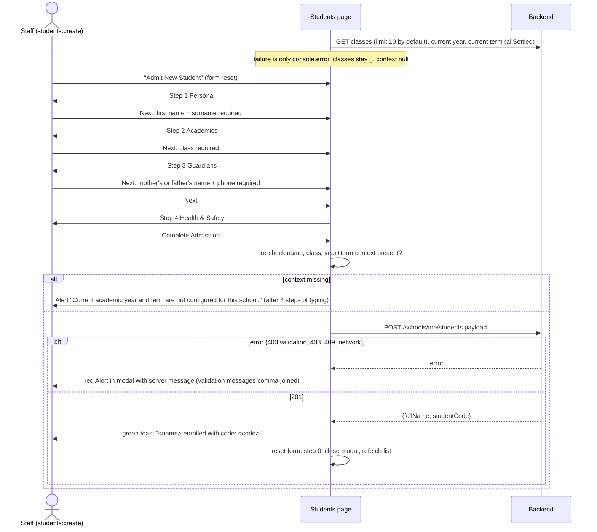

# Flow: Student admission (4-step modal)

Code: the page is `src/app/school-admin/(app)/(school)/students/page.tsx`; the four-step form, its checks and the submit are in `src/features/students/AdmitStudentModal.tsx`; the calls are `studentsApi.list`, `activeCount` and `admit` in `src/features/students/api.ts`.

**Who:** users with `students:create`: Principal, Academic Head and Secretary. Backend: `POST /schools/me/students` with `@Role(PRINCIPAL, ACADEMIC_HEAD, SECRETARY)`, `students:create`, module `students`.

## Backend endpoints

| When | Call | Notes |
| --- | --- | --- |
| Page mount | `GET /schools/me/classes` | **No `limit`, so the backend default of 10 applies.** Schools with more than 10 classes see only the first 10 in both the filter and the admission dropdown. |
| Page mount | `GET /schools/me/academic-years/current`, `GET /schools/me/academic-terms/current` | Both are needed for submit |
| List | `GET /schools/me/students?page&limit=10&search&classId&status` | Standard list (`data[]` plus `meta`). `search` matches first name, surname, other name and student code. |
| KPI | `GET /schools/me/students?status=Active&limit=1` | Reads `meta.total` |
| Submit | `POST /schools/me/students` (AdmitStudentDto) | Returns StudentResponse (`fullName`, `studentCode`, …) |

## Diagram

## Steps, fields and defaults

| Step | Field | Required (client) | Default sent if untouched | Backend rule |
| --- | --- | --- | --- | --- |
| 1 Personal | First name | ✓ | — | ≤100 |
| | Surname | ✓ | — | ≤100 |
| | Other name | | — | ≤100 |
| | Gender | | **Male** | `Male`\|`Female` |
| | Date of birth | | — | date, up to today. A future date shows "Birth date can't be in the future." and blocks Next; the backend refuses it too, and so does the student's Profile tab (QA-209) |
| | National ID / Ghana Card | | — | ≤50, no format check |
| | Nationality | | **Ghanaian** | ≤100 |
| | Religion | | **Christian** | ≤100 |
| | Residential address, Digital address | | — | digital ≤50, no GhanaPost format check |
| 2 Academics | Class cohort | ✓ | — | UUID |
| | Department / track | | **Primary** | ≤50 |
| | Previous school | | — | ≤255 |
| | Boarding status | | **Day** | ≤30 |
| | Transport route | | omitted when "None" | ≤100; the routes are hard-coded Accra examples |
| | Entrance exam notes | | — | — (the `entranceExamScore` state exists but has no input and is never sent) |
| 3 Guardians | Mother and father name, phone, email, occupation | Mother's **or** father's name and phone ("Add the mother's or father's name and phone number."), checked on Next and again on Complete Admission (QA-210) | — | emails `IsEmail` (server only; the client has only `type="email"`, which is not enforced on step change) |
| 4 Health | Blood group | | **O+** | ≤10 |
| | Genotype | | **AA** | ≤10 |
| | Allergies / medical notes | | — | |
| | Emergency contact name, phone | | — | phone ≤50, no format check |
| | Relationship | | **Mother** (if cleared, falls back to **Uncle**) | ≤50 |

Always sent: `admissionAcademicYearId`, `admissionTermId` (current), and `admissionClassId`.

## States

| State | UI |
| --- | --- |
| List loading | Table row "Loading student records from server…"; Refresh button spinning |
| List empty | "No students match your filter criteria." (the same text with no filters, for a new school) |
| List error | Red toast "Error"; the table keeps its previous rows |
| Modal validation | Red Alert "Admission Form Alert" at the top of the modal |
| Submitting | "Complete Admission" button `loading`. Cancel and the close X stay enabled, and Esc closes the modal (`closeOnEscape` default). |
| Success | Toast, modal closes, list refetches |
| Server error | Alert inside the modal, entered data kept |
| Enter in a field | Moves to the next step (same checks as Next). Only Complete Admission on the last step admits. Before 24 Oct, Next Step on Guardians admitted at once and skipped Health (QA-210, fixed in `90d7a5a`) |

## Issues specific to this flow

- **Fabricated defaults.** Blood group O+, genotype AA, religion Christian, gender Male, department Primary and relationship Mother are saved even when staff never set them. That is wrong medical data for a child.
- **Late failure.** A missing current year or term is detected only at the final submit.
- **Data loss.** Esc, the X or Cancel closes the modal without a confirmation, and nothing is saved as a draft.
- **No duplicate check** before admission: the same name, date of birth and guardian can be admitted twice.
- **No follow-up steps.** There is no dossier, edit, photo upload, parent linking, promotion or exit, although the backend supports all of them and the page subtitle promises "personal dossiers".
- **List behaviour:**
  - Search fires two requests per keystroke (list plus active count), with no debounce and no stale-response guard.
  - "Total Enrolled" shows the *filtered* total.
  - The status filter offers only All, Active and Inactive. The backend also has Pending_Admission, Stopped, Transferred_Out and Graduated, which show with a red badge.
- **Mobile:** the table has a minimum width of 840px and scrolls horizontally, and the four-step Stepper labels squeeze on narrow screens.

## After admission: guardian contacts and parent links (QA-211, QA-214)

Added 23 Oct 2026 (backend `a89ee57`, frontend `0fd3b0d`). Code: `src/features/students/GuardiansTab.tsx`.

- **Where:** student drawer → **Guardians** tab.
  - Editing needs `students:update` plus `students:read_sensitive` (Principal, Academic Head, Secretary).
  - The Account Officer sees the contacts read-only.
  - Teachers see "Phone numbers and emails are hidden for your role".
- **Edit contacts:** `PATCH me/students/:id`. Values are trimmed, blanks are saved as null, and emails are lowercased. Every real change is recorded in `audit_logs`; a save that changes nothing records nothing.
- **Link parent account:** `POST me/students/:id/parents/from-guardian {guardian}` links the one parent account matching the mother's or father's saved phone or email. It answers 404 when none matches and 409 when several do. The button is disabled while edits are unsaved.
- **Unlink:** "Prevent this parent from linking again" plus a reason stores a block (`parent_link_blocks`) on the account and its phone and email. The parent's OTP linking then fails with the ordinary mismatch message, and staff linking gets 409. **Allow again** (`DELETE …/parent-blocks/:id`) lifts it.
- **Change history:** `GET me/students/:id/history`. Shown under Change history → Show, newest first (QA-238 fixed 23 Oct).
- **Known gaps (re-test 23 Oct):**
  - All fixed 23 Oct: QA-239 (a restored session refreshes permissions from `/auth/profile`), QA-240 (a block unlinks and covers every account on the same phone or email; the dialog names them), QA-241 (linking an already-linked parent is a 409 "already linked"), QA-242 (a blocked parent gets "blocked … Lift the block first").

## Moving classes up (QA-207)

Added 24 Oct 2026 (backend `23504b6`). Code: `src/features/promotions/`, at `/school-admin/students/promote`, reached by **Move classes up** on Students. Only roles with `enrollment:manage` (Principal, Academic Head, Secretary) and the `students` module get it.

- **Preview:** `GET /schools/me/promotions/preview` lists every class in order with its pupils and a suggestion: the next class by Order, **Graduates** when no class comes after it, or a required choice when several classes share the next number.
- **Per class:** the target picker is pre-filled from the suggestion. Options are the suggested class(es), Graduates (leaves the school), Don't move, or any other class. Classes with no pupils are left out. Expanding a class lists its pupils, all ticked; unticked pupils repeat the year and are sent as `exceptStudentIds`.
- **Term:** "Start in term" defaults to the term after the current one by date. With no current or no next term it's empty and must be picked. The optional leaving date is sent as `exitDate` for graduates.
- **Confirm:** a summary ("N pupils move up, M graduate, K stay" plus each class's move, and each class set to "Don't move" named with its pupils, e.g. "Primary 2: doesn't move (1 pupil stays)"), then one `POST /schools/me/promotions`. The buttons lock while it runs, and the results table shows moved and stayed counts per class. Classes set to "Don't move" are listed as "Not moved", and their pupils count as stayed in the toast and summary; the backend's `kept` only counts unticked repeaters (QA-249).
- **All or nothing:** a failed run moves nobody. The toast says "Nothing was moved" with the backend's message.
- **Checked live (24 Oct):** one real run on the throwaway test school PRM-001. A→B 2 moved and 1 repeater stayed, B→C 3 moved, C graduated 3. Class history and exit records were written. A Teacher gets 403. Details are under QA-207 in `docs/qa/findings.md`.
- **Fixed 24 Oct:** QA-245 (order numbers are unique; a taken number gives 409 "Order N is already used by …" under the field), QA-247 (moving into a term that hasn't started dates the new class from the term's first day, for bulk and single moves).
- **Also fixed 24 Oct:** QA-248 (while any class is on Order 0, the top numbered class needs a target chosen instead of defaulting to Graduates) and QA-249 (classes set to Don't move count as "stayed", and the results table lists them as "Not moved").
