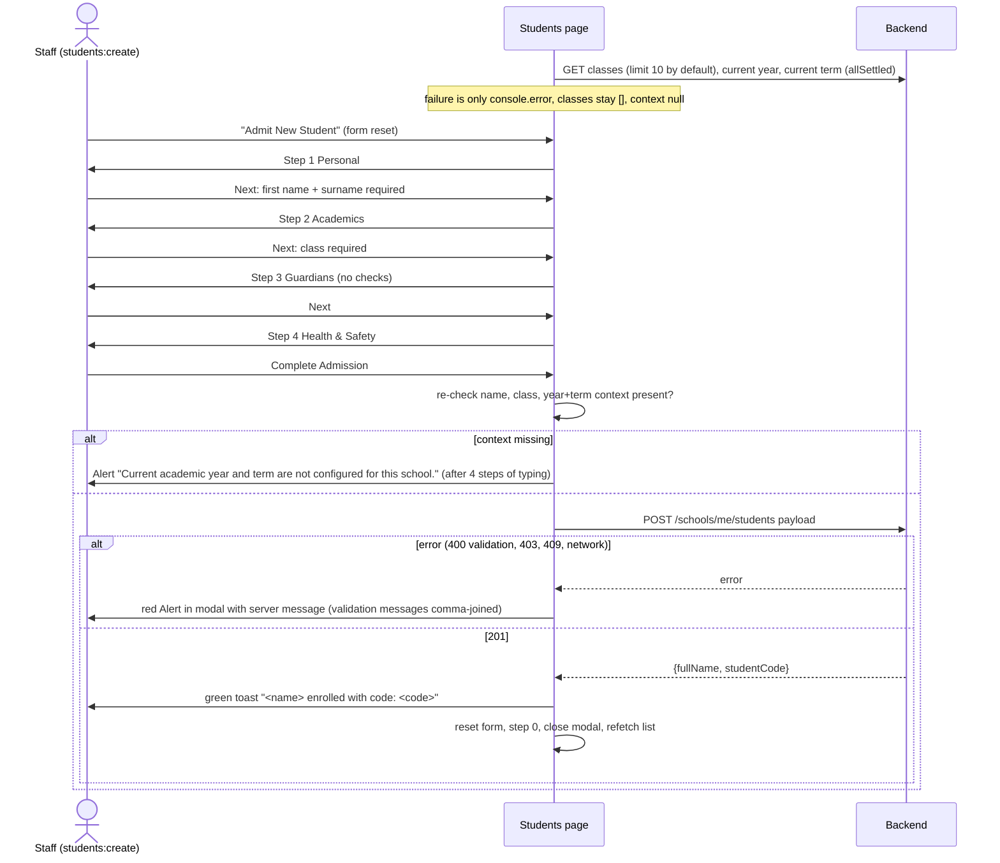

# Flow: Student admission (4-step modal)

Code: `src/app/school-admin/(app)/(school)/students/page.tsx` (whole page; modal at lines 691-1245, submit at 268-364).

**Who:** users with `students:create`: Principal, Academic Head and Secretary. Backend: `POST /schools/me/students` with `@Role(PRINCIPAL, ACADEMIC_HEAD, SECRETARY)`, `students:create`, module `students`.

## Backend endpoints

| When | Call | Notes |
| --- | --- | --- |
| Page mount | `GET /schools/me/classes` | **No `limit`, so the backend default of 10 applies.** Schools with more than 10 classes see only the first 10 in both the filter and the admission dropdown. |
| Page mount | `GET /schools/me/academic-years/current`, `GET /schools/me/academic-terms/current` | Both are needed for submit |
| List | `GET /schools/me/students?page&limit=10&search&classId&status` | Standard list (`data[]` plus `meta`). `search` matches first name, surname, other name and student code. |
| KPI | `GET /schools/me/students?status=Active&limit=1` | Reads `meta.total` |
| Submit | `POST /schools/me/students` (AdmitStudentDto) | Returns StudentResponse (`fullName`, `studentCode`, …) |

## Diagram

## Steps, fields and defaults

| Step | Field | Required (client) | Default sent if untouched | Backend rule |
| --- | --- | --- | --- | --- |
| 1 Personal | First name | ✓ | — | ≤100 |
| | Surname | ✓ | — | ≤100 |
| | Other name | | — | ≤100 |
| | Gender | | **Male** | `Male`\|`Female` |
| | Date of birth | | — | date; **future dates accepted** |
| | National ID / Ghana Card | | — | ≤50, no format check |
| | Nationality | | **Ghanaian** | ≤100 |
| | Religion | | **Christian** | ≤100 |
| | Residential address, Digital address | | — | digital ≤50, no GhanaPost format check |
| 2 Academics | Class cohort | ✓ | — | UUID |
| | Department / track | | **Primary** | ≤50 |
| | Previous school | | — | ≤255 |
| | Boarding status | | **Day** | ≤30 |
| | Transport route | | omitted when "None" | ≤100; the routes are hard-coded Accra examples |
| | Entrance exam notes | | — | — (the `entranceExamScore` state exists but has no input and is never sent) |
| 3 Guardians | Mother and father name, phone, email, occupation | | — | emails `IsEmail` (server only; the client has only `type="email"`, which is not enforced on step change) |
| 4 Health | Blood group | | **O+** | ≤10 |
| | Genotype | | **AA** | ≤10 |
| | Allergies / medical notes | | — | |
| | Emergency contact name, phone | | — | phone ≤50, no format check |
| | Relationship | | **Mother** (if cleared, falls back to **Uncle**) | ≤50 |

Always sent: `admissionAcademicYearId`, `admissionTermId` (current), and `admissionClassId`.

## States

| State | UI |
| --- | --- |
| List loading | Table row "Loading student records from server…"; Refresh button spinning |
| List empty | "No students match your filter criteria." (the same text with no filters, for a new school) |
| List error | Red toast "Error"; the table keeps its previous rows |
| Modal validation | Red Alert "Admission Form Alert" at the top of the modal |
| Submitting | "Complete Admission" button `loading`. Cancel and the close X stay enabled, and Esc closes the modal (`closeOnEscape` default). |
| Success | Toast, modal closes, list refetches |
| Server error | Alert inside the modal, entered data kept |

## Issues specific to this flow

- **Fabricated defaults.** Blood group O+, genotype AA, religion Christian, gender Male, department Primary and relationship Mother are saved even when staff never set them. That is wrong medical data for a child.
- **Late failure.** A missing current year or term is detected only at the final submit.
- **Data loss.** Esc, the X or Cancel closes the modal without a confirmation, and nothing is saved as a draft.
- **No duplicate check** before admission: the same name, date of birth and guardian can be admitted twice.
- **No follow-up steps.** There is no dossier, edit, photo upload, parent linking, promotion or exit, although the backend supports all of them and the page subtitle promises "personal dossiers".
- **List behaviour:**
  - Search fires two requests per keystroke (list plus active count), with no debounce and no stale-response guard.
  - "Total Enrolled" shows the *filtered* total.
  - The status filter offers only All, Active and Inactive. The backend also has Pending_Admission, Stopped, Transferred_Out and Graduated, which show with a red badge.
- **Mobile:** the table has a minimum width of 840px and scrolls horizontally, and the four-step Stepper labels squeeze on narrow screens.
